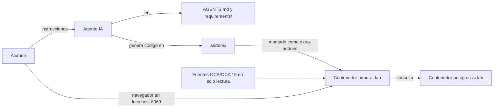

# Práctica: Creación de un módulo Odoo con agente IA

## Objetivos

Al terminar esta práctica serás capaz de:

- Preparar un entorno Odoo 19 con Docker Compose a partir del repositorio `odoo-ai-lab`.
- Interpretar las reglas de `AGENTS.md` y usarlas para guiar al agente de IA.
- Convertir un enunciado escrito en lenguaje natural en un módulo Odoo: modelos, vistas, acciones y permisos.
- Instalar y actualizar el módulo, leer los logs y pedir al agente que corrija los errores.
- Comprobar uno a uno los requisitos funcionales y distinguir lo comprobado de lo pendiente.

Tu objetivo final es obtener una versión funcional de un módulo en base a las especificaciones de la práctica: el módulo `library_management`, con su README y las pruebas realizadas.

## Requisitos previos

- Haber estudiado los apartados de la unidad sobre [estructura de módulos](../../../contenidos/unidades/05/1-modulos-odoo.md), [modelos](../../../contenidos/unidades/05/2-modelos-odoo.md), [vistas](../../../contenidos/unidades/05/3-vistas-odoo.md), [acciones](../../../contenidos/unidades/05/4-acciones-odoo.md) y [seguridad](../../../contenidos/unidades/05/5-seguridad-odoo.md).
- Manejo básico de Git: `status`, `add`, `commit` y `push`.
- Manejo básico de Docker Compose: `up`, `ps`, `logs` y `exec`.
- Docker Engine y Docker Compose instalados y en funcionamiento.
- Visual Studio Code con un agente de programación habilitado.
- Las imágenes de Odoo 19 y PostgreSQL 17, las fuentes OCB/OCA 19 y el archivo `odoo.conf` que te facilite tu profesor.

## Escenario y material

Vas a trabajar sobre el repositorio `odoo-ai-lab`. Es una plantilla con un entorno Docker Compose, las instrucciones para el agente y un enunciado: un sistema de gestión de préstamos de libros para una biblioteca. El agente lee ese enunciado y las reglas del repositorio, y genera el código del módulo. Tú no escribes el código a mano: diriges el trabajo, revisas cada propuesta y compruebas el resultado.



| Recurso | Detalle |
|---|---|
| `AGENTS.md` | Reglas que debe seguir el agente: alcance, convenciones, límites de escritura y validación. |
| `requirements/funcionales.md` | Enunciado del módulo: funcionalidades, reglas de negocio y casos de aceptación. |
| `requirements/tecnicos.yml` | Restricciones técnicas: versión 19.0, convenciones OCA y nombre técnico del módulo (`library_management`). |
| `templates/` | Especificaciones YAML opcionales de modelos, vistas y seguridad. Son orientativas: Odoo no las carga. |
| `examples/` | Módulos de referencia. Se consultan para estudiar patrones; no se modifican ni se instalan desde aquí. |
| `docs/referencias.yml` | Documentación web que puede consultar el agente. |
| `addons/` | Carpeta donde se crea el módulo. Se monta en `/opt/odoo/src/extra-addons`. |
| `docker-compose.yml` | Define los servicios `odoo` (Odoo 19) y `db` (PostgreSQL 17). |

> **Importante**
>
> - Instalar o actualizar el módulo modifica la base de datos del laboratorio. No uses datos que quieras conservar.
> - `docker compose down -v` elimina el volumen de PostgreSQL y, con él, todas las bases de datos. Solo ejecútalo si tu profesor lo autoriza.
> - Trabaja solo en `addons/` y en la documentación del repositorio. No modifiques `docker-compose.yml`, `odoo.conf` ni el código de OCB.
> - No subas a Git contraseñas, `.env` ni `odoo.conf`.

## Procedimiento

### Paso 1. Prepara tu repositorio

Crea tu copia del laboratorio con **Use this template** en GitHub, o clona el repositorio y trabaja en una rama propia. Después, sitúate en la raíz del proyecto y revisa su estado:

```bash
git status
```

**Comprueba:** `git status` no muestra cambios pendientes y el árbol incluye `AGENTS.md`, `requirements/`, `templates/`, `examples/`, `docs/` y `addons/`.

### Paso 2. Configura el entorno local

Copia la plantilla de variables y ajústala con las imágenes que te haya facilitado tu profesor:

```bash
cp .env.example .env
```

Las variables `ODOO_IMAGE` y `POSTGRES_IMAGE` indican qué imágenes usará Compose. Las credenciales de `.env` son locales: no las compartas ni las subas al repositorio.

Coloca el `odoo.conf` del curso en la raíz del proyecto. Compose lo monta como `/opt/odoo/odoo.conf`. Comprueba que su `addons_path` incluye `/opt/odoo/src/OCB/addons` y `/opt/odoo/src/extra-addons`.

Las fuentes OCB/OCA 19 deben estar en el host en la ruta que espera Compose: por defecto `~/odoo/src/OCB`, o la indicada en la variable `ODOO_SRC`.

**Comprueba:** `docker compose config` muestra la configuración resultante sin errores.

### Paso 3. Arranca los servicios

```bash
docker compose up -d
docker compose ps
docker compose logs -f odoo
```

`up -d` arranca los contenedores en segundo plano. `ps` muestra su estado. `logs -f` sigue la salida de Odoo; pulsar `Ctrl+C` detiene solo la visualización de logs, no los contenedores.

**Comprueba:** `docker compose ps` muestra `odoo-ai-lab` y `postgres-ai-lab` en ejecución, y `http://localhost:8069` responde en el navegador.

### Paso 4. Lee las reglas del agente

Abre `AGENTS.md` y localiza las secciones 1 (objetivo y ámbito), 2 (fuentes y prioridad), 3 (reglas de implementación), 8 (entorno Docker y límites de escritura) y 9 (validación obligatoria). Fíjate en el orden de prioridad: si hay contradicciones, el agente debe preguntar y no resolverlas en silencio.

Pide al agente un análisis previo, sin generar código:

```text
Lee AGENTS.md, requirements/funcionales.md, requirements/tecnicos.yml y templates/.
Resume los requisitos, los actores y permisos, los modelos y relaciones previstos,
las vistas, acciones y menús necesarios y cualquier duda o contradicción.
No generes código todavía.
```

**Comprueba:** la respuesta distingue actores, modelos, vistas y permisos, y `addons/` sigue sin archivos nuevos (solo `.gitkeep`).

### Paso 5. Revisa el diseño antes de implementar

Pide una propuesta técnica sencilla:

```text
Propón un diseño para el módulo library_management. Para cada modelo indica si es nuevo
o hereda de un modelo estándar (res.partner o product.product) y justifica la decisión.
Indica las dependencias necesarias y cómo has comprobado que existen en
/opt/odoo/src/OCB/addons. No implementes nada todavía.
```

Revisa la propuesta con criterio: los nombres deben coincidir con `funcionales.md`, no deben aparecer campos ni funciones que no se hayan pedido, y cada dependencia debe estar verificada en las fuentes. Solo cuando el diseño sea correcto, autoriza la implementación.

### Paso 6. Genera el módulo en `addons/`

Cuando el diseño sea correcto, autoriza la implementación con una instrucción concreta:

```text
Autorizo la implementación del diseño aprobado. Crea el módulo library_management en addons/
con la estructura habitual de un módulo Odoo: __init__.py, __manifest__.py, models/, views/,
security/ y README.md. Implementa solo lo que pide funcionales.md, usa los permisos mínimos
necesarios y comprueba la sintaxis de Python, XML y CSV antes de terminar.
```

El agente debe trabajar solo dentro de `addons/` y no tocar las fuentes de OCB. Al terminar, pídele el resumen de archivos creados y de requisitos implementados y pendientes.

**Comprueba:** existe la carpeta `addons/library_management/` en tu equipo y su `__manifest__.py` declara en `data` los archivos XML y CSV que contiene.

### Paso 7. Instala el módulo

Antes de instalarlo, comprueba que el contenedor ve el módulo:

```bash
docker compose exec odoo ls /opt/odoo/src/extra-addons/library_management
```

Instálalo con una instancia puntual de Odoo que use la misma configuración:

```bash
docker compose exec odoo \
  python3 /opt/odoo/src/OCB/odoo-bin --config=/opt/odoo/odoo.conf \
  -d <nombre_base> -i library_management --stop-after-init
```

`-d` indica la base de datos, `-i` instala el módulo y `--stop-after-init` termina el proceso al acabar. Sustituye `<nombre_base>` por la base de datos que vayas a usar; si no la conoces, pregúntala a tu profesor.

Cuando cambies el código de un módulo ya instalado, usa `-u library_management` en lugar de `-i`. Si la actualización requiere reinicializar la base de datos, detente y pide autorización.

**Comprueba:** el comando termina sin errores y `docker compose logs odoo` no muestra trazas relacionadas con `library_management`.

### Paso 8. Corrige los errores con el agente

Si la instalación falla, no edites el código a ciegas. Copia el traceback completo y pídele al agente que lo analice:

```text
La instalación de library_management falla con este error: <pega aquí el traceback completo>.
Localiza la causa en el código del módulo, compara el patrón con las fuentes de Odoo 19
antes de cambiar nada, aplica la corrección mínima y explica qué has cambiado y por qué.
```

Repite el Paso 7 hasta que la instalación sea correcta, usando `-u` tras cada cambio.

### Paso 9. Prueba el módulo en Odoo

Accede a `http://localhost:8069` con un usuario de la base de datos y recorre el comportamiento descrito en la sección 7 de `requirements/funcionales.md` (casos de uso y aceptación). Anota para cada caso si se cumple, no se cumple o queda pendiente. No des un caso por correcto sin haberlo probado.

Si algo falla, copia el comportamiento observado y el registro de logs, y pide al agente una corrección concreta, como en el Paso 8.

### Paso 10. Documenta y registra el trabajo

Pide al agente que actualice la documentación del módulo:

```text
Actualiza addons/library_management/README.md con: objetivo y funcionalidades, dependencias,
instalación, uso básico, grupos y permisos, pruebas realizadas y limitaciones.
Describe solo lo que se haya comprobado realmente y señala lo pendiente.
```

Antes de confirmar cambios, revisa qué muestra Git:

```bash
git status
```

Ten en cuenta que la carpeta `addons/` figura en el `.gitignore` del laboratorio: por eso, el código del módulo no aparecerá en `git status`. Si tu profesor exige que el módulo forme parte de la entrega, consúltalo antes de añadirlo con `git add -f`. No cambies el `.gitignore` por tu cuenta.

Cuando todo esté revisado, confirma los cambios de la documentación y las reglas del laboratorio que hayas modificado:

```bash
git add README.md AGENTS.md requirements examples docs templates
git commit -m "Desarrolla el módulo solicitado"
git push
```

No incluyas en el commit bases de datos, logs, `.env` ni `odoo.conf`.

## Verificación final

- [ ] `docker compose ps` muestra `odoo-ai-lab` y `postgres-ai-lab` en ejecución.
- [ ] `library_management` aparece como instalado en Odoo.
- [ ] Al registrar un préstamo de un libro disponible, el libro pasa a estar prestado.
- [ ] Un libro con un préstamo activo rechaza un segundo préstamo.
- [ ] Un socio con tres préstamos activos no puede registrar un cuarto.
- [ ] Al registrar la devolución se guarda la fecha real y el libro vuelve a estar disponible.
- [ ] Una fecha prevista de devolución anterior a la fecha de préstamo impide guardar el préstamo.
- [ ] Existen 10 libros y 10 socios de demostración.
- [ ] La vista de libros en tablero (kanban) refleja el estado de préstamo, y la de préstamos tiene vista de calendario.
- [ ] El rol de librero puede crear y modificar, pero no eliminar. El administrador de biblioteca sí puede eliminar.
- [ ] Los logs de Odoo no muestran errores atribuibles al módulo.
- [ ] El README del módulo distingue lo comprobado de lo pendiente.

## Qué debes entregar

- El módulo `addons/library_management/` completo, con su `README.md`.
- Una tabla con cada caso de aceptación y su resultado (se cumple, no se cumple o pendiente), incluida en la sección de pruebas del README del módulo.
- La salida de `docker compose ps` y el commit realizado en tu repositorio.
- Cualquier otra forma de entrega que indique tu profesor.

## Limpieza

Para detener el entorno sin perder datos:

```bash
docker compose stop
```

Para eliminar los contenedores y la red, conservando el volumen de PostgreSQL:

```bash
docker compose down
```

Eliminar el volumen borra todas las bases de datos del laboratorio. Solo ejecútalo con autorización expresa:

```bash
docker compose down -v
```

Los archivos `.env` y `odoo.conf` son locales: no los subas al repositorio.

## Documentación oficial

- [Tutorial Server Framework 101](https://www.odoo.com/documentation/19.0/developer/tutorials/server_framework_101.html): recorrido completo para construir un módulo desde cero.
- [Estructura y composición de los módulos](https://www.odoo.com/documentation/19.0/developer/tutorials/server_framework_101/01_architecture.html): archivos, manifiesto y directorios de un módulo.
- [API ORM](https://www.odoo.com/documentation/19.0/developer/reference/backend/orm.html): modelos, campos, relaciones y restricciones.
- [Sistema de vistas](https://www.odoo.com/documentation/19.0/developer/reference/user_interface/view_architectures.html): vistas de lista, formulario, kanban y calendario.
- [Referencia de acciones](https://www.odoo.com/documentation/19.0/developer/reference/backend/actions.html): acciones de ventana y su configuración.
- [Seguridad en el backend](https://www.odoo.com/documentation/19.0/developer/reference/backend/security.html): grupos, permisos de acceso y reglas de registro.
- [Archivos de datos XML y CSV](https://www.odoo.com/documentation/19.0/developer/reference/backend/data.html): carga de datos iniciales y de demostración.
- [Pruebas automatizadas](https://www.odoo.com/documentation/19.0/developer/reference/backend/testing.html): pruebas de módulos desde `odoo-bin`.
- [Instalación desde código fuente](https://www.odoo.com/documentation/19.0/administration/install/source.html): contexto del entorno basado en fuentes OCB.
- [Documentación de Docker Compose](https://docs.docker.com/compose/): servicios, volúmenes y comandos de Compose.
