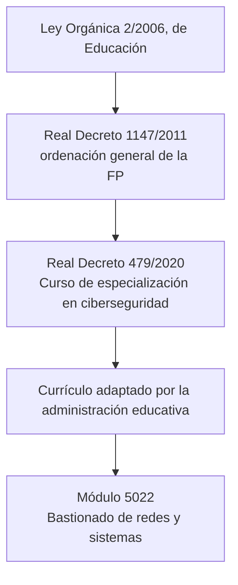
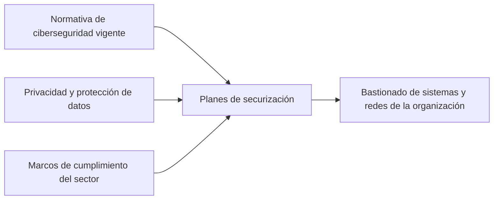

# Marco legal del módulo Bastionado de redes y sistemas

## Qué aprenderás

- Identificar la norma que regula el curso de especialización en el que se integra el módulo.
- Conocer los datos oficiales del curso y del módulo 5022: duración, créditos y referente.
- Saber quién puede acceder al curso y qué vinculación tiene con otros estudios.
- Entender qué habilita (y qué no) el título que obtendrás.
- Situar el módulo dentro del conjunto de módulos del curso y reconocer la normativa de ciberseguridad y de protección de datos que el módulo exige aplicar.

## Dónde nace el módulo

!!! abstract "Idea clave"
    El módulo **Bastionado de redes y sistemas** forma parte del **Curso de especialización en ciberseguridad en entornos de las tecnologías de la información**. Lo establece el **Real Decreto 479/2020, de 7 de abril**, publicado en el BOE el 13 de mayo de 2020.

El real decreto fija los **aspectos básicos del currículo**: lo mínimo común que se enseña en toda España. Después, cada administración educativa lo adapta y concreta, respetando lo que marca la norma estatal.

!!! info "Validez en todo el territorio"
    El Real Decreto 479/2020 tiene carácter oficial y validez en todo el territorio nacional. Lo que estudias aquí es válido en cualquier comunidad autónoma.

### Normas en las que se apoya

El propio real decreto cita las normas que le sirven de base:

- **Ley Orgánica 2/2006, de 3 de mayo, de Educación.** Encarga al Gobierno establecer los títulos de FP y los aspectos básicos de su currículo.
- **Real Decreto 1147/2011, de 29 de julio.** Regula la ordenación general de la FP del sistema educativo. Su artículo 27 define los cursos de especialización y los requisitos que deben cumplir.
- **Constitución Española, artículo 149.1.30.ª.** Da al Estado la competencia para regular la obtención, expedición y homologación de los títulos académicos y profesionales.

## Datos oficiales del curso

| Dato | Valor |
|------|-------|
| Denominación | Ciberseguridad en entornos de las tecnologías de la información |
| Nivel | Formación Profesional de Grado Superior |
| Duración | 720 horas |
| Familia profesional | Informática y Comunicaciones |
| Rama de conocimiento | Ingeniería y Arquitectura |
| Créditos ECTS | 43 |
| Referente en la CINE | P-5.5.4 |

!!! note "ECTS y CINE"
    **ECTS** son los créditos del sistema europeo de transferencia de créditos. Sirven para reconocer la formación entre estudios distintos. **CINE** es la Clasificación Internacional Normalizada de la Educación.

## Dónde encaja el módulo 5022

El curso se compone de seis módulos profesionales. Todos se desarrollan en el anexo I del real decreto.

| Código | Módulo |
|--------|--------|
| 5021 | Incidentes de ciberseguridad |
| **5022** | **Bastionado de redes y sistemas** |
| 5023 | Puesta en producción segura |
| 5024 | Análisis forense informático |
| 5025 | Hacking ético |
| 5026 | Normativa de ciberseguridad |

Datos del módulo 5022:

- **Duración:** 160 horas (192 sesiones).
- **Créditos ECTS:** 10.

Según el real decreto, este módulo contiene la formación necesaria para desempeñar la **función de bastionado** de los sistemas y redes de una organización. Esa función incluye administrar sistemas y redes teniendo en cuenta la **normativa de ciberseguridad vigente**, tanto nacional como internacional.

## Normativa de ciberseguridad y de protección de datos

El curso no se limita a enseñar técnicas: exige aplicar la normativa. Se trabajan tres bloques de referencia que el alumnado debe identificar y utilizar:

- **Normativa legal aplicable a ciberseguridad en España.** Las normas de ciberseguridad vigentes, tanto nacionales como internacionales, que condicionan la administración de sistemas y redes.
- **Regulaciones de privacidad y protección de datos.** Las normas que regulan el tratamiento de los datos personales y su confidencialidad, que el curso incluye expresamente.
- **Marcos de cumplimiento normativo del sector.** Los procedimientos y estándares actualizados con los que una organización demuestra que cumple la normativa, tanto internamente como frente a terceros.

Entre sus competencias profesionales están:

- Elaborar e implementar planes de prevención y concienciación en ciberseguridad, **aplicando la normativa vigente**.
- Definir y aplicar procedimientos para el **cumplimiento normativo en materia de ciberseguridad y de protección de datos personales**, tanto internamente como en relación con terceros.
- Revisar y actualizar procedimientos según normas y estándares actualizados para el correcto cumplimiento normativo.

El módulo 5022 lleva esa exigencia a sus resultados de aprendizaje. Por ejemplo, el primero pide diseñar planes de securización con **buenas prácticas** y, en sus criterios, identificar **estándares, guías y políticas** de securización. El segundo pide configurar el control de acceso y la autenticación **preservando la confidencialidad y la privacidad de los datos**.

!!! warning "Importante"
    El curso menciona la protección de datos personales y la normativa de ciberseguridad vigente, pero no desarrolla aquí el contenido de cada ley. Para consultar el texto de la norma, usa la documentación oficial indicada al final de este apartado.

!!! tip "Cómo se relaciona con el módulo"
    Cuando diseñes un plan de securización, cada medida que propongas deberá poder justificarse con una norma, un estándar o una buena práctica documentada.

## Resumen

- El módulo pertenece al curso de especialización en ciberseguridad, regulado por el Real Decreto 479/2020.
- El curso es de Grado Superior, dura 720 horas y vale 43 créditos ECTS.
- El módulo 5022 dura 160 horas (192 sesiones) y vale 10 créditos ECTS.
- Se accede con uno de cinco títulos de Técnico Superior del ámbito informático y electrónico.
- El título no regula ninguna profesión regulada.
- El módulo se centra en el bastionado: planes de securización y diseño de redes seguras, aplicando la normativa de ciberseguridad vigente y la protección de datos personales.

## Conceptos clave

- **Real decreto:** norma del Gobierno que, en este caso, fija los aspectos básicos del currículo del curso.
- **Currículo:** conjunto de objetivos, competencias, contenidos, resultados de aprendizaje y criterios de evaluación de unas enseñanzas.
- **Curso de especialización:** formación oficial de FP que complementa la de un título de referencia.
- **Módulo profesional:** cada una de las partes en que se organiza el curso.
- **ECTS:** crédito del sistema europeo que sirve para reconocer formación entre estudios.
- **Resultado de aprendizaje:** lo que debes saber hacer al terminar el módulo.
- **Bastionado:** función de proteger sistemas y redes aplicando la normativa de ciberseguridad vigente.

## Documentación oficial

- [Real Decreto 479/2020, de 7 de abril (BOE-A-2020-4963)](https://www.boe.es/buscar/act.php?id=BOE-A-2020-4963): texto completo de la norma, con el anexo I donde se desarrolla el módulo 5022.
