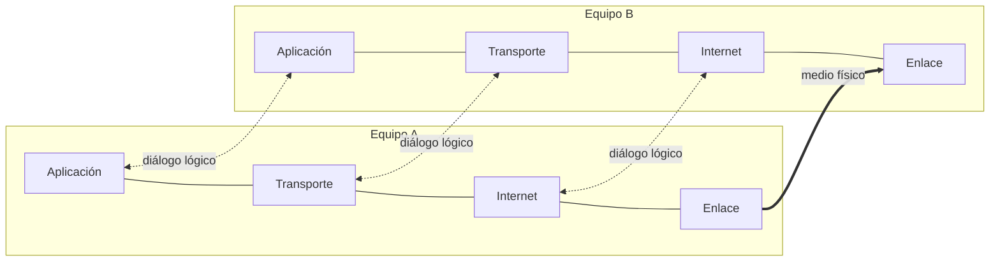
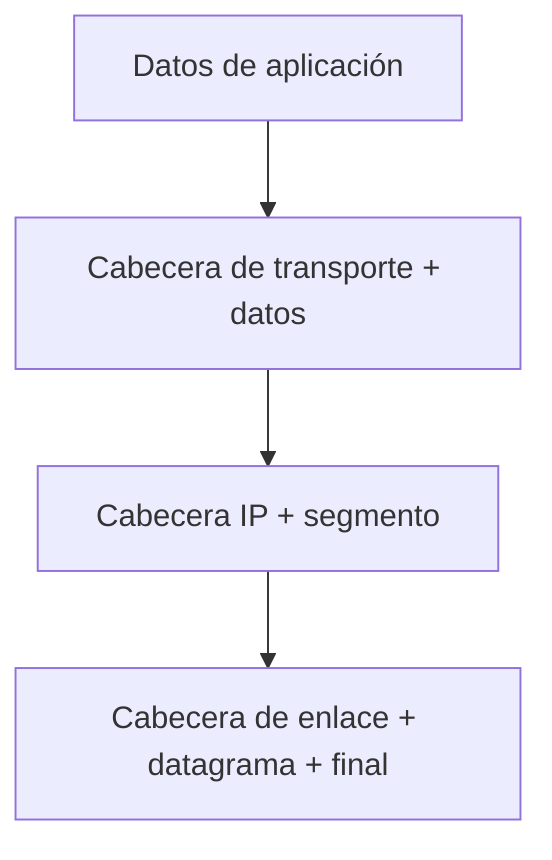

# Introducción a protocolos de red: arquitectura en capas y pila TCP/IP

## Qué aprenderás

- Entender por qué las redes se organizan en capas y qué función cumple cada una.
- Describir la interacción entre capas, servicios y protocolos.
- Seguir el flujo de la información al enviar (encapsulación) y al recibir (desencapsulación).
- Entender cómo se comunican las capas pares (*peer-to-peer*).
- Identificar la pila de protocolos TCP/IP y los protocolos principales de cada capa.

---

## Por qué las redes se organizan en capas

Cuando hablamos por teléfono, enviamos un WhatsApp o cargamos una página web, hay una montaña de cosas ocurriendo simultáneamente: direccionar, enviar datos por un cable o por el aire, asegurar que llegan completos, interpretar lo que contienen... Para no tener que resolver todo en un solo programa enorme, el trabajo se reparte en **capas**.

La **arquitectura en capas** organiza la red en niveles, cada uno con una función concreta. Cada capa ofrece un **servicio** a la capa superior sin que esta conozca los detalles internos de cómo funciona. Y a su vez, cada capa se apoya en el servicio de la inferior. Este es el **concepto de arquitectura de red en capas**: una forma de organizar la comunicación en la que cada nivel resuelve una parte del problema y solo interactúa con los niveles adyacentes.

Gracias a esto es posible la **encapsulación de datos**: cada capa añade su propia información sin modificar lo que hacen las demás.

!!! abstract "Idea clave"
    Una capa ofrece un servicio a la superior y usa el servicio de la inferior. Lo que ocurre dentro de cada capa queda oculto para las demás.

---

## Servicios, protocolos e interfaces

Para entender cómo funciona todo, conviene distinguir tres conceptos clave:

- **Servicio:** lo que una capa ofrece a la superior, por ejemplo, la entrega de datos entre dos extremos.
- **Protocolo:** el conjunto de reglas que una capa usa con su homóloga en el otro extremo: formato de los mensajes, orden de las acciones y respuestas esperadas.
- **Interfaz:** el punto de contacto entre dos capas adyacentes de un mismo equipo.

---

## Interacción entre pares de capas (peer-to-peer)

Cada capa de un equipo **dialoga con su homóloga** del equipo remoto. Imagina que dos personas se envían cartas: quien escribe no se preocupa de cómo viaja el sobre, quién lo transporta o cómo llega al buzón. Solo importa que su mensaje llegue al destinatario.

El intercambio real de bits solo ocurre en la capa más baja. Las capas superiores se comunican de forma lógica, a través de las inferiores.

---

## Encapsulación y desencapsulación

El flujo de información tiene dos sentidos:

- **De arriba hacia abajo (encapsulación):** al enviar, cada capa añade su **cabecera** (y, en algunas, un final) a los datos que recibe de la superior. El resultado se entrega a la capa inferior, que lo trata como datos.
- **De abajo hacia arriba (desencapsulación):** al recibir, cada capa lee y retira su cabecera y pasa el resto a la capa superior.

!!! example "Ejemplo"
    Un mensaje de aplicación se envuelve primero con una cabecera de transporte, después con una cabecera IP y por último con una cabecera de enlace. En el destino ocurre el proceso inverso, en orden contrario.

!!! warning "Atención"
    La encapsulación añade información de control, así que cada paquete transporta más bytes que los datos útiles. Por eso se distingue entre la carga útil (*payload*) y el resto de cabeceras.

Cuando una capa recibe datos de la superior, no los interpreta: los trata como una carga útil y se limita a añadir o retirar su propia cabecera. Por eso una misma pila puede transportar aplicaciones muy distintas sin cambiar las capas inferiores.

---

## Modelo de capas: OSI y TCP/IP

Hay dos modelos de referencia. El **modelo OSI** tiene siete capas y es un modelo conceptual muy completo, pero la **arquitectura TCP/IP**, la que realmente usa Internet, agrupa sus funciones en **cuatro capas**:

| Capa TCP/IP | Función | Equivalencia aproximada en OSI |
|-------------|---------|-------------------------------|
| Aplicación | Protocolos que usan directamente los usuarios y los servicios de soporte | Aplicación, presentación y sesión |
| Transporte | Comunicación de extremo a extremo entre aplicaciones | Transporte |
| Internet | Entrega de datagramas entre equipos a través de redes distintas | Red |
| Enlace | Conexión con la red física local | Enlace de datos y física |

Como ves, la capa de aplicación de Internet combina las funciones de presentación y aplicación del modelo OSI.

---

## La pila TCP/IP y sus protocolos principales

Aquí tienes los protocolos más importantes, organizados por capa:

| Capa | Protocolos principales | ¿Para qué sirve? |
|------|----------------------|------------------|
| **Aplicación** | Telnet, FTP, SMTP, DNS, DHCP, BOOTP | Servicios de usuario y soporte de red |
| **Transporte** | TCP, UDP | Comunicación de extremo a extremo entre aplicaciones |
| **Internet** | IP, ICMP | Entrega de datagramas entre redes; control de errores |
| **Enlace** | Ethernet, IEEE 802, ARP | Transporte de datagramas IP en tramas; resolución de direcciones |

- **TCP** es un servicio fiable y orientado a conexión, con control de flujo y reordenación.
- **UDP** es un servicio sin conexión basado en datagramas, más ligero pero sin garantías.
- **IP** es un servicio sin conexión que no garantiza la entrega.
- **ICMP** es un protocolo de control que viaja sobre IP (por ejemplo, para el comando *ping*).
- **ARP** resuelve la relación entre direcciones IP y direcciones de enlace dentro de la red local.

!!! tip "Cómo identificar la capa"
    Cada protocolo lleva su información de control en una cabecera propia. Así, la cabecera IP corresponde a la capa de Internet y la de TCP o UDP, a la de transporte.

---

## Resumen

- Las redes se organizan en capas: cada una ofrece un servicio a la superior y usa el de la inferior.
- Servicio, protocolo e interfaz son conceptos distintos.
- Cada capa dialoga con su homóloga en el otro extremo (*peer-to-peer*).
- Al enviar, los datos se encapsulan de arriba hacia abajo; al recibir, se desencapsulan de abajo hacia arriba.
- La pila TCP/IP tiene cuatro capas: aplicación, transporte, Internet y enlace.

---

## Conceptos clave

- **Capa:** nivel de la arquitectura de red que resuelve una parte del problema de comunicación.
- **Servicio:** funcionalidad que una capa ofrece a la superior.
- **Protocolo:** reglas que una capa usa con su homóloga.
- **Encapsulación:** añadir cabeceras a los datos al bajar por la pila.
- **Desencapsulación:** retirar cabeceras al subir por la pila.
- **ARP:** protocolo que resuelve direcciones IP en direcciones de enlace.

---

## Documentación oficial

- [RFC 1122: Requirements for Internet Hosts, capas de comunicación](https://www.rfc-editor.org/rfc/rfc1122): describe la pila de protocolos de Internet y sus capas.
- [RFC 791: Internet Protocol](https://www.rfc-editor.org/rfc/rfc791): especificación de IP.
- [RFC 9293: Transmission Control Protocol](https://www.rfc-editor.org/rfc/rfc9293): especificación actual de TCP.
- [RFC 768: User Datagram Protocol](https://www.rfc-editor.org/rfc/rfc768): especificación de UDP.
- [RFC 792: Internet Control Message Protocol](https://www.rfc-editor.org/rfc/rfc792): especificación de ICMP.
- [RFC 826: Address Resolution Protocol](https://www.rfc-editor.org/rfc/rfc826): especificación de ARP.
- [RFC 1035: Domain Names, implementación y especificación](https://www.rfc-editor.org/rfc/rfc1035): especificación de DNS.
- [RFC 2131: Dynamic Host Configuration Protocol](https://www.rfc-editor.org/rfc/rfc2131): especificación de DHCP.
