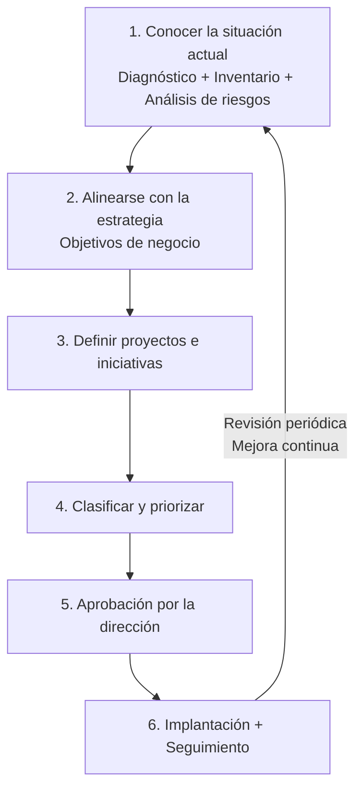

# Plan director de seguridad

## 🎯 Qué aprenderás

- ✅ Qué es un **Plan Director de Seguridad (PDS)** y cuál es su **definición y propósito** fundamental.
- ✅ Cuáles son sus **fases de elaboración**: diagnóstico, análisis de riesgos y estrategia.
- ✅ Cómo lograr la **alineación con los objetivos de negocio** de la organización.
- ✅ Qué implica la **gobernanza** y cómo definir **roles de responsabilidad** claros.
- ✅ Qué papel juegan las políticas de seguridad y el estándar ISO/IEC 27001.

## 📖 ¿Qué es un Plan Director de Seguridad?

Cuando una organización decide mejorar su ciberseguridad, la primera pregunta es: **¿por dónde empiezo?** La respuesta es planificar. Un **Plan Director de Seguridad** es la **definición y priorización** de un conjunto de proyectos de seguridad de la información cuyo **propósito** es **reducir los riesgos** hasta un nivel aceptable, partiendo de un análisis de la situación inicial.

> **💡 Idea clave**
> El PDS no es solo tecnología: incluye proyectos **técnicos** (instalar productos o contratar servicios), **legales** (cumplir normativa de privacidad y comercio electrónico) y **organizativos** (formación, procedimientos, políticas internas).

Un buen PDS se **alinea con los objetivos estratégicos** del negocio, define su **alcance** e incorpora las obligaciones y buenas prácticas de los trabajadores y de los terceros que colaboran con la organización. Su magnitud depende del tamaño, su madurez tecnológica, su sector, el marco legal y la naturaleza de la información que maneja.

!!! warning "Importante"
    No se puede proteger todo frente a todo. Se prioriza y se avanza de forma incremental, con **mejora continua**, hacia los objetivos que convienen al negocio.

## 🔄 Las fases del plan (elaboración: diagnóstico, análisis de riesgos, estrategia)

Un PDS sigue un camino ordenado y, al terminar, el ciclo vuelve a empezar (**mejora continua**).



### Detalle de cada fase

1. **Conocer la situación actual (Diagnóstico).** Es la fase más importante y compleja: participan muchas personas y la información debe ser fiable, completa y actualizada. Se parte de un **autodiagnóstico**, un **inventario de activos** y, si se quiere profundizar, un **análisis de riesgos**.

2. **Alinearse con la estrategia (Objetivos de negocio).** Los objetivos a medio y largo plazo de la organización marcan las etapas siguientes. Aquí es donde se produce la **alineación con los objetivos de negocio**.

3. **Definir proyectos e iniciativas** que lleven al nivel de ciberseguridad deseado.

4. **Clasificar y priorizar** para abordar primero lo que mejor encaja con los objetivos estratégicos.

5. **Aprobación por la dirección.** Sin ella, ningún plan llega a buen puerto. El apoyo de la dirección garantiza **recursos suficientes** y que el enfoque va alineado con la estrategia.

6. **Implantación.** Se asignan **responsables**, se fijan hitos y se revisa periódicamente, porque las necesidades cambian.

> **💡 Ejemplo**
> Este año la prioridad es asegurar el servicio que más rentabilidad da, y a él se dedica la mayor parte del esfuerzo. Cada año se revisa el plan, se comprueba su avance, se readapta a la estrategia y se eligen los siguientes pasos.

## 🎯 Antes de analizar: alcance, gobernanza y roles de responsabilidad

El alcance de un PDS es la parte de la organización sobre la que se aplica el plan (a nivel organizativo, geográfico y funcional). El PDS debe definir claramente su alcance, con **límites precisos** para que no crezca indebidamente.

La **gobernanza** es esencial para el éxito de un PDS: el esquema de roles de responsabilidad (RR) define quién hace qué, quién asume las obligaciones y responsabilidades y quién designa y reemplaza a los responsables. Este es un requisito del ENS (art. 12) y de la guía CCN-STIC 805.

Los roles de responsabilidad en ciberseguridad son de **niveles verticales** (quién aprueba, quién diseña, quién implementa, quién opera, quién audita) y de **niveles horizontales** (responsable de seguridad de la información - RSI, los responsables de los temas de seguridad como los de redes, servidores, aplicaciones, etc.). El responsable de seguridad de la información suele ser un **rol unipersonal** con funciones y responsabilidades definidas en la política de seguridad. No debe delegar su autoridad en subalternos o en el Comité de Seguridad.

## 🛠️ Herramientas de INCIBE

La **herramienta de autodiagnóstico** de INCIBE ofrece, en unos 5 minutos y mediante preguntas sobre sistemas y metodologías, un nivel de riesgo dividido en tres puntuaciones (**personas, procesos y tecnologías**), con informes de recomendaciones para cada una. INCIBE también facilita tres plantillas:

- Inventario de activos
- Análisis de riesgos
- Priorización de proyectos

## 📋 Políticas de seguridad

Las políticas concretan los aspectos esenciales para lograr los proyectos del plan. Por ejemplo, si se usa almacenamiento en la nube, hay que incorporar las medidas de su política; igual con móviles, wifi y otras redes. INCIBE ofrece **29 políticas**, cada una con lista de chequeo y un PDF con los controles detallados:

| Grupo | Ejemplos |
|-------|---------|
| Empresario | Recursos humanos, aplicaciones permitidas, clasificación de la información |
| Personal técnico | Auditorías de sistemas, control de accesos, respuesta a incidentes |
| Empleado | Correo electrónico, puesto de trabajo, contraseñas, móviles corporativos |

## 🏛️ ISO/IEC 27001: Marco de gestión

**ISO/IEC 27001** es el estándar internacional más conocido para los **Sistemas de Gestión de la Seguridad de la Información (SGSI)**. Define los requisitos de un SGSI para organizaciones de cualquier tamaño y sector, con un proceso de gestión de riesgos (edición 2022). Protege tres principios, la **tríada CIA**:

- **Confidencialidad**: solo accede quien debe. *Riesgo: roban credenciales y las venden.*
- **Integridad**: los datos son fiables y no se borran ni dañan. *Riesgo: borrado accidental de datos críticos.*
- **Disponibilidad**: la información es accesible cuando se necesita. *Riesgo: caída de BD sin copia suficiente.*

> **ℹ️ Nota**
> La certificación es voluntaria: unas organizaciones aplican el estándar por sus buenas prácticas y otras se certifican para dar confianza a sus clientes.

## 📝 Resumen

- El **PDS** es un conjunto de proyectos técnicos, legales y organizativos, priorizados para **reducir el riesgo** a un nivel aceptable.
- Tiene **seis fases**, empieza por **conocer la situación actual** (diagnóstico, análisis de riesgos) y requiere la **aprobación de la dirección**.
- Es un **ciclo de mejora continua**, con **alcance acotado** y **roles de responsabilidad** definidos (**gobernanza**).
- Se **alinea con los objetivos de negocio** de la organización.
- Las **políticas** concretan las medidas; **ISO/IEC 27001** ofrece un marco de gestión (SGSI).

## 🔑 Conceptos clave

- **PDS:** Plan que define y prioriza los proyectos de seguridad de una organización.
- **Alcance:** Parte de la organización sobre la que se aplica el plan.
- **Activo:** Cualquier elemento con valor para la organización.
- **Análisis de riesgos:** Proceso para identificar, estimar y priorizar riesgos.
- **SGSI:** Sistema de gestión de la seguridad de la información.
- **Tríada CIA:** Confidencialidad, integridad y disponibilidad.
- **Gobernanza:** Estructura de roles, responsabilidades y rendición de cuentas.

## 📚 Documentación oficial

- [INCIBE – Plan Director de Seguridad](https://www.incibe.es/empresas/que-te-interesa/plan-director-seguridad): Explicación del plan, dosier y recursos.
- [INCIBE – ¿Sabes gestionar la ciberseguridad en tu empresa?](https://www.incibe.es/empresas/blog/sabes-gestionar-ciberseguridad-tu-empresa-no-te-pille-el-toro): Fases, autodiagnóstico, plantillas y políticas.
- [ISO/IEC 27001:2022](https://www.iso.org/isoiec-27001-information-security.html): Descripción oficial del estándar.

## 🏛️ Gobernanza y roles de responsabilidad (Diagrama)

```mermaid
flowchart TB
    PDS[Plan Director<br/>de Seguridad] -->|Aprueba,<br/>asigna recursos| DIR[Dirección<br/>General]
    PDS -. Línea directa .-> RSI[Responsable<br/>Seguridad<br/>(RSI)]
    RSI -. Define/diseña .-> CS[Comité<br/>Seguridad]
    CS -. Decide/coordina .-> ET[Equipos<br/>Técnicos<br/>Responsables]
    PDS -. Supervisa/seguimiento .-> AI[Auditoría<br/>Interna]
    PDS -. Reporta .-> AC[Autoridad<br/>Competente]
    AI -. Verifica .-> PDS
    AC -. Aprueba cambios .-> PDS
```
