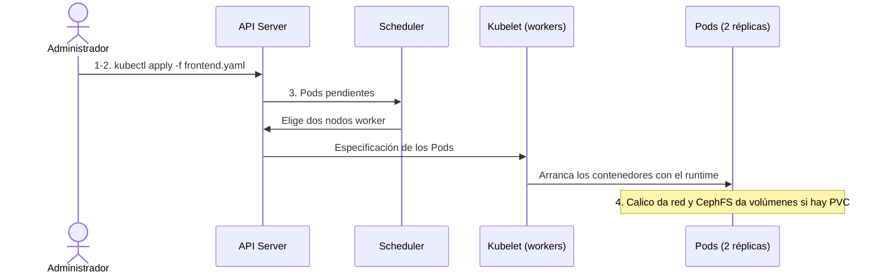

## Modo de Funcionamiento: El Modelo Declarativo
A diferencia de la administración tradicional (donde se ejecutan comandos paso a paso), Kubernetes funciona mediante un **estado deseado**. 

1. El administrador define cómo debe ser el entorno (ej: "necesito 3 réplicas de la web").
2. Kubernetes utiliza sus **bucles de control** para comparar el estado actual con el deseado.
3. Si hay una discrepancia (ej: un nodo falla), Kubernetes actúa automáticamente para corregirla (**Self-healing**).

## Arquitectura del Clúster: Partes y Servicios
Un clúster de Kubernetes se divide en dos áreas principales que se comunican entre sí para mantener el sistema operativo:

### El Plano de Control (Control Plane)
Es el "cerebro" del clúster y suele residir en el nodo **Manager**.

*   **kube-apiserver:** Es la cara del plano de control. Expone la **API de Kubernetes** (REST) que permite configurar y validar los datos de los objetos.
*   **kube-scheduler:** Se encarga de asignar los nuevos objetos (Pods) a los nodos disponibles basándose en recursos, políticas y restricciones.
*   **kube-controller-manager:** Ejecuta los procesos de control que regulan el estado del clúster (detectar caídas de nodos, gestionar réplicas, etc.).
*   **etcd:** (Base de datos persistente) Almacena de forma segura todos los datos de configuración y el estado del clúster.

### Los Nodos de Trabajo (Worker Nodes)
Son las máquinas donde realmente se ejecutan las aplicaciones.

*   **kubelet:** El agente principal que corre en cada nodo. Se asegura de que los contenedores estén funcionando dentro de los Pods según lo descrito en las especificaciones (**PodSpecs**).
*   **kube-proxy:** Gestiona las reglas de red en los nodos, permitiendo la comunicación (TCP/UDP/SCTP) entre servicios y el balanceo de carga.
*   **Container Runtime:** El software encargado de ejecutar los contenedores (ej: containerd o Docker).

---

## Gestión de Objetos del Entorno
Los **objetos** son entidades persistentes que representan el estado del clúster (qué aplicaciones corren, qué recursos tienen, etc.).

### Identificación y Organización

*   **Namespaces:** Permiten dividir un clúster físico en múltiples "clústeres virtuales" para organizar recursos por proyectos o entornos (dev, prod).
*   **Labels (Etiquetas) y Selectors:** Pares clave-valor vinculados a los objetos que permiten organizarlos y seleccionarlos de forma masiva.
*   **Annotations (Anotaciones):** Metadatos no identificativos para herramientas externas.

### Métodos de Gestión
Para interactuar con la API se utiliza la herramienta de línea de comandos **kubectl**. Existen tres enfoques:

1.  **Imperativo por comandos:** `kubectl run ...` (Rápido para pruebas).
2.  **Imperativo por archivos:** `kubectl create -f config.yaml`.
3.  **Declarativo (Recomendado):** `kubectl apply -f config.yaml`. Aquí defines el estado final y K8s decide qué cambios aplicar.

---

## Artefactos Principales (Recursos)

### Cargas de Trabajo (Workloads)

*   **Pod:** La unidad mínima de ejecución. Es un grupo de uno o más contenedores que comparten almacenamiento y red.
*   **Deployment:** La forma más común de desplegar aplicaciones **sin estado** (stateless). Gestiona réplicas y permite actualizaciones progresivas (Rolling Updates).
*   **StatefulSet:** Diseñado para aplicaciones **con estado** (como bases de datos), garantizando identidad y almacenamiento persistente ordenado.
*   **DaemonSet:** Asegura que una copia de un Pod se ejecute en todos (o algunos) nodos del clúster.

### Red y Almacenamiento

*   **Service:** Una abstracción que define una política de acceso a un grupo de Pods (actúa como balanceador de carga interno).
*   **PersistentVolume (PV) y Claim (PVC):** El PV es el recurso físico de almacenamiento (ej: un volumen en **CephFS**), mientras que el PVC es la "solicitud" que hace un Pod para usar ese espacio.

### Configuración

*   **ConfigMaps y Secrets:** Permiten inyectar configuraciones y datos sensibles (contraseñas, certificados) en los contenedores sin necesidad de incluirlos en la imagen.

---

## Ejemplo de Flujo de Trabajo
En vuestro clúster de laboratorio (1 Manager, 2 Workers):

1. Definís un archivo `frontend.yaml` de tipo **Deployment** con 2 réplicas.
2. Ejecutáis `kubectl apply -f frontend.yaml`.
3. El **API Server** recibe la petición, el **Scheduler** elige dos nodos worker, y el **Kubelet** en esos nodos arranca los contenedores usando el runtime configurado. 
4. Si el CNI (**Calico**) y el almacenamiento (**CephFS**) están bien configurados, los Pods tendrán red instantánea y acceso a volúmenes compartidos si se solicita un PVC.
El siguiente diagrama sigue esos pasos en orden:

