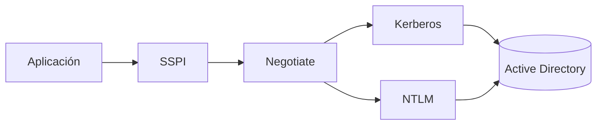
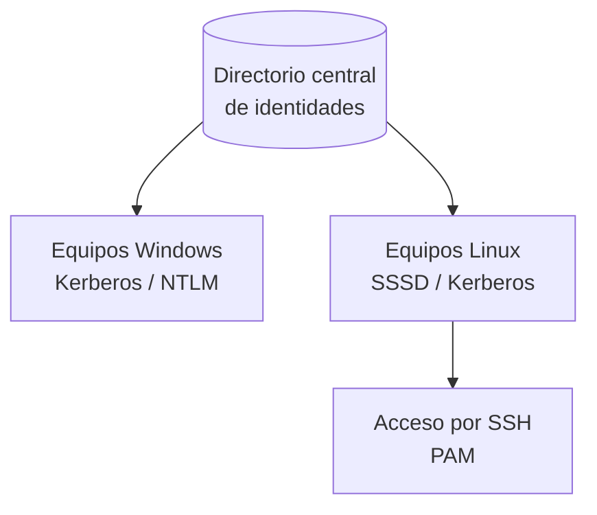

# Autenticación en Windows y Linux

## 🎯 Qué aprenderás

- 🔑 Reconocer los componentes de autenticación de Windows: Active Directory, Kerberos y NTLM.
- 🐧 Entender cómo Linux guarda y verifica las credenciales locales mediante PAM y `/etc/shadow`.
- 🔐 Conocer cómo exigir factores adicionales en el acceso remoto por SSH.
- 📜 Relacionar las políticas de contraseñas y el bloqueo de cuentas con los mecanismos que las aplican.
- 🤝 Comprender los retos de integrar Windows y Linux en un mismo entorno.

---

## 🪟 Autenticación en Windows

Cuando haces clic en el botón de «Iniciar sesión» de un equipo Windows, ocurre algo mucho más complejo de lo que parece. Detrás de esa pantalla hay una cadena de procesos que se encarga de responder a una pregunta clave: **¿realmente eres tú quien dice ser?**

Windows no deja que cada aplicación implemente su propio protocolo de autenticación. En su lugar, utiliza un conjunto de **proveedores de compatibilidad para seguridad** (SSP). Las aplicaciones simplemente llaman a la **interfaz SSPI**, y es esta interfaz la que elige el proveedor adecuado en cada caso. Los SSP predeterminados de Windows Server incluyen Negotiate, Kerberos, NTLM y Schannel.

Todas las políticas y cuentas de seguridad del dominio se guardan en **Active Directory Domain Services (AD DS)**. En un controlador de dominio, esas políticas y cuentas son las que están vigentes para el dominio al que pertenece ese controlador.



### 🎫 Kerberos

**Kerberos** es el protocolo de autenticación preferente en un dominio de Active Directory. Funciona como un sistema de tickets: no envías tu contraseña por la red, sino que obtienes un ticket que demuestra quién eres.

Implica tres actores:

- El **cliente** (usuario o equipo que quiere acceder).
- El **servicio** al que el cliente quiere conectarse.
- El **Centro de Distribución de Claves** (KDC), que reside en el controlador de dominio y utiliza Active Directory como base de cuentas.

El proceso es sencillo: el cliente obtiene primero un **Ticket Granting Ticket (TGT)** y, con él, pide tickets de servicio específicos para cada recurso. Kerberos requiere Active Directory en las implementaciones predeterminadas.

### 🔑 NTLM

**NTLM** es una familia de protocolos de autenticación de tipo desafío-respuesta: el servidor envía un reto y el cliente demuestra que conoce la contraseña sin enviarla nunca en claro. Sigue admitiéndose y es necesario para la autenticación de sistemas configurados como miembros de un grupo de trabajo, pero **Kerberos es la opción preferida** en entornos de dominio moderno.

> **Importante**
>
> NTLM se conserva sobre todo por compatibilidad con aplicaciones heredadas. En un dominio moderno, conviene priorizar Kerberos.

### 🛡️ Protección de credenciales: Credential Guard

**Credential Guard** protege los secretos de autenticación (hashes NTLM, tickets TGT de Kerberos, credenciales almacenadas) frente al robo de credenciales. Lo hace usando **seguridad basada en virtualización (VBS)** para aislar esos secretos, de modo que solo el software del sistema con privilegios pueda acceder a ellos.

No es una protección completa por sí sola: los ataques persistentes suelen desplazarse hacia nuevas técnicas, por lo que debe combinarse con otras medidas de seguridad.

### 👋 Windows Hello para empresas

**Windows Hello** permite iniciar sesión con datos biométricos (huella, rostro) o con un PIN en lugar de una contraseña tradicional. Con FIDO/WebAuthn también puede usarse para acceder a sitios web compatibles. **Windows Hello para empresas** añade administración y seguridad de nivel empresarial, como la autenticación basada en certificados.

---

## 🐧 Autenticación en Linux

En Linux, la autenticación de cuentas locales se apoya en **PAM** (*Pluggable Authentication Modules*), un sistema de módulos conectables. Piensa en PAM como un encadenador: cada servicio que necesita autenticar usuarios (inicio de sesión, `sudo`, SSH…) consulta su propia configuración en `/etc/pam.d/`, donde se encadenan los módulos que realizan cada tarea.

Los tipos de tarea que aparecen en la documentación de PAM son:

| Tipo | Función |
|------|---------|
| `auth` | Comprueba la identidad del usuario (por ejemplo, la contraseña). |
| `account` | Comprueba que la cuenta sigue activa y puede usarse. |
| `password` | Gestiona el cambio de la contraseña. |
| `session` | Gestiona las tareas previas y posteriores a la sesión. |

El módulo `pam_unix` es el módulo tradicional de autenticación Unix. Verifica la contraseña a partir de `/etc/passwd` y `/etc/shadow`.

### 📄 El fichero `/etc/shadow`

Las contraseñas no se guardan en `/etc/passwd` (que puede ser legible por todos los usuarios), sino en **`/etc/shadow`**. Esta separación es el mecanismo de *shadow passwords* (contraseñas ocultas). El fichero contiene los hashes de las contraseñas y los datos de caducidad, y **no debe ser legible por los usuarios normales**.

> **Importante**
>
> Si el campo de contraseña de `/etc/shadow` está vacío, el usuario puede iniciar sesión sin contraseña. Un campo que empieza por `!` indica una cuenta bloqueada.

### 🔐 Autenticación remota con SSH

El servidor OpenSSH controla los métodos de autenticación desde `sshd_config`, el fichero de configuración del demonio `sshd`. Algunas directivas relevantes son:

- `PasswordAuthentication`: indica si se permite la autenticación por contraseña.
- `PubkeyAuthentication`: indica si se permite la autenticación por clave pública.
- `KbdInteractiveAuthentication`: indica si se permite la autenticación interactiva por teclado.
- `MaxAuthTries`: número máximo de intentos de autenticación permitidos por conexión.
- `AuthenticationMethods`: métodos que deben completarse con éxito para conceder el acceso (por ejemplo, una clave pública seguida de una contraseña).

=== "Ejemplo de configuración (sshd_config)"

    ```ini
    # /etc/ssh/sshd_config (fragmento de ejemplo)
    PubkeyAuthentication yes
    PasswordAuthentication no
    AuthenticationMethods publickey,password
    MaxAuthTries 3
    ```

> **Importante**
>
> Este fragmento es un ejemplo ilustrativo de las directivas descritas. Antes de aplicar cambios de este tipo en un servidor real, verifica que no dejas sin acceso a los administradores y mantén una sesión abierta por si hay que revertirlos.

---

## 📜 Políticas de contraseñas y bloqueo de cuentas

Las políticas de contraseñas y de bloqueo se describen de forma general, válida para ambos sistemas:

- Una política de contraseñas sólida dificulta que se adivine una contraseña por medios manuales o automáticos. Debe imponer una longitud mínima.
- Según NIST, los verificadores **no deben imponer** otras reglas de composición, como exigir mezclas de tipos de caracteres (mayúsculas, números, símbolos).
- Conviene evitar los cambios periódicos obligatorios y bloquear las contraseñas comunes o ya filtradas.
- El bloqueo de cuenta impide nuevos intentos durante un tiempo tras un número de fallos. Debe asociarse a la cuenta y **no solo a la dirección IP**, para que un atacante no pueda evitarlo cambiando de IP. Además, el bloqueo debe diseñarse para que no pueda usarse para bloquear a otros usuarios (DoS por bloqueo).

En Linux, la pila `password` de PAM puede incluir el módulo `pam_passwdqc`, que comprueba la fortaleza de la nueva contraseña antes de que `pam_unix` la acepte.

---

## 🤝 Integración de Windows y Linux en entornos mixtos

En muchas organizaciones conviven equipos Windows y Linux. Una forma de integrarlos es disponer de un **directorio central de identidades**:

- **Active Directory** almacena las cuentas y las políticas del dominio, y es el centro de la autenticación Kerberos en Windows.
- **FreeIPA** gestiona de forma centralizada usuarios, grupos, autenticación Kerberos, políticas de acceso y certificados en Linux.
- **SSSD** (*System Security Services Daemon*) permite a los sistemas Linux integrarse con proveedores de identidad y directorios, con autenticación centralizada y caché de credenciales.



---

## 👥 Gestión de usuarios y grupos en ambos sistemas

En Windows, las cuentas y los grupos de un dominio se administran desde **Active Directory Domain Services**, que organiza los usuarios, los grupos y los equipos en dominios y unidades organizativas.

En Linux, **FreeIPA** ofrece una gestión centralizada de usuarios y grupos para el entorno integrado.

---

## 🛡️ Herramientas de auditoría y monitoreo de la autenticación

Conviene registrar los eventos de autenticación, incluidos los bloqueos de cuenta, y revisarlos periódicamente para detectar intentos de ataque y fallos de acceso. Un monitoreo activo es tu mejor aliado para detectar patrones sospechosos antes de que se conviertan en un problema real.

---

## 📝 Resumen

- Windows autentica mediante SSPI y proveedores como Kerberos y NTLM. En un dominio, Kerberos y Active Directory son el centro de la autenticación.
- Linux autentica mediante PAM, que encadena módulos por tipo de tarea. Las contraseñas locales se guardan como hash en `/etc/shadow`.
- SSH permite exigir varios métodos de autenticación mediante `AuthenticationMethods`.
- Las políticas de contraseñas y el bloqueo de cuentas deben aplicarse en ambos sistemas y registrarse.
- La integración en entornos mixtos se apoya en un directorio central, como Active Directory o FreeIPA.

---

## 🔑 Conceptos clave

- **SSPI:** interfaz de Windows que permite a las aplicaciones usar servicios de autenticación sin conocer el protocolo concreto.
- **Kerberos:** protocolo de autenticación basado en tickets emitidos por un KDC.
- **NTLM:** protocolo de autenticación de desafío-respuesta, mantenido por compatibilidad.
- **PAM:** sistema de módulos conectables que implementa la autenticación en Linux.
- **`/etc/shadow`:** fichero que guarda la información de autenticación de las cuentas locales de Linux.
- **Active Directory:** servicio de directorio de Windows que almacena las cuentas y las políticas del dominio.
- **FreeIPA:** solución de gestión centralizada de identidades en Linux.
- **SSSD:** demonio que permite a Linux integrarse con directorios e identidades externas.

---

## 📚 Documentación oficial

- [Microsoft Learn – Información general de la autenticación de Windows](https://learn.microsoft.com/es-es/windows-server/security/windows-authentication/windows-authentication-overview): arquitectura de autenticación de Windows.
- [Microsoft Learn – Introducción a la autenticación Kerberos en Windows Server](https://learn.microsoft.com/es-es/windows-server/security/kerberos/kerberos-authentication-overview): funcionamiento de Kerberos.
- [Microsoft Learn – Introducción a NTLM](https://learn.microsoft.com/es-es/windows-server/security/kerberos/ntlm-overview): protocolo NTLM y su uso actual.
- [Microsoft Learn – Credential Guard](https://learn.microsoft.com/es-es/windows/security/identity-protection/credential-guard/): protección de credenciales.
- [Microsoft Learn – Windows Hello para empresas](https://learn.microsoft.com/es-es/windows/security/identity-protection/hello-for-business/): autenticación sin contraseña.
- [Microsoft Learn – Active Directory Domain Services](https://learn.microsoft.com/en-us/windows-server/identity/ad-ds/active-directory-domain-services): administración de identidades en Windows.
- [Linux-PAM – System Administrators' Guide](https://www.linux-pam.org/Linux-PAM-html/): arquitectura de módulos PAM.
- [Linux man-pages – pam.d(5)](https://man7.org/linux/man-pages/man5/pam.d.5.html): configuración de PAM.
- [Linux man-pages – shadow(5)](https://man7.org/linux/man-pages/man5/shadow.5.html): fichero de contraseñas ocultas.
- [OpenSSH – sshd_config(5)](https://man.openbsd.org/sshd_config): configuración del servidor SSH.
- [FreeIPA – Documentation](https://www.freeipa.org/page/Documentation): gestión centralizada de identidades en Linux.
- [SSSD – System Security Services Daemon](https://sssd.io/docs/): integración de Linux con directorios e identidades.
