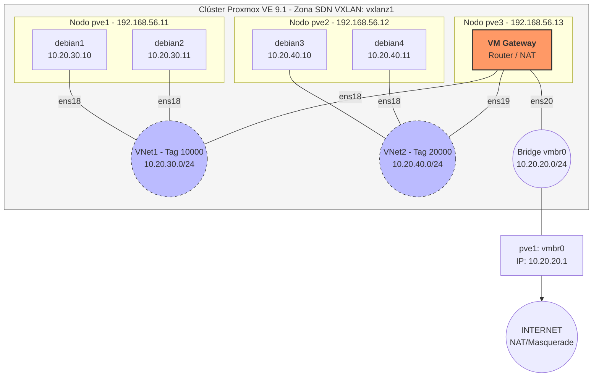

# Práctica: Infraestructura SDN con Vnets de tipo VXLAN
Esta práctica tiene como objetivo desplegar una red virtual avanzada utilizando **VXLAN**, configurar el enrutamiento inter-VNet mediante una máquina virtual de pasarela (Gateway) y aplicar políticas de afinidad en un entorno de clúster.



## 1. Configuración de la Infraestructura SDN

**Contexto**
La integración de **Software-Defined Network (SDN)** en Proxmox permite gestionar redes virtuales a nivel de clúster. En esta práctica utilizamos la zona de tipo **VXLAN**, que permite crear una red de capa 2 (L2) encapsulada sobre una infraestructura física de capa 3 (L3), garantizando que las máquinas virtuales puedan comunicarse independientemente del nodo físico en el que residan.

### Crear Zona VXLAN
1. Acceder a **Datacenter > SDN > Zones**.
2. Crear una nueva zona con los siguientes parámetros:
   *   **ID:** `vlxanz1`
   *   **Peers:** `192.168.56.11`, `192.168.56.12`, `192.168.56.13`.

Usando la línea de comandos, desde uno de los nodos del clúster Proxmox:

```bash
pvesh create /cluster/sdn/zones \
  --zone vlxanz1 \
  --type vxlan \
  --nodes pve1,pve2,pve3 \
  --peers 192.168.56.11,192.168.56.12,192.168.56.13
```

### Crear Redes Virtuales (VNets)
Las VNets actúan como bridges virtuales locales a nivel de clúster. Utilizaremos **Tags** para identificar y aislar el tráfico dentro de la misma zona.

- **Crear vnet1:**
    - **ID:** `vnet1`
    - **Zone:** `vxlanz1`
    - **Tag:** `10000` (Identificador VNI L2 para el switch virtual).
- **Crear vnet2:**
    - **ID:** `vnet2`
    - **Zone:** `vxlanz1`
    - **Tag:** `20000`.

Utilizando la línea de comandos:
```bash
pvesh create /cluster/sdn/vnets --vnet vnet1 --zone vlxanz1 --tag 10000
pvesh create /cluster/sdn/vnets --vnet vnet2 --zone vlxanz1 --tag 20000
```

Tal como están definidos, como Vnets con distinto Tag (VNI) dentro de la misma zona VXLAN, el tráfico L2 entre ellas estará aislado. **VXLAN encapsula el tráfico L2 dentro de UDP/IP**, y la clave para el aislamiento es el VNI.

Todo el tráfico con el mismo VNI dentro de una zona SDN puede “verse” entre sí a nivel de L2, porque VXLAN lo entrega a todos los endpoints que usan ese VNI. Al utilizar VNI diferentes el tráfico de cada VNet está separado a nivel L2.

Se definen como Tag números fuera del rango válido de VLAN ID del estándar 802.1Q (1 – 4094) para evitar colisiones de ID.

Es necesario aplicar los cambios SDN de forma explícita, podemos hacerlo desde la interfaz web o bien con el comando:
```bash
pvesh set /cluster/sdn
```

## 2. Despliegue de Máquinas Virtuales (Clones)

Utilizaremos el comando `qm` o la interfaz web para gestionar las máquinas basadas en KVM. Cada máquina se conectará a las VNets creadas anteriormente. Partiremos de una MV inicial, debian1, creada anteriormente, la cual clonaremos para obtener. Vamos a crear los clones con los siguientes comandos:

```bash
qm clone 100 101 --name debian2 --target pve1
qm clone 100 102 --name debian3 --target pve2
qm clone 100 103 --name debian4 --target pve2
qm clone 100 104 --name gateway --target pve3
```

Los comandos anteriores generan la siguiente estructura de MVs:

| VM origen | VM destino | Nombre | Nodo destino | Descripción |
|-----------|------------|--------|--------------|-------------|
| 100 | 101 | `debian2` | `pve1` | Clona la VM 100 y crea `debian2` en `pve1` |
| 100 | 102 | `debian3` | `pve2` | Clona la VM 100 y crea `debian3` en `pve2` |
| 100 | 103 | `debian4` | `pve2` | Clona la VM 100 y crea `debian4` en `pve2` |
| 100 | 104 | `gateway` | `pve3` | Clona la VM 100 y crea el gateway en `pve3` |

### Configuración de red de las MVs

Asignamos a cada MV el dispositivo de interfaz de red correspondiente:
```bash
pvesh set /nodes/pve1/qemu/100/config --net0 virtio,bridge=vnet1
pvesh set /nodes/pve1/qemu/101/config --net0 virtio,bridge=vnet1
pvesh set /nodes/pve2/qemu/102/config --net0 virtio,bridge=vnet2
pvesh set /nodes/pve2/qemu/103/config --net0 virtio,bridge=vnet2
pvesh set /nodes/pve3/qemu/104/config --net0 virtio,bridge=vnet1 \
--net1 virtio,bridge=vnet2 --net2 virtio,bridge=vmbr0
```

Los comandos anteriores `pvesh set` modifican directamente la configuración de red de las máquinas virtuales en Proxmox. Cada interfaz `netX` se configura como una tarjeta de red virtual **VirtIO** conectada a un determinado **bridge**.
```text
pvesh set /nodes/<nodo>/qemu/<VM>/config --netX virtio,bridge=<bridge>
```

* **`pvesh set`** → modifica la configuración de una VM mediante la API de Proxmox.
* **`/nodes/pveX/qemu/VMID/config`** → indica el nodo, la VM y su configuración.
* **`--net0`, `--net1`, `--net2`** → identifican las interfaces de red de la VM.
* **`virtio`** → utiliza una tarjeta de red virtual VirtIO.
* **`bridge=`** → conecta la interfaz al bridge indicado.

Según los comandos anteriores, la configuración realizada sería:

| Nodo   |  VM | Interfaz | Bridge  | Descripción                  |
| ------ | --: | -------- | ------- | ---------------------------- |
| `pve1` | 100 (debian 1)| `net0`   | `vnet1` | Interfaz conectada a `vnet1`       |
| `pve1` | 101 (debian 2)| `net0`   | `vnet1` | Interfaz conectada a `vnet1`       |
| `pve2` | 102 (debian 3)| `net0`   | `vnet2` | Interfaz conectada a `vnet2`       |
| `pve2` | 103 (debian 4)| `net0`   | `vnet2` | Interfaz conectada a `vnet2`       |
| `pve3` | 104 (gateway)| `net0`   | `vnet1` | Primera interfaz conectada a `vnet1` |
| `pve3` | 104 (gateway)| `net1`   | `vnet2` | Segunda interfaz conectada a `vnet2` |
| `pve3` | 104 (gateway)| `net2`   | `vmbr0` | Tercera interfaz conectada al bride `vmbr0` |

### En resumen

Las VMs **100 y 101** utilizan `vnet1`, las VMs **102 y 103** utilizan `vnet2`, y la VM **104** actúa como una máquina con **tres interfaces de red**, conectada simultáneamente a `vnet1`, `vnet2` y `vmbr0`.


## 3. Alta Disponibilidad (HA) y Afinidad de Nodo

Para evitar sobrecargar los nodos del clúster, los cuales tienen recursos muy justos, vamos a distribuir las MVs anteriores de modo que podamos ejecutarlas a la vez sin problemas de rendimiento o estabilidad en los nodos. Para ello usaremos HA.

El sistema **ha-manager** supervisa los recursos para asegurar su disponibilidad. Mediante las reglas de afinidad, podemos distribuir la carga de trabajo entre los nodos para evitar la saturación de un único servidor físico.

### Configuración de Afinidad:
En primer lugar crearemos un recurso HA por cada una de las MVS.

```bash
ha-manager add vm:100
ha-manager add vm:101
ha-manager add vm:102
ha-manager add vm:103
ha-manager add vm:104
```

Definiremos a continuación reglas de afinidad de nodo para que las máquinas virtuales se ejecuten preferentemente en los nodos asignados:

*   **Nodo pve1:** Alojará a `debian1` y `debian2` de forma estricta, es decir en caso de fallo no se levantarán en otro nodo.
*   **Nodo pve2:** Alojará a `debian3` y `debian4` de forma estricta.
*   **Nodo pve3:** Alojará la **Gateway VM** `gateway`de forma estricta.

```bash
ha-manager rule add node-affinity rule-pve1 \
--resources vm:100,vm:101 --nodes pve1 --strict 1
ha-manager rule add node-affinity rule-pve2 \
--resources vm:102,vm:103 --nodes pve2 --strict 1
ha-manager rule add node-affinity rule-pve3 \
--resources vm:104 --nodes pve3 --strict 1
```

**Nota de Seguridad:** Conviene asegurarse de que el Firewall de Proxmox esté configurado para permitir el tráfico VXLAN (puerto UDP 4789) entre los nodos del clúster si el firewall está activo.

### Configuración de Red por Máquina:
Implementaremos la siguiente configuración de red en las máquinas del escenario. Para ello podriamos editar el archivo **/etc/network/interfaces** correspondiente

* **Segmento vnet1 (Red 10.20.30.0/24):**
    * `debian1`: IP `10.20.30.10`, GW `10.20.30.254`.
    * `debian2`: IP `10.20.30.11`, GW `10.20.30.254`.
* **Segmento vnet2 (Red 10.20.40.0/24):**
    * `debian3`: IP `10.20.40.10`, GW `10.20.40.254`.
    * `debian4`: IP `10.20.40.11`, GW `10.20.40.254`.

A modo de ejemplo se mostrará la configuración de red de debian1 (las demás son similares cambiando el direccionamento):
```text
allow-hotplug ens18
iface ens18 inet static
address 10.20.30.10
netmask 255.255.255.0
gateway 10.20.30.254
```
Tras los cambios en la configuración de red será necesario reiniciar la misma con el comando `service networking restart`

## 4. Configuración del Gateway y Enrutamiento Externo
Para permitir la comunicación entre redes y la salida a internet, configuramos una VM que actúe como router.

### Configuración de Interfaces en la VM Gateway
La máquina Gateway requiere tres interfaces de red:

1. **Interfaz 1:** IP `10.20.30.254` (conectada a `vnet1`).
2. **Interfaz 2:** IP `10.20.40.254` (conectada a `vnet2`).
3. **Interfaz 3:** IP `10.20.20.254` (conectada a `vmbr0` del host).
   *   **GW por defecto:** `10.20.20.1` (IP del bridge físico `vmbr0`).

### Activar el Reenvío de Paquetes (IP Forwarding)
Dentro de la VM Gateway, ejecute para permitir el tráfico entre interfaces:
```bash
echo net.ipv4.ip_forward = 1 > /etc/sysctl.conf
sysctl -p
```

### Activar SNAT
Para que los paquetes que atraviesan la interfaz conectada a vmbr0 (10.20.20.254), salgan hacia el ámbito público (Internet) la IP asocida al vmbr0 en el host (10.20.20.1) será necesario que puedan volver, para ello deberemos realizar la correspondiente NAT en el Gateway, ejecutamos:
```bash
iptables -t nat -A POSTROUTING -j MASQUERADE
```
!!! Nota
      El comando anterior dará error porque seguramente no esté instalado el paquete iptables en la MV que hace de host **gateway**. Lo que haremos será ejecutar el siguiente paso, 4, antes de repetir el comando anterior y tras ejecutar `apt update && apt install -y iptables`, después de realizar el paso 4.

## 5. Configuración en el Nodo Host (pve1)
La interfaz conectada al bridge vmbr0 de `gateway`permite alcanzar la puerta de enlace externa, a través de la IP **10.20.20.1** asociada a la interfaz vmbr0 en pve1. De este modo las MVs podrán establecer comunicación con el exterior utilizando como puerta de enlace la IP .254 de `gateway`en su subred.

Para que el tráfico regrese desde el exterior a las redes virtuales, el host debe conocer la ruta de vuelta y realizar NAT (Enmascaramiento):
```bash
# Configurar NAT para salida a internet
iptables -t nat -A POSTROUTING -j MASQUERADE
```

## 6. Pruebas

### Alcance de hosts en otras vnets

Desde cualquier nodo podemos probar a alcanzar una red fuera de la vnet propia. Por ejemplo desde `debian1` (vnet1) haremos ping a `debian3` (vnet2)

```bash
ping 10.20.40.10
```
Del mismo modo podemos probar a alcanzar un destino público

```bash
ping 8.8.8.8
```
En virtud de la configuración de enrutamiento (capa 3) establecidas a través de `gateway` debería obtener respuesta en ambos casos. 

### Comprobación del aislamiento de los hosts en L2

Tras las pruebas anteriores, desde el host `debian1` lanzamos el comando:
```bash
ip neigh
```
Veremos como solamente mostrará aquellos hosts dentro de la misma vnet (vnet1) con los que se ha establecido comunicación.

En el paso anterior hemos hecho ping desde `debian1` (vnet1) al host `debian3` que está en otra vnet (vnet2). Sin embargo la tabla del comando anterior no muestra ese host en la lista, ya que no está en el mismo segmento de red L2, sino que hemos accedido a él  a través de L3 mediante `gateway` que sí aparece en la salida del comando al compartir vnet (vnet1) con `debian1`.

Lo anterior muestra a las claras el aislamiento a nivel de segmento de red L2 derivado de pertenecer a vnet distintas.

