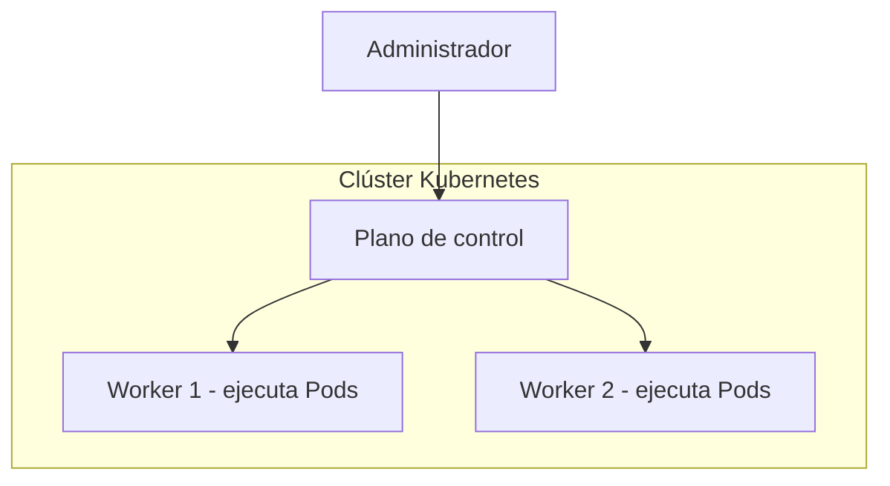
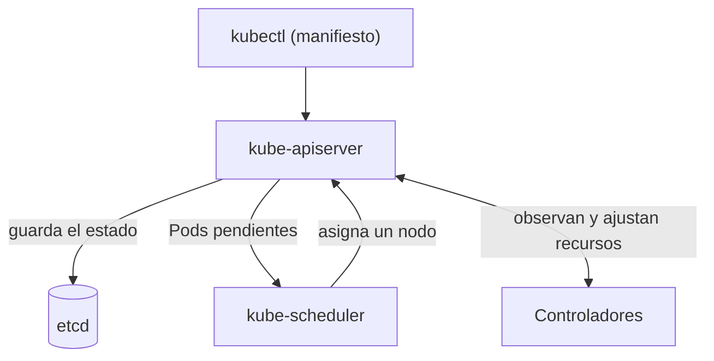
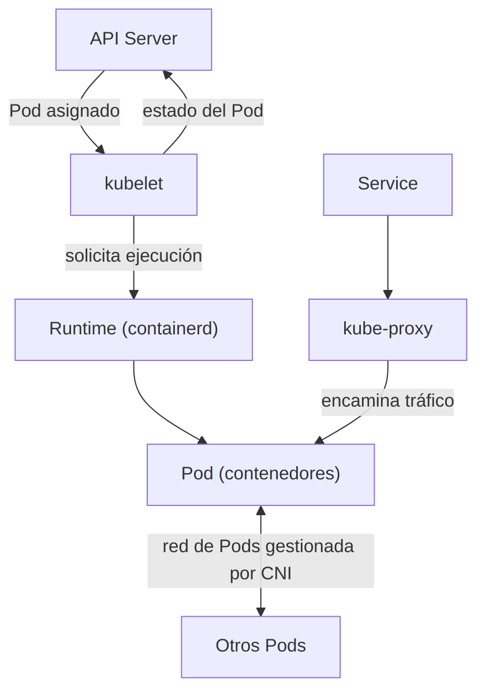

# ¿Por qué Kubernetes?

Para entender Kubernetes (K8s), es necesario visualizarlo no solo como una herramienta, sino como una **plataforma completa de orquestación** diseñada para gestionar el ciclo de vida de las aplicaciones en contenedores. En el contexto de este curso, K8s actuará como el pilar central para ilustrar la orquestación, monitorización y seguridad en entornos cloud.

## Cómo se organiza un clúster

Un clúster agrupa el **plano de control**, que coordina Kubernetes, y los **nodos de trabajo (workers)**, donde se ejecutan las aplicaciones. Esta vista muestra únicamente esa división:

El plano de control administra los nodos; las aplicaciones se ejecutan en los workers. Los siguientes diagramas amplían primero cómo se coordinan los componentes y después qué ocurre dentro de un worker.

### El Objetivo: Del Caos a la Automatización
El objetivo principal de Kubernetes es proporcionar un marco de trabajo para ejecutar sistemas distribuidos de forma resiliente. En la administración tradicional, el despliegue y la recuperación ante fallos solían ser procesos manuales o basados en scripts específicos. Kubernetes soluciona esto mediante la **configuración declarativa**: el administrador define el "estado deseado" y la plataforma se encarga de alcanzarlo y mantenerlo automáticamente.

Al enviar un manifiesto con `kubectl`, el **API Server** recibe la petición y guarda el estado del clúster en `etcd`. El Scheduler decide en qué nodo colocar los Pods pendientes, y los controladores comprueban que el estado observado coincida con el solicitado:

Así, si el estado real deja de coincidir con el deseado, los controladores solicitan cambios a través del API Server. Este ciclo de observación y ajuste es la base de la automatización y la auto-reparación.

### Beneficios Clave para la Administración de Sistemas
A diferencia de otras formas de gestión de servicios, Kubernetes ofrece ventajas nativas que reducen la carga operativa:

*   **Auto-reparación (Self-healing):** El sistema reinicia contenedores que fallan, reemplaza y reagenda contenedores cuando los nodos mueren, y mata aquellos que no responden a los chequeos de salud definidos por el usuario.
*   **Descubrimiento de servicios y Balanceo de carga:** Kubernetes puede exponer un contenedor usando un nombre DNS o su propia dirección IP; si el tráfico es muy alto, es capaz de balancear la carga para que el despliegue sea estable.
*   **Orquestación de Almacenamiento:** Permite montar automáticamente el sistema de almacenamiento que prefieras. En nuestro laboratorio, esto se traduce en la capacidad de gestionar volúmenes compartidos mediante **CephFS** de forma transparente para las aplicaciones.
*   **Gestión de Cargas de Trabajo (Workloads):** Facilita la ejecución tanto de aplicaciones **stateless** (sin estado) mediante Deployments, como de aplicaciones **stateful** (con estado) que requieren persistencia y una identidad única, como bases de datos.

### Qué ocurre dentro de un worker

Cuando el plano de control asigna un Pod a un nodo, el `kubelet` de ese worker solicita al runtime —por ejemplo, `containerd`— que ejecute sus contenedores. El `kubelet` comunica el estado del Pod al API Server. Para el tráfico de red, `kube-proxy` implementa el encaminamiento de los Services y el plugin CNI, como Calico en el laboratorio, proporciona conectividad entre Pods:

### Comparativa: Gestión Tradicional vs. Kubernetes
Mientras que en la gestión tradicional de servidores (o incluso en el uso de contenedores aislados) el administrador debe preocuparse por en qué máquina específica corre cada servicio, Kubernetes introduce una capa de abstracción sobre la infraestructura:

| Característica | Gestión Tradicional / Scripting | Gestión con Kubernetes |
| :--- | :--- | :--- |
| **Despliegue** | Manual o imperativo paso a paso. | Declarativo (se define el estado final). |
| **Escalabilidad** | Requiere intervención manual para añadir instancias. | Soporta escalado horizontal manual y automático (HPA). |
| **Actualizaciones** | Riesgo de tiempo de inactividad durante el cambio. | Permite **Rolling Updates** (actualizaciones progresivas) y retrocesos (rollbacks). |
| **Infraestructura** | Ligada a máquinas específicas. | Abstrae los nodos (como vuestro clúster de 3 nodos) en un único pool de recursos. |

### Seguridad y Ecosistema Cloud Native
Uno de los factores innovadores de Kubernetes es su enfoque en la **seguridad cloud-native**, proporcionando estándares y políticas para controlar el acceso a la API y proteger las cargas de trabajo. Además, al ser un proyecto de código abierto con una comunidad masiva, permite extender sus funcionalidades mediante plugins para redes (como **Calico**, que usaremos en las prácticas) y almacenamiento.

Esta plataforma no solo busca ejecutar aplicaciones, sino garantizar que estas sean **portátiles y extensibles**, permitiendo que lo que aprendáis en vuestro clúster de laboratorio sea aplicable en cualquier proveedor de nube pública o privada.