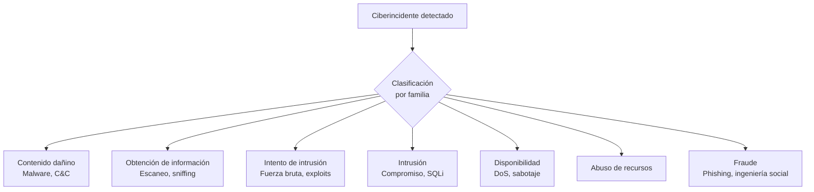
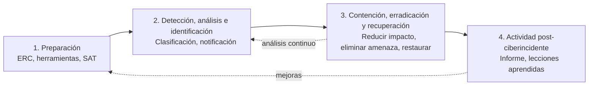
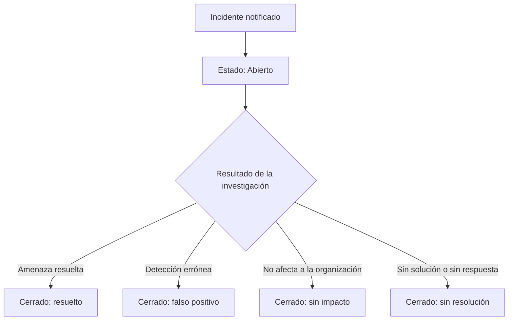

# Gestión de ciberincidentes según CCN-STIC 817

## 🎯 Qué aprenderás

- ✅ Entender la **definición y clasificación de incidentes de seguridad** (ciberincidentes).
- ✅ Describir el **procedimiento de detección y reporte de incidentes**.
- ✅ Explicar el **plan de respuesta a incidentes (fases: contención, erradicación, recuperación)** y el ciclo completo.
- ✅ Valorar la **peligrosidad** y el **impacto** para priorizar la respuesta.
- ✅ Conocer la **normativa CCN-STIC 817 para gestión de incidentes** y su relación con ISO/IEC 27035-1.
- ✅ Explicar cómo se notifica, se siguen los estados y se custodian las **evidencias**.

## 📖 Definición y clasificación de incidentes de seguridad

Un **ciberincidente** es, según la guía **CCN-STIC 817**, sinónimo de **incidente de seguridad de la información**: cualquier evento que comprometa la confidencialidad, integridad o disponibilidad de la información o de los servicios.

> **💡 Definición clave**
> **Definición y clasificación de incidentes de seguridad**: un ciberincidente es un evento adverso que afecta a la seguridad de la información. La **clasificación** permite priorizar la respuesta según la gravedad.

El **Esquema Nacional de Seguridad (ENS)** exige a las entidades públicas (art. 12 y anexo II):

- Disponer de un sistema de **detección y reacción frente a código dañino**.
- **Registrar los incidentes** y las acciones de tratamiento seguidas.
- Usar esos registros para la **mejora continua**.

La norma internacional **ISO/IEC 27035-1:2023** plantea lo mismo con enfoque genérico: un método estructurado para **prepararse, detectar, notificar, evaluar y responder** a incidentes, y para **aplicar las lecciones aprendidas**.

### Taxonomía: familias de incidentes (CCN-STIC 817)

No todos los incidentes se tratan igual. La guía agrupa los incidentes en **familias** según el tipo de amenaza:

| Familia | Ejemplos |
|---|---|
| **Contenido dañino** | Sistema infectado, servidor de mando y control (C&C), distribución de malware |
| **Obtención de información** | Escaneo de redes, *sniffing* |
| **Intento de intrusión** | Explotación de vulnerabilidades conocidas, intentos de acceso por fuerza bruta |
| **Intrusión** | Compromiso de cuentas o aplicaciones (p. ej. inyección SQL), robo físico |
| **Disponibilidad** | Denegación de servicio (DoS/DDoS), sabotaje, fallo de suministro eléctrico |
| **Abuso de recursos** | Uso no autorizado de capacidad de proceso, almacenamiento o red |
| **Fraude** | Suplantación de identidad (*phishing*, *spear phishing*), ingeniería social |
| **Otro** | Incidentes que no encajan en las anteriores |

## 🔍 Procedimiento de detección y reporte de incidentes

La **detección** puede provenir de:

- **Fuentes internas**: sistemas de monitorización (SIEM, IDS/IPS), antivirus/EDR, reportes de usuarios, análisis de logs.
- **Fuentes externas**: **Sistemas de Alerta Temprana (SAT)** del CCN-CERT, notificaciones de terceros, inteligencia de amenazas (*threat intelligence*).

> **💡 Precursores vs Indicadores**
> - **Precursor**: señal de un incidente **futuro** (ej. reconocimiento previo, escaneo de puertos).
> - **Indicador**: señal de un incidente **posible o en curso** (ej. alerta de malware, conexión sospechosa).

### Flujo de reporte (notificación)

Una vez detectado, se sigue el **procedimiento de detección y reporte**:

1. **Registro inmediato** en el sistema de gestión (p. ej. **LUCIA** del CCN-CERT).
2. **Clasificación** preliminar por familia y gravedad.
3. **Notificación** al CERT de referencia (en sector público: **CCN-CERT**) mediante modelo de **ventanilla única**.
4. **Activación** del Equipo de Respuesta a Ciberincidentes (ERC).

> **⚠️ Importante**
> La notificación temprana permite al CCN-CERT correlacionar campañas y alertar a otras entidades adheridas a sus sistemas de alerta.

## 🛡️ Plan de respuesta a incidentes (fases: contención, erradicación, recuperación)

La **CCN-STIC 817** estructura la respuesta en **cuatro fases** (ciclo de vida):

### Detalle de cada fase

#### 1. Preparación
- Crear y formar el **Equipo de Respuesta a Ciberincidentes (ERC)**.
- Dotar de herramientas (SIEM, EDR, forense, sandbox).
- Desplegar medidas según análisis de riesgos.
- Adherirse a los **Sistemas de Alerta Temprana (SAT)** del CCN-CERT.

#### 2. Detección, análisis e identificación
- Descubrir la amenaza (internamente o vía sondas CCN-CERT).
- **Clasificar** el incidente (familia, origen, sistemas afectados).
- Activar **notificaciones** necesarias (ventanilla única → CCN-CERT).

#### 3. Contención, erradicación y recuperación (el núcleo de la respuesta)

> **💡 Plan de respuesta a incidentes (fases: contención, erradicación, recuperación)**
> Esta fase se ejecuta en **orden estricto**: primero contener, luego erradicar, finalmente recuperar.

| Subfase | Objetivo | Acciones típicas |
|---|---|---|
| **Contención** | **Reducir el impacto** inmediato | Aislar sistemas afectados, bloquear IPs maliciosas, deshabilitar cuentas comprometidas, activar *failover* |
| **Erradicación** | **Eliminar la amenaza** | Eliminar malware, cerrar vulnerabilidades explotadas, revocar credenciales robadas, limpiar persistencia |
| **Recuperación** | **Restaurar el servicio** normal | Reconstruir sistemas desde copias limpias, verificar integridad, monitorizar tras restablecimiento |

> **⚠️ Importante**
> El **análisis continúa** durante la contención: entender al atacante ayuda a erradicar mejor. No se recupera hasta estar seguro de que la amenaza se ha eliminado.

#### 4. Actividad post-ciberincidente
- Emitir **informe de cierre** con: causa raíz, coste, acciones tomadas, impacto.
- Para niveles **alto, muy alto, crítico**: informe obligatorio con nivel final de peligrosidad, acciones de contención/erradicación/recuperación, impacto (sistemas, tiempo, coste, reputación).
- Aplicar **lecciones aprendidas**: actualizar defensas, procedimientos, formación.
- Remitir resumen anual al CCN-CERT.

## ⚠️ Valoración de peligrosidad e impacto

### Peligrosidad (gravedad potencial)

La **peligrosidad** se valora en **5 niveles** (bajo → crítico) según:
- Tipo y origen de la amenaza.
- Categoría de sistemas afectados.
- Perfil y privilegios de usuarios implicados.
- Número de sistemas afectados.
- Requisitos legales.

### Impacto (consecuencias reales)

El **impacto** se mide con criterios objetivos:
- % de sistemas afectados.
- Tiempo de interrupción del servicio.
- Jornadas-persona para resolver.
- Impacto económico.
- Extensión geográfica.
- Daño reputacional.

> **💡 Ejemplo: Nivel Crítico**
> Interrupción > 24 h que afecta a > 50 % de los usuarios.

## 📋 Notificación, estados y seguimiento (LUCIA)

La notificación sigue **ventanilla única**: la víctima reporta a su CERT de referencia (público → **CCN-CERT**).

### Estados del incidente en LUCIA

### Plazos de cierre automático (sin respuesta)

| Nivel | ¿Notificar al CCN-CERT? | Cierre automático (días) |
|---|---|---|
| **Crítico** | Sí | 120 |
| **Muy alto** | Sí | 90 |
| **Alto** | Sí | 45 |
| **Medio** | No | 30 |
| **Bajo** | No | 21 |

**LUCIA** es la herramienta del CCN-CERT con sistema de tickets para documentar cada acción (detección, contención, erradicación, recuperación).

## 🔐 Evidencias y custodia

Recoger **evidencias** sirve para resolver el incidente y, a veces, para acciones legales:

1. **Empezar cuanto antes** (en la detección).
2. **Instantánea del sistema atacado** (imagen forense, memoria volátil).
3. **Aislar** el sistema garantizando integridad (cadena de custodia).
4. **Trabajar con copias**; el original queda sellado.
5. **Registro de custodia**: n.º de serie, host, MAC, IP, quién manipuló, cuándo, dónde se guarda.

> **⚠️ Importante**
> La cadena de custodia es esencial para que las evidencias sean admisibles en proceso judicial.

## 📝 Resumen

- **Definición y clasificación de incidentes de seguridad**: ciberincidente = incidente de seguridad; se clasifica en familias (contenido dañino, intrusión, disponibilidad, fraude...).
- **Procedimiento de detección y reporte**: fuentes internas/externas → registro → clasificación → notificación (ventanilla única CCN-CERT) → activación ERC.
- **Plan de respuesta a incidentes (fases: contención, erradicación, recuperación)**: ciclo de 4 fases (preparación, detección, contención/erradicación/recuperación, post-incidente) con mejora continua.
- **Peligrosidad** (5 niveles) e **impacto** (criterios objetivos) permiten priorizar.
- **Notificación y seguimiento** en **LUCIA**; plazos de cierre automático según nivel.
- **Evidencias**: recoger pronto, custodiar con registro, trabajar con copias.
- **Normativa CCN-STIC 817 para gestión de incidentes**: guía del ENS; complementada por **ISO/IEC 27035-1** (estándar internacional).

## 🔑 Conceptos clave

- **Ciberincidente:** Incidente de seguridad de la información.
- **Precursor / Indicador:** Señal de incidente futuro / de incidente posible o en curso.
- **Peligrosidad:** Nivel de gravedad potencial (bajo, medio, alto, muy alto, crítico).
- **Impacto:** Consecuencias reales sobre funciones, activos o personas.
- **ERC:** Equipo de Respuesta a Ciberincidentes.
- **LUCIA:** Herramienta del CCN-CERT para gestión y seguimiento (tickets).
- **Contención / Erradicación / Recuperación:** Subfases ordenadas de la respuesta activa.
- **Cadena de custodia:** Registro documentado de manipulación de evidencias.

## 📚 Documentación oficial

- [CCN-STIC 817 – Gestión de Ciberincidentes](https://www.ccn-cert.cni.es/publico/seriesCCN-STIC/series/800-Esquema_Nacional_de_Seguridad/817-Gestion_incidentes_seguridad/817-Gestion_incidentes_seguridad-ago12.pdf): Guía del CCN-CERT sobre la gestión de incidentes en el ENS.
- [ISO/IEC 27035-1:2023](https://www.iso.org/standard/78973.html): Norma internacional de gestión de incidentes de seguridad de la información.
- [CCN-CERT – Portal principal](https://www.ccn-cert.cni.es/): Guías, alertas y servicios de ciberseguridad.
