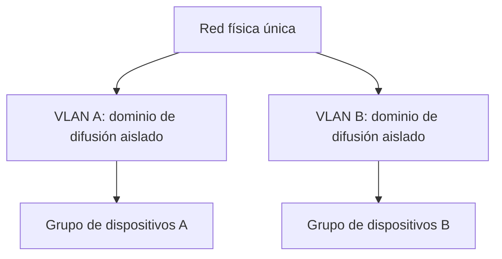
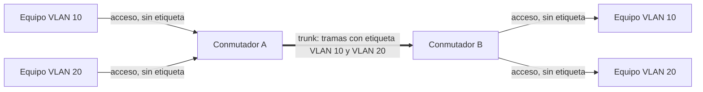
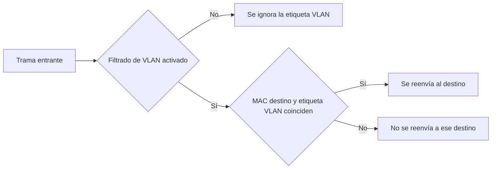

# VLANs: segmentación lógica de la red

## Qué aprenderás

- Qué es una VLAN y qué ventajas tiene frente a separar redes con cableado independiente.
- Dónde encaja una VLAN dentro del modelo de capas.
- La diferencia entre una VLAN por puerto y una VLAN por protocolo.
- Qué distingue a un puerto de acceso de un puerto trunk, y por qué los troncales necesitan etiquetas.
- Cómo funciona el etiquetado IEEE 802.1Q y su extensión 802.1ad (QinQ).
- Cómo configurar VLAN en Linux con un bridge y con interfaces `ip link ... type vlan`.

## Qué es una VLAN

Antes de entrar en detalle conviene tener clara la definición de VLAN y el contexto en el que aparece.

Una **LAN** (*Local Area Network*) es una red que cubre un espacio reducido, normalmente un edificio o un campus, y que conecta ordenadores, servidores, impresoras y otros dispositivos, ya sea por cable Ethernet o por Wi-Fi.

Una **VLAN** (*Virtual Local Area Network*) es una división lógica de una red física en varios **dominios de difusión aislados**. Dicho de otro modo: sobre una misma infraestructura creas varias redes virtuales, y cada grupo de equipos se comporta como si estuviera en su propia red física.



### Beneficios

- **Se separa por configuración, no por cableado.** No necesitas una red física distinta para cada grupo: basta con asignar los dispositivos a su VLAN.
- **Los dominios de difusión son más pequeños.** El tráfico de difusión de una VLAN no llega a las demás.
- **Puedes segmentar por función.** Por ejemplo, agrupar los servidores por un lado y los usuarios por otro, manteniéndolos separados sobre el mismo equipo.
- **Cambiar a un equipo de grupo es un cambio de configuración.** No hay que tocar el cableado.

!!! example "Ejemplo"

    Imagina una empresa con un único conmutador. Asigna los puertos de los servidores a la VLAN 10 y los de los puestos de trabajo a la VLAN 20. Todos comparten el mismo aparato, pero forman dominios de difusión distintos.

## Segmentación de redes mediante VLANs

Segmentar consiste en dividir la red en partes que se gestionan de forma independiente. Con VLAN, cada segmento tiene su propio identificador (*VLAN ID*, o VID). Dos dispositivos de VLAN distintas no se ven a nivel de enlace, aunque estén conectados al mismo conmutador. Si necesitan comunicarse, hace falta un dispositivo de capa superior, como un router, y ese router es también el lugar natural para aplicar reglas de filtrado.

## Ámbito de operación en el modelo de capas

Las VLAN trabajan en la **capa de enlace de datos (capa 2)** del modelo OSI. Lo que se etiqueta y se filtra son **tramas Ethernet**, no paquetes IP.

Quienes las gestionan son los **bridges** (puentes) y los conmutadores. Un bridge reenvía tráfico de forma transparente entre varias interfaces: une dos o más redes Ethernet físicas en una sola red Ethernet lógica y decide por dónde reenviar cada trama según la dirección MAC de destino. Como solo mira información de capa 2, le da igual qué protocolo de capa 3 viaje dentro (IP, IPv6 u otro).

El estándar **IEEE 802.1Q-2022**, *Bridges and Bridged Networks*, es el que define cómo funcionan estos puentes, incluidos los **VLAN Bridges**, es decir, los que entienden de VLAN.

## Tipos de VLAN

Lo que cambia de un tipo a otro es **cómo decide el conmutador a qué VLAN pertenece una trama que entra**.

- **VLAN por puerto:** la pertenencia depende del puerto por el que entra la trama. Las tramas sin etiqueta que llegan por ese puerto se asignan a su VLAN. En un bridge Linux, esa VLAN es el **PVID** del puerto.
- **VLAN por protocolo:** la pertenencia depende del protocolo de la trama, identificado en la capa de enlace. La enmienda IEEE 802.1v (*VLAN Classification by Protocol and Port*) define reglas para clasificar las tramas entrantes por criterios distintos del puerto de origen.

| Tipo | Criterio de pertenencia | Ejemplo |
|---|---|---|
| Por puerto | Puerto de entrada | Los equipos de los puertos 1 a 8 forman la VLAN 10 |
| Por protocolo | Protocolo de la trama | Las tramas de un protocolo concreto se asignan a una VLAN determinada |

## Tipos de puertos: acceso y trunk

- **Puerto de acceso:** pertenece a **una sola VLAN** y en él se conectan los equipos finales. El equipo no sabe nada de VLAN: envía y recibe tramas **sin etiqueta**. El conmutador asigna a cada trama que entra la VLAN del puerto y le quita la etiqueta al salir.
- **Puerto trunk (troncal):** transporta **varias VLAN a la vez** por un mismo enlace, normalmente entre dos conmutadores o entre un conmutador y un router. Las tramas viajan **etiquetadas**.



### Por qué hay que etiquetar en los enlaces troncales

Por un enlace troncal viajan mezcladas tramas de varias VLAN. Una trama Ethernet normal no indica a qué VLAN pertenece, así que el conmutador del otro extremo no sabría en qué dominio de difusión reenviarla. Por eso existe la necesidad de añadir una **etiqueta VLAN** a las tramas Ethernet en los enlaces troncales. La etiqueta se añade a cada trama: lleva el identificador de la VLAN y permite al receptor reenviarla solo dentro de la suya. Estas tramas se llaman **tramas etiquetadas** (*VLAN-tagged frames*).

!!! warning "Importante"

    La etiqueta se añade y se retira en el conmutador. Los equipos conectados a puertos de acceso no necesitan saber nada de las VLAN.

## Etiquetado IEEE 802.1Q e IEEE 802.1ad

Hay dos implementaciones de etiquetado de VLAN que conviene distinguir:

- **IEEE 802.1Q:** el estándar de etiquetado de VLAN en Ethernet. Permite crear VLAN lógicas sobre una red física y marcar las tramas con su información de VLAN.
- **IEEE 802.1ad:** conocido como **QinQ** o *Double VLAN*. Es una extensión de 802.1Q que permite **apilar varias etiquetas VLAN** en una misma trama Ethernet.

El bridge de Linux soporta ambos protocolos. Al configurarlo, los valores válidos son `0x8100` (802.1Q) y `0x88A8` (802.1ad), y el valor por defecto es 802.1Q.

!!! warning "Importante"

    Al crear una interfaz VLAN en Linux, un identificador que empiece por `0` se interpreta como octal, y uno que empiece por `0x` como hexadecimal. Escribe siempre el VLAN ID sin ceros a la izquierda.

## VLAN en Linux: filtrado en un bridge

El bridge de Linux puede tener en cuenta la VLAN a la hora de reenviar tramas. Esa función se llama **filtrado de VLAN** (*VLAN filtering*) y viene **desactivada por defecto**:

- **Desactivado:** el bridge ignora la etiqueta VLAN al procesar las tramas.
- **Activado:** el bridge reenvía cada trama solo si coinciden la **dirección MAC de destino** y la **etiqueta VLAN**.



Para crear un bridge con el filtrado activado se usa `vlan_filtering` en `ip link add`: un valor mayor que 0 lo activa y 0 lo desactiva.

```bash
ip link add br0 type bridge vlan_filtering 1
```

### PVID: qué pasa con el tráfico sin etiquetar

El **PVID** es el identificador de VLAN que se aplica a las tramas entrantes **sin etiqueta** (y a las que solo llevan prioridad, *priority-tagged*). El bridge tiene un PVID por defecto, configurable con `vlan_default_pvid`, que corresponde a la VLAN nativa o sin etiquetar:

- Por defecto vale **1**.
- Si se fija a **0**, ningún puerto tendrá PVID por defecto y **no se aceptará tráfico sin etiquetar**.

### Puertos de acceso y trunk con `bridge vlan`

La utilidad `bridge` gestiona las VLAN de cada puerto con `bridge vlan add`. Hay dos indicadores clave:

- **`pvid`:** la VLAN indicada es el PVID de entrada, así que las tramas sin etiqueta se asignan a ella.
- **`untagged`:** la VLAN indicada sale sin etiqueta.

Un puerto con `pvid untagged` en una única VLAN se comporta como **puerto de acceso**. Un puerto con varias VLAN, sin `untagged`, las transporta etiquetadas y funciona como **puerto trunk**.

```bash
# Dos puertos dentro del bridge
ip link set eth1 master br0
ip link set eth2 master br0

# eth1: acceso a la VLAN 10 (sin etiqueta hacia el equipo)
bridge vlan add dev eth1 vid 10 pvid untagged

# eth2: trunk con las VLAN 10 y 20 (tramas etiquetadas)
bridge vlan add dev eth2 vid 10
bridge vlan add dev eth2 vid 20

# Consultar la configuración
bridge vlan show
```

## VLAN en Linux: interfaces con `ip link`

Linux permite crear una **interfaz VLAN** encima de otra interfaz, a la que llamamos «padre». La sintaxis general es:

```bash
ip link add link DEVICE name NAME type vlan [ protocol VLAN_PROTO ] id VLANID
```

Sus parámetros son:

- `link DEVICE`: interfaz sobre la que se crea la VLAN.
- `name NAME`: nombre de la nueva interfaz.
- `protocol VLAN_PROTO`: `802.1Q` o `802.1ad`.
- `id VLANID`: identificador de la VLAN.

```bash
# Crear la interfaz VLAN eth0.10 sobre eth0
ip link add link eth0 name eth0.10 type vlan id 10

# Mostrar los dispositivos VLAN
ip link show type vlan

# Eliminar la interfaz VLAN
ip link delete dev eth0.10
```

El tipo `vlan` admite argumentos opcionales que conviene conocer:

- **`reorder_hdr { on | off }`:** reordena o no las cabeceras Ethernet (por defecto, `on`). Con `on`, la cabecera VLAN se inserta justo antes de enviar el paquete al dispositivo físico y se retira antes de que llegue a la interfaz VLAN. Así se acelera el etiquetado, pero al capturar tráfico la cabecera VLAN no aparece en el paquete, lo que puede confundir.
- **`gvrp` y `mvrp`:** registran la VLAN mediante GARP VLAN Registration Protocol o Multiple VLAN Registration Protocol.
- **`loose_binding` y `bridge_binding`:** ligan el estado de la interfaz VLAN al del dispositivo físico o al de los puertos del bridge que pertenecen a esa VLAN.
- **`ingress-qos-map` y `egress-qos-map`:** asignan la prioridad de la cabecera VLAN a la prioridad interna de Linux, en formato `FROM:TO`.

Para comprobar si la tarjeta física descarga el etiquetado VLAN (*offloading*), usa `ethtool`:

```bash
ethtool -k <phy_dev> | grep tx-vlan-offload
```

## Otras funciones del bridge relacionadas con VLAN

- **Multicast por VLAN:** el bridge admite *snooping* de multicast por VLAN, pero viene desactivado por defecto.
- **Switchdev:** si el hardware lo permite, el reenvío, el filtrado y el aprendizaje de tramas pueden delegarse en el conmutador, lo que reduce la carga de la CPU.

## El estándar IEEE 802.1Q

El estándar vigente es **IEEE 802.1Q-2022**, *IEEE Standard for Local and Metropolitan Area Networks—Bridges and Bridged Networks*. Describe cómo las redes con puentes dan soporte al servicio MAC, cuáles son sus principios de funcionamiento y cómo operan los puentes MAC y los puentes VLAN, incluidas la gestión, los protocolos y los algoritmos. Se publicó el 22 de diciembre de 2022 y sustituye a 802.1Q-2018.

Lo desarrolla el **grupo de trabajo IEEE 802.1**, que se ocupa de la arquitectura y la interconexión de redes LAN y MAN, de la seguridad 802 y de la gestión de red. Los estándares 802 pueden descargarse gratis seis meses después de su publicación inicial.

## Resumen

- Una VLAN divide una red física en dominios de difusión aislados mediante configuración, sin tocar el cableado.
- Las VLAN operan en la capa de enlace (capa 2) y las gestionan bridges y conmutadores.
- En las VLAN por puerto la asignación depende del puerto de entrada; en las VLAN por protocolo, del protocolo de la trama.
- Un puerto de acceso pertenece a una VLAN y usa tramas sin etiqueta; un puerto trunk transporta varias VLAN con etiquetas.
- Los troncales necesitan etiquetas porque por ellos viajan tramas de varias VLAN, y el receptor debe saber a cuál pertenece cada una.
- 802.1Q etiqueta las tramas; 802.1ad (QinQ) permite apilar varias etiquetas.
- En Linux, el filtrado de VLAN del bridge viene desactivado por defecto, el PVID por defecto es 1 y las interfaces VLAN se crean con `ip link add ... type vlan id N`.

## Conceptos clave

- **VLAN:** segmentación lógica de una red física en dominios de difusión aislados.
- **VLAN por puerto:** la pertenencia depende del puerto de entrada.
- **VLAN por protocolo:** la pertenencia depende del protocolo de la trama.
- **Puerto de acceso:** puerto de una sola VLAN que usa tramas sin etiqueta.
- **Puerto trunk:** puerto que transporta varias VLAN con tramas etiquetadas.
- **Trama etiquetada:** trama Ethernet marcada con información de VLAN.
- **IEEE 802.1Q:** estándar de etiquetado de VLAN en Ethernet.
- **IEEE 802.1ad (QinQ):** extensión que apila varias etiquetas VLAN en una trama.
- **Bridge:** dispositivo de capa 2 que reenvía tramas entre interfaces según la MAC de destino.
- **Filtrado de VLAN:** función del bridge que tiene en cuenta la etiqueta VLAN al reenviar; desactivada por defecto.
- **PVID:** VLAN aplicada a los paquetes entrantes sin etiqueta; por defecto, 1.

## Documentación oficial

- [Grupo de trabajo IEEE 802.1](https://www.ieee802.org/1/): misión del grupo, proyectos activos y acceso gratuito a los estándares 802.
- [IEEE 802.1Q-2022](https://standards.ieee.org/ieee/802.1Q/10323/): ficha del estándar de puentes y redes con puentes, con su estado y enmiendas.
- [Linux Kernel: Ethernet Bridging](https://www.kernel.org/doc/html/latest/networking/bridge.html): funcionamiento del bridge Linux, filtrado de VLAN y atributos de configuración.
- [ip-link(8)](https://man7.org/linux/man-pages/man8/ip-link.8.html): manual de `ip link`, con la sintaxis de interfaces VLAN y bridge y ejemplos.
- [bridge(8)](https://man7.org/linux/man-pages/man8/bridge.8.html): manual de la utilidad `bridge`, con `bridge vlan add`, `pvid` y `untagged`.
