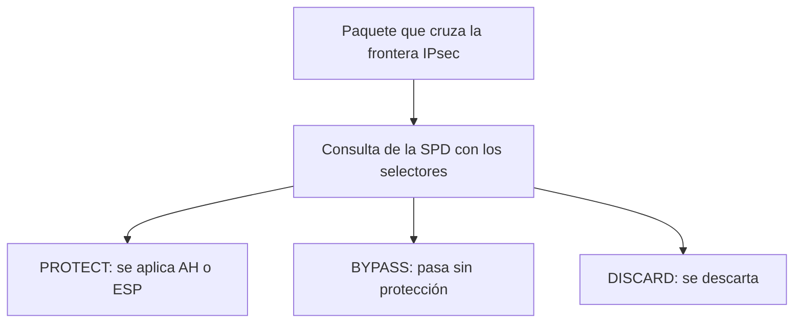
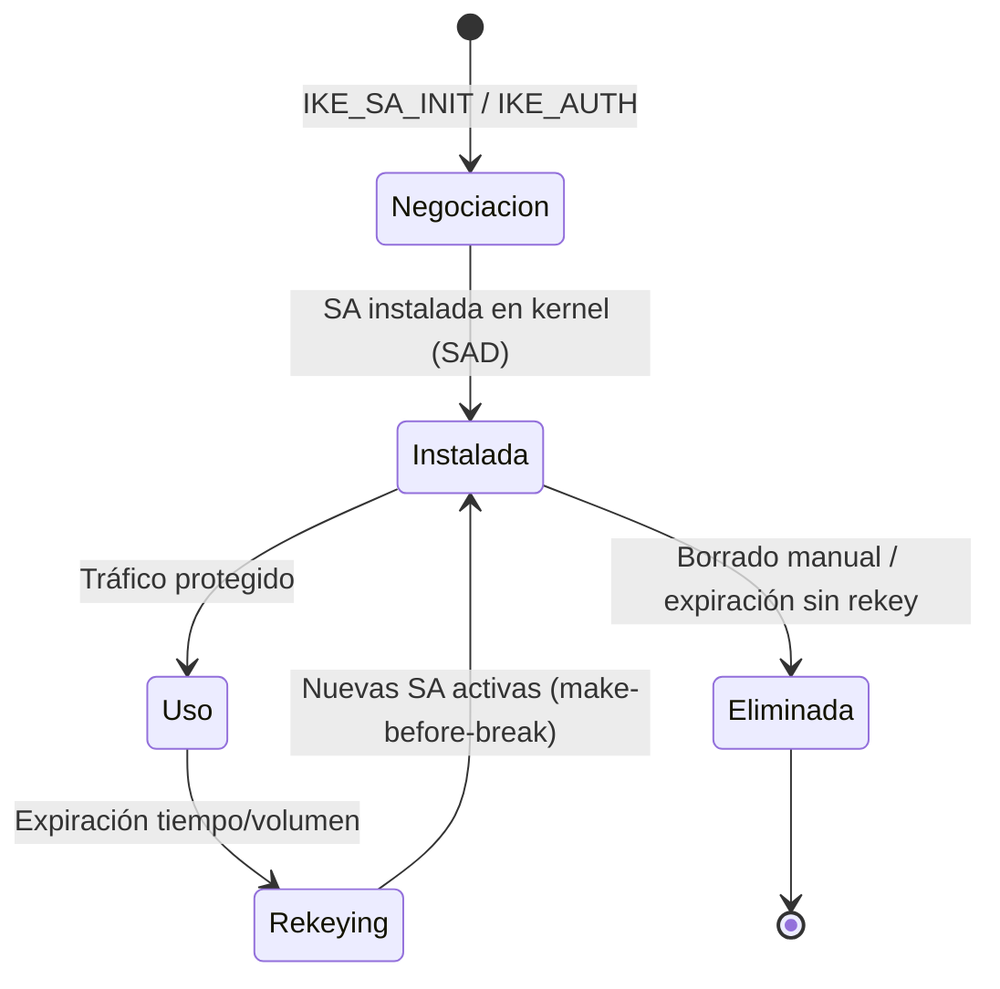
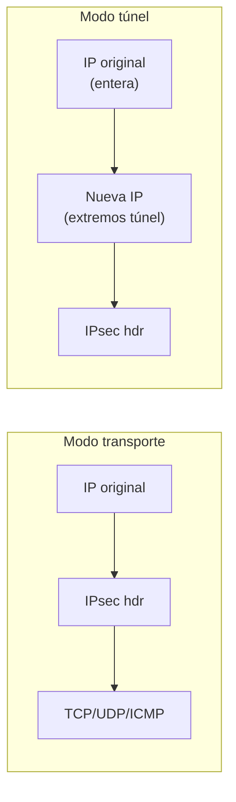
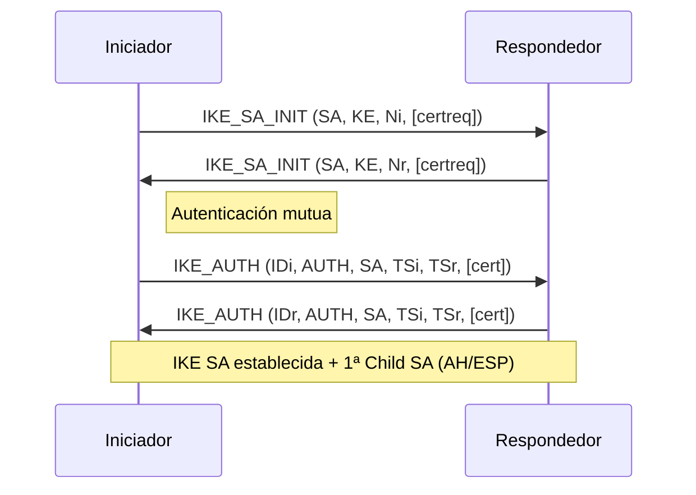
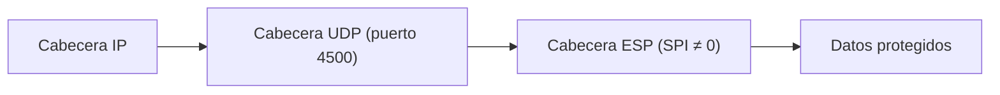

# Protocolo IPsec. Implementación de VPN con IPsec

## Qué aprenderás

- Qué es **IPsec** y qué servicios de seguridad ofrece a nivel IP.
- Cómo decide IPsec qué hacer con cada paquete: **SPD** y **Security Associations (SA)**.
- Qué diferencia hay entre los **modos transporte y túnel**, y entre **AH y ESP**.
- Cómo negocian claves y SA los dos extremos con **IKEv2** (`IKE_SA_INIT` e `IKE_AUTH`).
- Cómo atraviesa IPsec un **NAT** (NAT-T, UDP 4500).
- **Gestión de asociaciones de seguridad (SA)**: ciclo de vida, SAD, expiración, rellaveo.
- **Configuración e implementación con strongSwan**: archivos `swanctl.conf`, comandos `swanctl`, escenarios típicos.

---

## Qué es IPsec

**IPsec** es un conjunto de estándares que protege el tráfico **en la capa IP**, tanto en IPv4 como en IPv6. Ofrece:

- **Confidencialidad** (cifrado).
- **Integridad** de datos.
- **Autenticación** del origen.
- **Control de acceso** (políticas de filtrado).

Para ello combina cuatro piezas:

| Componente | Función |
|---|---|
| **Protocolos de seguridad** | **AH** (*Authentication Header*) y **ESP** (*Encapsulating Security Payload*) |
| **Security Associations (SA)** | El «contrato» que define cómo se protege un flujo (simplex, un sentido) |
| **Gestión de claves** | Manual o automática mediante **IKE** (*Internet Key Exchange*) |
| **Algoritmos criptográficos** | Cifrado (AES-GCM, ChaCha20-Poly1305) e integridad (HMAC-SHA256) |

IPsec puede funcionar en:
- Un **equipo final** (*host-to-host*).
- Una **pasarela de seguridad** (*security gateway*: router o firewall con IPsec) — modo *site-to-site*.
- Un dispositivo independiente — *host-to-gateway* (acceso remoto).

!!! note "Nota"
    Si necesitas recordar qué es una VPN, repasa antes [VPN](05-vpn.md).

---

## La frontera IPsec y la política (SPD)

IPsec traza una **frontera** entre la zona protegida y la no protegida. Cada paquete que la cruza se compara con la **SPD** (*Security Policy Database*), la base de datos de políticas que mantiene el administrador. Según los **selectores** (direcciones IP, puertos, protocolo), la política decide:

- **PROTECT:** Aplicar servicios IPsec (AH o ESP).
- **DISCARD:** Descartar el paquete.
- **BYPASS:** Dejarlo pasar sin protección IPsec.



La granularidad la decides tú: un único túnel para todo el tráfico entre dos pasarelas, o uno distinto por conexión TCP.

---

## Security Associations (SA) — Gestión de asociaciones de seguridad

Una **SA** (*Security Association*) es una «conexión» **simplex** (un solo sentido) que da servicios de seguridad al tráfico que transporta.

### Reglas básicas de las SA

- Una SA usa **AH** o **ESP**, nunca ambos. Para ambos, se necesitan **dos SA coordinadas**.
- Comunicación bidireccional = **dos SA** (una por sentido). IKE crea los pares directamente.
- Las SA de un mismo par deben ser del **mismo modo** (transporte o túnel).
- El **SPI** (*Security Parameters Index*, 32 bits) identifica la SA en tráfico unicast.
- El receptor busca la SA en la **SAD** (*SA Database*) por SPI (+ direcciones si procede); si no la encuentra, descarta el paquete y audita el evento.

### Gestión de asociaciones de seguridad (SA): ciclo de vida

| Fase | Descripción |
|---|---|
| **Creación** | IKEv2 negocia y crea la *IKE SA* (fase 1) y las *Child SA* (fase 2, AH/ESP). |
| **Instalación** | Las SA se instalan en el kernel (SAD) y en la SPD se referencia la política. |
| **Uso** | El tráfico saliente usa la SA para cifrar/firmar; el entrante la busca por SPI. |
| **Expiración** | Por **tiempo** (ej. 1 h, 8 h) o por **volumen** (ej. 100 GB). Antes de expirar, IKE inicia **rellaveo** (*rekeying*). |
| **Rellaveo (rekeying)** | Se negocian nuevas SA (*make-before-break*); las antiguas se borran tras confirmar las nuevas. |
| **Eliminación** | Borrado de la SAD y actualización de SPD; puede ser manual (`swanctl --terminate`) o automático. |

!!! warning "Importante"
    La **gestión de asociaciones de seguridad (SA)** correcta evita interrupciones: el *rekeying* *make-before-break* garantiza continuidad del túnel sin pérdida de paquetes.



---

## Modos de uso: transporte y túnel

Tanto AH como ESP admiten dos modos:

### Modo transporte

La cabecera IPsec se inserta **tras la cabecera IP original** y antes del protocolo de capa superior (TCP, UDP, ICMP...). Protege la **carga útil** (capa superior). Se usa típicamente **host-to-host**.

### Modo túnel

El **paquete IP original se protege entero** y se coloca dentro de uno nuevo:

- Cabecera **interna**: direcciones reales de origen/destino.
- Cabecera **externa**: direcciones de los extremos del túnel (dos pasarelas).

Se usa en **site-to-site** (pasarela a pasarela) y **host-to-gateway** (acceso remoto). Permite IP internas y externas de versión distinta (IPv4 sobre IPv6 y viceversa).



---

## Protocolos AH y ESP

| Característica | **AH** (RFC 4302) | **ESP** (RFC 4303) |
|---|---|---|
| **Servicios** | Integridad + autenticación origen | **Integridad + autenticación + cifrado** (confidencialidad) |
| **Cifrado** | No | Sí (AES-GCM, ChaCha20-Poly1305, etc.) |
| **Cobertura integridad** | Cabecera IP + payload (excepto campos mutables) | Solo payload + cabecera ESP |
| **NAT traversal** | No compatible (protege IP externa) | Compatible con NAT-T (UDP 4500) |
| **Obligatoriedad** | Opcional | **Obligatorio** de implementar |
| **Número de protocolo IP** | 51 | 50 |

!!! tip "En la práctica"
    **ESP es el estándar de facto**. AH apenas se usa hoy porque no soporta NAT y no cifra. ESP en modo túnel con AES-GCM (AEAD) da integridad + confidencialidad en una sola pasada.

---

## IKEv2: Negociación de claves y SA

**IKEv2** (*Internet Key Exchange v2*, RFC 7296) es el protocolo actual para negociar SA de forma automática. Mejora a IKEv1: menos mensajes, mejor NAT-T, movilidad (MOBIKE), EAP.

### Intercambio básico (4 mensajes)



- **IKE_SA_INIT**: Diffie-Hellman (KE), nonces (Ni, Nr), propuesta de algoritmos.
- **IKE_AUTH**: Autenticación (firma digital, PSK, EAP), identidades (IDi/IDr), **selectores de tráfico** (TSi/TSr = qué tráfico protege la Child SA).
- Resultado: **IKE SA** (canal de control) + **1ª Child SA** (AH/ESP para datos).

### Child SA adicionales

Para más selectores de tráfico, se usa **CREATE_CHILD_SA** (request/response) sobre la IKE SA existente.

---

## NAT-T: IPsec a través de NAT

El **NAT** rompe IPsec porque modifica direcciones/puerto que AH protege y ESP no espera. Solución: **NAT-Traversal (NAT-T**, RFC 3947/3948).

### Dos pasos

1. **Detectar el NAT** (en `IKE_SA_INIT`):
   - Cada extremo envía *hashes* de su IP/puerto (payloads `NAT_DETECTION_SOURCE_IP` y `NAT_DETECTION_DESTINATION_IP`).
   - Si los hashes no coinciden con lo que ve el receptor → hay NAT.
   - El extremo detrás del NAT debe enviar *keepalives* UDP.

2. **Encapsular en UDP 4500**:
   - Todo el tráfico (IKE + ESP) va por **UDP 4500**.
   - ESP va tras cabecera UDP; SPI ≠ 0 distingue ESP de IKE.
   - IKE en puerto 4500 lleva 4 bytes a cero (*Non-ESP Marker*).
   - *Keepalive* NAT = paquete UDP con un octeto `0xFF` (se ignora).
   - **Nunca** sobre puerto 500.



!!! warning "Importante"
    NAT-T solo funciona con **IKE** (no con claves manuales) y **excluye a AH** (AH protege direcciones que el NAT altera).

---

## Configuración e implementación con strongSwan

**strongSwan** es la implementación IPsec/IKEv2 de facto en Linux. Usa el subsistema **XFRM** del kernel y gestiona la configuración mediante **`swanctl`** (v5.9+) y el archivo **`swanctl.conf`**.

### Archivos clave

| Archivo | Función |
|---|---|
| `swanctl.conf` | Configuración principal: conexiones, secrets, pools, autoridades. |
| `swanctl` | Herramienta CLI: cargar config, iniciar/parar, consultar estado. |
| `charon` | Demonio IKE (userspace) que negocia y gestiona SA. |
| Kernel XFRM | Motor de cifrado/des cifrado y lookup de SA/SAD/SPD. |

### Estructura básica de `swanctl.conf`

```ini
connections {
    # --- Site-to-site (modo túnel) ---
    oficina-madrid {
        version = 2
        local_addrs  = 203.0.113.10      # IP pública local
        remote_addrs = 198.51.100.20     # IP pública remota
        local {
            auth = pubkey
            certs = oficina-madrid.pem
            id = "CN=oficina-madrid,O=MiEmpresa"
        }
        remote {
            auth = pubkey
            id = "CN=oficina-barcelona,O=MiEmpresa"
        }
        children {
            red-oficinas {
                local_ts  = 10.10.0.0/16     # Red local (traffic selector)
                remote_ts = 192.168.20.0/24  # Red remota
                esp_proposals = aes256gcm16-prfsha384-ecp384
                start_action = start        # Iniciar al arrancar
                close_action = start        # Reintentar si cae
            }
        }
    }

    # --- Acceso remoto (Roadwarrior, IKEv2 + EAP) ---
    roadwarrior {
        version = 2
        local_addrs = %any
        remote_addrs = %any
        local {
            auth = pubkey
            certs = vpn-server.pem
            id = "CN=vpn.miempresa.es"
        }
        remote {
            auth = eap-mschapv2
            eap_id = %any
        }
        children {
            rw {
                local_ts = 10.10.0.0/16
                remote_ts = %dynamic
                esp_proposals = aes256gcm16-prfsha384-ecp384
                dpd_action = start
            }
        }
        pools = rw-pool
        send_certreq = yes
    }
}

secrets {
    eap-usuarios {
        id = usuario1
        secret = "password-seguro"
    }
    # Clave privada del certificado del servidor
    rsa-vpn-server {
        file = vpn-server-key.pem
    }
}

pools {
    rw-pool {
        addrs = 10.50.0.0/24   # Pool de IPs virtuales para clientes remotos
    }
}
```

### Comandos operativos `swanctl`

```bash
# Cargar configuración
swanctl --load-all

# Listar conexiones definidas
swanctl --list-conns

# Iniciar una conexión (site-to-site)
swanctl --initiate --child red-oficinas

# Ver estado de SA (IKE y Child)
swanctl --list-sas

# Ver políticas instaladas (SPD)
swanctl --list-policies

# Ver pools de direcciones
swanctl --list-pools

# Terminar una conexión
swanctl --terminate --ike oficina-madrid

# Recargar configuración tras cambios
swanctl --load-all
```

### Verificación típica

```bash
# 1. ¿Está la IKE SA establecida?
swanctl --list-sas | grep ESTABLISHED

# 2. ¿Hay Child SA (ESP) instaladas en kernel?
ip xfrm state
ip xfrm policy

# 3. ¿El tráfico fluye por el túnel?
ping -c 3 192.168.20.10   # IP en red remota

# 4. Logs en tiempo real
journalctl -u strongswan -f
```

!!! tip "Buenas prácticas strongSwan"
    - Usa **certificados (PKI)** en producción; PSK solo para laboratorios.
    - Define `dpd_action = start` y `close_action = start` para **alta disponibilidad**.
    - Limita `esp_proposals` a suites modernas AEAD (AES-GCM, ChaCha20-Poly1305).
    - Habilita **MOBIKE** (`mobike = yes`) para clientes móviles (cambio de IP).
    - Monitoriza expiraciones y *rekeyings* en logs (`charon` loglevel 2-3).

---

## Resumen

- **IPsec** protege el tráfico en la capa IP con **AH/ESP**, **SA**, **gestión de claves (IKE)** y algoritmos criptográficos.
- La **SPD** decide por paquete: **PROTECT**, **DISCARD** o **BYPASS**.
- Una **SA** es simplex (AH o ESP); bidireccional = 2 SA. El **SPI** la identifica.
- **Modo transporte** protege carga útil; **modo túnel** protege paquete IP entero.
- **ESP** (obligatorio) = integridad + cifrado; **AH** = solo integridad (casi en desuso).
- **IKEv2** negocia en 4 mensajes (`IKE_SA_INIT` + `IKE_AUTH`) y crea la primera Child SA.
- **NAT-T** detecta NAT con hashes y encapsula ESP/IKE en **UDP 4500**.
- **Gestión de asociaciones de seguridad (SA)**: creación (IKE), instalación (SAD), uso, expiración (tiempo/volumen), rellaveo (*make-before-break*), eliminación.
- **Configuración e implementación con strongSwan**: `swanctl.conf` (conexiones, secrets, pools), `swanctl` CLI, verificación con `ip xfrm state/policy`.

---

## Conceptos clave

- **IPsec:** Conjunto de estándares de seguridad en la capa IP.
- **SA (Security Association):** Conexión simplex con servicios de seguridad, identificada por el **SPI**.
- **SPD / SAD:** Base de políticas (qué hacer) y base de SA activas (cómo hacerlo).
- **SPI:** Campo de 32 bits que identifica una SA.
- **AH / ESP:** Protocolos de integridad (AH) e integridad + cifrado (ESP).
- **Modo transporte / túnel:** Protege la carga útil / protege todo el paquete IP.
- **IKEv2:** Protocolo de negociación de claves y SA (4 mensajes base).
- **Child SA:** SA de AH o ESP creada por IKE.
- **NAT-T:** Encapsulado de ESP e IKE en **UDP 4500** para cruzar NAT.
- **strongSwan:** Implementación IPsec/IKEv2 en Linux (`swanctl.conf`, `swanctl`).
- **Rekeying / Make-before-break:** Renovación de SA sin cortar el túnel.

---

## Documentación oficial

- [RFC 4301 — Arquitectura de seguridad IP](https://www.rfc-editor.org/rfc/rfc4301): SPD, SA, modos transporte y túnel, funcionamiento general de IPsec.
- [RFC 4302 — Authentication Header](https://www.rfc-editor.org/rfc/rfc4302): Formato de AH, cobertura de integridad y posicionamiento en ambos modos.
- [RFC 4303 — Encapsulating Security Payload](https://www.rfc-editor.org/rfc/rfc4303): Formato del paquete ESP, servicios y procesamiento.
- [RFC 7296 — IKEv2](https://www.rfc-editor.org/rfc/rfc7296): Intercambios iniciales, payloads, traffic selectors y NAT traversal.
- [RFC 3947 — Negociación de NAT-Traversal en IKE](https://www.rfc-editor.org/rfc/rfc3947): Detección de NAT mediante hashes y vendor ID.
- [RFC 3948 — Encapsulado UDP de ESP](https://www.rfc-editor.org/rfc/rfc3948): Formatos de paquete en UDP, marcador no-ESP y keepalive.
- [strongSwan — Introduction](https://docs.strongswan.org/docs/latest/howtos/introduction.html): Introducción a IPsec e IKEv2 con strongSwan.
- [strongSwan — Configuration Quickstart](https://docs.strongswan.org/docs/latest/config/quickstart.html): Configuración práctica de VPN IPsec (site-to-site, acceso remoto, certificados, `swanctl.conf`).
- [strongSwan — IKEv2 Configuration Examples](https://docs.strongswan.org/docs/latest/config/IKEv2.html): Colección de configuraciones IKEv2.
- [strongSwan — swanctl.conf Reference](https://docs.strongswan.org/docs/latest/swanctl/swanctlConf.html): Referencia completa de `swanctl.conf`.
