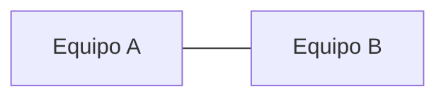

# Práctica: [Título]

## Objetivos

- [Qué serás capaz de hacer al terminar, en lenguaje llano.]

## Requisitos previos

- [Conocimientos, permisos y recursos necesarios.]

## Escenario y material

[Descripción breve del escenario.]



| Recurso | Detalle |
|---|---|
| [Sistema / máquina] | [Función en la práctica] |

> **Importante**
>
> [Riesgo, cambio persistente u operación destructiva, antes de ejecutar el paso afectado.]

## Procedimiento

### Paso 1. [Nombre]

[Qué se hace y por qué.]

```bash
[comando respaldado por la documentación oficial]
```

**Comprueba:** [Qué debes observar para saber que el paso ha funcionado.]

### Paso 2. [Nombre]

[...]

## Verificación final

- [ ] [Comprobación observable.]

## Qué debes entregar

- [Archivo, captura o resultado solicitado.]

## Limpieza

[Cómo devolver el entorno a su estado inicial.]

## Documentación oficial

- [Nombre de la documentación](https://url-oficial): [qué encontrarás].

<!--
Reglas de esta plantilla (borrar este comentario al generar):
- Texto solo para el alumnado: sin estado, fuentes internas, marcadores [POR DEFINIR], lagunas ni comentarios docentes.
- Comandos y opciones solo si los respalda la documentación oficial de la práctica; no se inventan salidas, IP, credenciales ni versiones.
- No se afirma que la práctica esté probada; el campo `probada` de practicas/unidades.yml lo decide el profesor.
- Datos del entorno que falten: se registran en el informe de trabajo y se preguntan; no se publican con marcadores.
- Extensión y diagramas: según practicas/unidades.yml.
- Trazabilidad, lagunas y dudas: trabajo/<unidad>/<practica>/informe.md (plantillas/informe_trabajo.md).
-->
