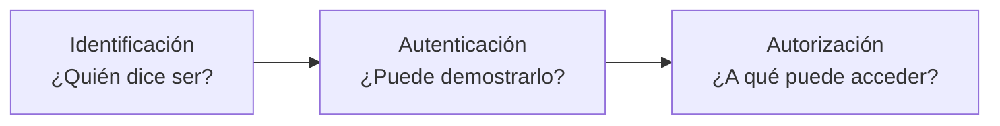
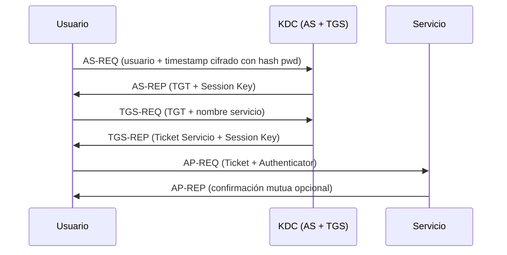

# Mecanismos y factores de autenticación

## 🎯 Qué aprenderás

- ✅ Diferenciar **identificación, autenticación y autorización**.
- ✅ Conocer los **tres factores de autenticación**: conocimiento, posesión e inherencia.
- ✅ Identificar los **ejemplos de mecanismos de autenticación** (contraseñas, tokens, biometricos) y sus **ventajas y desventajas**.
- ✅ Entender la **problemática de las contraseñas como factor único** y qué aporta el **concepto de autenticación multifactor (MFA)**.
- ✅ Conocer **ejemplos de protocolos de autenticación** (RADIUS, TACACS+, Kerberos) y su función.
- ✅ Conocer las medidas básicas para **almacenar y proteger las credenciales** de forma segura.

## 🔍 Autenticar, identificar y autorizar

Antes de conceder acceso a un sistema, hay que saber quién está al otro lado. Ese proceso se compone de tres pasos que conviene no confundir:

- **Identificación:** el usuario declara quién es, por ejemplo con un nombre de usuario.
- **Autenticación:** el sistema comprueba que el usuario es quien dice ser.
- **Autorización:** una vez comprobada la identidad, el sistema decide a qué recursos puede acceder el usuario.

## 🔑 Definición de factores de autenticación

Un **factor de autenticación** es una categoría de evidencia que el usuario puede presentar para demostrar su identidad. Existen **tres categorías de factores** (conocimiento, posesión e inherencia):

| Factor | Pregunta que responde | Ejemplos |
|---|---|---|
| **Conocimiento** (*something you know*) | ¿Qué sabe el usuario? | Contraseñas, PIN, respuestas secretas |
| **Posesión** (*something you have*) | ¿Qué tiene el usuario? | Tokens OTP, claves U2F/FIDO2, certificados, tarjetas inteligentes, SMS |
| **Inherencia** (*something you are*) | ¿Qué es el usuario? | Huella dactilar, reconocimiento facial, escáner de iris, biometría de comportamiento |

> **⚠️ Importante**
> Dos contraseñas, o una contraseña y un PIN, pertenecen al **mismo factor**: el de conocimiento. Repetir el mismo tipo de factor **no constituye autenticación multifactor**, porque un único ataque puede comprometer ambos secretos.

## 🛠️ Ejemplos de mecanismos de autenticación (contraseñas, tokens, biometricos)

Los mecanismos de autenticación se agrupan según el factor al que pertenecen. Aquí veremos los **ejemplos de mecanismos de autenticación** principales: **contraseñas**, **tokens** y **biometricos**.

### 1. Contraseñas y PIN (Factor: Conocimiento)

Las **contraseñas** y los PIN son el mecanismo más extendido porque son sencillos de implementar y no requieren hardware especial.

> **💡 Ventajas**
> - Fáciles de implementar y entender
> - No requieren hardware adicional
> - Bajo coste

> **⚠️ Desventajas**
> - El usuario tiende a elegirlas de forma predecible
> - Se reutilizan entre servicios
> - Vulnerables al *phishing* (usuario introduce el secreto en un sitio falso)
> - Vulnerables al *credential stuffing* (prueba de pares filtrados en otros sitios)

### 2. Tokens y contraseñas de un solo uso — OTP (Factor: Posesión)

Un **OTP** (*One-Time Password*) es un código que cambia constantemente y que el usuario debe introducir para autenticarse. Los **tokens** OTP pueden ser hardware (llaves físicas) o software (apps de autenticación).

> **💡 Tipos principales**
> - **TOTP** (*Time-based OTP*): basado en el tiempo (ej. Google Authenticator, Microsoft Authenticator).
> - **HOTP** (*HMAC-based OTP*): basado en un contador (ej. tokens hardware YubiKey en modo OTP).

Es un mecanismo de **posesión**, ya que el código solo puede generarlo el dispositivo o la aplicación que el usuario tiene.

> **💡 Ventajas**
> - Resistente a reutilización de credenciales
> - No requiere recordar secretos complejos

> **⚠️ Desventajas**
> - Requiere dispositivo o app (hardware/software)
> - Vulnerable a *phishing* en tiempo real (si el usuario introduce el código en sitio falso)
> - Si se pierde el dispositivo, hay que recuperar acceso (códigos de respaldo)

### 3. Certificados y tarjetas inteligentes (Factor: Posesión)

Los **certificados digitales** y las **tarjetas inteligentes** (smart cards) son mecanismos de posesión basados en claves criptográficas. La autenticación consiste en demostrar que el usuario controla la clave privada asociada al certificado.

> **💡 Ejemplo**
> La tarjeta **CAC** (Common Access Card) del Departamento de Defensa de EE. UU. o el **DNI electrónico** español.

> **💡 Ventajas**
> - Muy fuerte criptográficamente
> - Permite firma digital y cifrado

> **⚠️ Desventajas**
> - Requiere infraestructura PKI compleja
> - Hardware específico (lectores)
> - Gestión de ciclo de vida de certificados (renovación, revocación)

### 4. Biometricos (Factor: Inherencia)

Los **biometricos** son un factor de inherencia. Se basan en características físicas (huella, rostro, iris, voz) o de comportamiento (patrón de escritura, marcha).

> **💡 Ventajas**
> - Difícil de falsificar (si está bien implementada)
> - Cómoda para el usuario (no hay que recordar nada)
> - No se puede «olvidar» ni «perder" como una contraseña o token

> **⚠️ Desventajas**
> - Exige hardware específico (lector de huella, cámara IR, etc.)
> - Requiere registro previo del usuario (enrollment)
> - Almacena **datos sensibles** que son difíciles o imposibles de cambiar si se comprometen
> - Posibles falsos positivos/negativos

> **⚠️ Importante**
> La biometría **no es un secreto** (no se puede revocar como una contraseña). Se usa mejor como **segundo factor** junto con algo que el usuario sabe o tiene.

## 📊 Ventajas y desventajas de cada factor

| Factor | Ventaja principal | Desventaja principal | ¿Se puede revocar? |
|---|---|---|---|
| Conocimiento (contraseña, PIN) | Fácil, sin hardware | Phishing, reutilización, adivinanza | Sí |
| Posesión (OTP, certificado, token) | Resistente a phishing (si es FIDO2/WebAuthn) | Se puede perder/robar/romper | Sí (reemitiendo) |
| Inherencia (biometricos) | Cómodo, no se olvida | No revocable, datos sensibles, hardware | **No** |

## 🛡️ Problemática de las contraseñas como factor único

La **contraseña sola** no protege lo suficiente. Esta es la **problemática de las contraseñas como factor único**:

1. **Se roba:** *phishing*, *keyloggers*, filtraciones de bases de datos.
2. **Se reutiliza:** el usuario usa la misma en múltiples servicios (*credential stuffing*).
3. **Se adivina:** contraseñas débiles, diccionarios, fuerza bruta.
4. **No prueba posesión:** cualquiera que conozca el secreto accede.

### Concepto de autenticación multifactor (MFA)

El **concepto de autenticación multifactor (MFA)** consiste en combinar **al menos dos factores independientes** de categorías distintas (conocimiento + posesión, o conocimiento + inherencia, etc.).

> **💡 Idea clave**
> La **MFA** es la **defensa más eficaz** frente a los ataques contra contraseñas. Según Microsoft, bloquea el 99,9 % de los ataques automatizados de cuentas.

!!! tip "Buena práctica"
    Usa **FIDO2 / WebAuthn** (llaves de seguridad hardware o passkeys) cuando sea posible: son resistentes al *phishing* y no comparten secretos.

## 🌐 Ejemplos de protocolos de autenticación

Estos protocolos permiten **centralizar** la autenticación y la autorización en entornos de red:

| Protocolo | RFC | Uso principal | Característica clave |
|---|---|---|---|
| **RADIUS** | RFC 2865 | Autenticación centralizada para acceso a red (VPN, Wi-Fi 802.1X, dial-up) | Cliente-servidor, UDP, contabilidad (accounting) |
| **TACACS+** | (Cisco propietario) | Autenticación, autorización y contabilidad (AAA) para dispositivos de red (routers, switches) | TCP, separa autenticación de autorización, cifra todo el payload |
| **Kerberos** | RFC 4120 | Autenticación en red basada en tickets (SSO en dominios Windows/Unix) | KDC, tickets TGT/servicio, mutua, sin enviar contraseñas por red |
| **LDAP** | RFC 4511 | Acceso a servicios de directorio; operación *Bind* para autenticar | Jerárquico, ampliamente soportado, *simple bind* o *SASL* |
| **SAML 2.0** | OASIS | Federación de identidades (SSO empresarial, cloud) | Basado en XML, *IdP* ↔ *SP*, aserciones firmadas |
| **OIDC** | OpenID Foundation | Federación moderna sobre OAuth 2.0 (login social, SSO cloud) | JSON/REST, *ID Token* (JWT), *UserInfo* endpoint |

> **💡 Diferencia RADIUS vs TACACS+**
> - **RADIUS**: Estándar abierto, UDP, combina autenticación y autorización en una respuesta, usado en ISP y Wi-Fi empresarial.
> - **TACACS+**: Propietario de Cisco (aunque hay implementaciones abiertas), TCP, **separa** autenticación, autorización y contabilidad (AAA), cifra todo el cuerpo del paquete. Preferido para administración de dispositivos de red (CLI de routers/switches).

### Kerberos en detalle

**Kerberos** es un protocolo de autenticación basado en **tickets** emitidos por un **Centro de Distribución de Claves (KDC)**. Permite **Single Sign-On (SSO)**: el usuario se autentica una vez y obtiene un *Ticket Granting Ticket (TGT)*; con él pide *tickets de servicio* para acceder a recursos sin volver a introducir credenciales.

## 🔐 Gestión de credenciales y almacenamiento seguro

Las credenciales deben protegerse tanto en su almacenamiento como en su verificación:

- **No almacenar contraseñas en claro.** Deben guardarse como **hash** calculado con funciones lentas y adaptativas, como **Argon2id** (recomendado), **bcrypt** o **PBKDF2**.
- **Añadir una *sal* única** a cada contraseña. La *sal* impide usar tablas precalculadas (*rainbow tables*) y obliga a atacar cada hash por separado.
- **Limitar los intentos fallidos.** El **bloqueo de cuenta** impide nuevos intentos durante un tiempo tras un número determinado de fallos. El contador debe asociarse a la cuenta y no solo a la dirección IP de origen, para que un atacante no pueda evitarlo cambiando de IP. Además, el bloqueo debe diseñarse para que no pueda usarse para bloquear a otros usuarios (DoS por bloqueo).
- **Registrar los eventos de autenticación.** Conviene registrar y revisar los bloqueos y los fallos de autenticación para detectar ataques.
- **Usar gestores de contraseñas** para generar y almacenar contraseñas únicas y fuertes por servicio.

## 📝 Resumen

- La **autenticación** comprueba la identidad; la **autorización** decide qué puede hacer el usuario una vez identificado.
- Existen **tres factores**: **conocimiento** (qué sabes), **posesión** (qué tienes) e **inherencia** (qué eres).
- **Ejemplos de mecanismos de autenticación**: **contraseñas**/PIN (conocimiento), **tokens** OTP/certificados (posesión), **biometricos** (inherencia).
- **Ventajas y desventajas de cada factor**: conocimiento (fácil pero débil), posesión (fuerte pero requiere hardware), inherencia (cómodo pero no revocable).
- **Problemática de las contraseñas como factor único**: se roban, reutilizan y adivinan.
- **Concepto de autenticación multifactor (MFA)**: combina factores independientes; es la defensa más eficaz.
- **Ejemplos de protocolos**: RADIUS, TACACS+, Kerberos, LDAP, SAML, OIDC.
- Las credenciales se almacenan como **hash lento con sal única**, y los intentos fallidos se **limitan y registran**.

## 🔑 Conceptos clave

- **Autenticación:** Proceso que comprueba que un usuario es quien dice ser.
- **Autorización:** Decisión sobre los recursos a los que puede acceder un usuario ya autenticado.
- **Factor de autenticación:** Categoría de evidencia de identidad (conocimiento, posesión o inherencia).
- **MFA:** Autenticación que exige al menos dos factores independientes.
- **OTP:** Contraseña de un solo uso que cambia con el tiempo (TOTP) o con cada uso (HOTP).
- **Sal (*salt*):** Valor aleatorio y único que se añade a cada contraseña antes de calcular su hash.
- **Relleno de credenciales (*credential stuffing*):** Ataque que prueba pares de usuario y contraseña obtenidos de filtraciones de otros sitios.
- **FIDO2 / WebAuthn:** Estándar de autenticación sin contraseña resistente al *phishing*.
- **RADIUS / TACACS+ / Kerberos:** Protocolos de autenticación centralizada en red.

## 📚 Documentación oficial

- [NIST SP 800-63B-4 – Authentication and Authenticator Management](https://csrc.nist.gov/pubs/sp/800/63/B/4/final): Factores de autenticación, contraseñas y autenticadores.
- [OWASP – Multifactor Authentication Cheat Sheet](https://cheatsheetseries.owasp.org/cheatsheets/Multifactor_Authentication_Cheat_Sheet.html): Factores, ventajas e inconvenientes de la MFA.
- [OWASP – Password Storage Cheat Sheet](https://cheatsheetseries.owasp.org/cheatsheets/Password_Storage_Cheat_Sheet.html): Almacenamiento seguro de contraseñas.
- [OWASP – Credential Stuffing Prevention Cheat Sheet](https://cheatsheetseries.owasp.org/cheatsheets/Credential_Stuffing_Prevention_Cheat_Sheet.html): Ataques de reutilización de credenciales.
- [IETF RFC 2865 – RADIUS](https://www.rfc-editor.org/rfc/rfc2865.html): Protocolo de autenticación centralizada.
- [IETF RFC 4120 – Kerberos V5](https://www.rfc-editor.org/rfc/rfc4120.html): Protocolo de autenticación basado en tickets.
- [IETF RFC 4511 – LDAP](https://www.rfc-editor.org/rfc/rfc4511.html): Protocolo de acceso a servicios de directorio.
- [FIDO Alliance – FIDO2](https://fidoalliance.org/fido2/): Autenticación sin contraseña.
