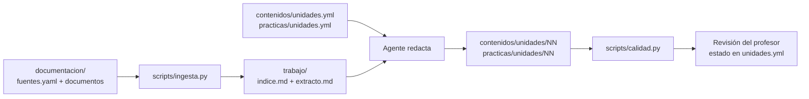

# Sistema de producción de materiales docentes

Estructura de trabajo para que un agente de IA en Visual Studio Code (o similar) genere apuntes y prácticas en Markdown a partir de documentación proporcionada por el docente.

## Principios

- **Las fuentes mandan**: no inventar contenido ni completar lagunas con conocimiento general sin autorización.
- **Trazabilidad**: identificar qué fuentes sustentan cada apartado importante.
- **Separación de responsabilidades**: contenidos teóricos, prácticas y publicación se gestionan por separado.
- **Trabajo incremental**: producir una unidad cada vez, revisar y validar antes de continuar.
- **Aprobación humana**: pedir autorización antes de consultar fuentes externas, instalar herramientas, ejecutar operaciones con efectos relevantes o publicar cambios en GitHub.
- **No incluir secretos**: `publicacion/repositorios.yml` debe contener URLs y configuración, nunca tokens, contraseñas ni claves privadas.

## Inicio rápido

1. Copia esta estructura a una carpeta de trabajo.
2. Completa `modulo/` con la información oficial del módulo.
3. Añade las fuentes en `documentacion/unidadNN-nombre/` (documentos + `fuentes.yaml` con las URLs oficiales; ver `plantillas/fuentes.yaml`).
4. Rellena `contenidos/unidades.yml` y `practicas/unidades.yml` (ver la guía de mantenimiento) y `publicacion/repositorios.yml` (repositorio y rama de cada unidad).
5. Ajusta las instrucciones generales y añade ejemplos propios a las carpetas `muestras/`.
6. Abre la carpeta raíz en VS Code con el agente elegido. El agente debe leer primero `AGENTS.md`.
7. Solicita una tarea concreta por el chat, por ejemplo: «Genera el apartado 01 de la unidad 04».
8. Revisa los resultados y marca el `estado` en `unidades.yml`. Da autorización explícita para las acciones que la requieran.

## Estructura

```text
materiales/                      raíz común (se versiona una sola vez)
├── AGENTS.md                   instrucciones del agente (común)
├── README.md                   esta guía
├── .gitignore
├── package.json                dependencia del skill de humanización
├── instrucciones/              flujo_trabajo.md · control_calidad.md · skills.md · solicitudes_ejemplo.md
├── plantillas/                 contenido_unidad.md · contenido_unidad_visual.md · practica.md · informe_trabajo.md · fuentes.yaml
├── scripts/                    ingesta.py · calidad.py · auditar_fuentes.py · comprobar_urls.py · publicar.py
├── contenidos/instrucciones.txt  reglas generales de generación de contenidos (común a todos los módulos)
├── practicas/instrucciones.txt   reglas generales de generación de prácticas (común a todos los módulos)
├── publicacion/
│   ├── instrucciones.txt       reglas obligatorias de publicación (común)
│   └── README.md               procedimiento de publicación (común)
├── brs/ · sxe/ · dpec/         un directorio por módulo (ver abajo)

brs/ (sxe/ y dpec/ tienen la misma forma)
├── AGENTS.md                   -> ../AGENTS.md                 (enlace)
├── instrucciones/              -> ../instrucciones             (enlace)
├── plantillas/                 -> ../plantillas                (enlace)
├── scripts/                    -> ../scripts                   (enlace)
├── contenidos/
│   ├── instrucciones-modulo.txt  específico (instrucciones propias del módulo)
│   ├── unidades.yml            específico
│   ├── muestras/               específico
│   └── unidades/NN/            material del alumnado (específico)
├── practicas/
│   ├── instrucciones-modulo.txt  específico (instrucciones propias del módulo)
│   ├── unidades.yml            específico
│   ├── muestras/               específico
│   └── unidades/NN/            específico
├── publicacion/
│   ├── instrucciones.txt       -> ../../publicacion/instrucciones.txt (enlace)
│   ├── README.md               -> ../../publicacion/README.md (enlace)
│   ├── repositorios.yml        específico (repositorio y rama por unidad)
│   └── mkdocs.yml              específico (plantilla de MkDocs del módulo)
├── mkdocs/                     vista previa local (específico)
│   ├── Dockerfile              copia real, idéntica en los tres módulos
│   ├── README.md               copia real, idéntica en los tres módulos
│   ├── docker-compose.yml      específico
│   ├── mkdocs.yml              específico
│   └── docs-raiz/              específico
├── modulo/                     documentación oficial del módulo (específico)
├── documentacion/              fuentes por unidad (específico)
└── trabajo/                    (no versionado) específico
```

### Qué es común y qué es específico

- **Común (raíz):** instrucciones, plantillas, scripts y reglas de publicación. Un cambio aquí afecta a todos los módulos.
- **Específico (módulo):** `modulo/`, `documentacion/`, `unidades.yml`, `unidades/`, `muestras/`, `repositorios.yml`, `mkdocs.yml`, `docker-compose.yml`, `docs-raiz/`, y `trabajo/`. El Dockerfile y el README de `mkdocs/` se copian en cada módulo porque cada uno publica su propia vista previa.
- Los enlaces simbólicos hacen que cada módulo vea la versión común sin copias. Al abrir VS Code en la carpeta de un módulo, el agente encuentra `AGENTS.md` y el resto de rutas relativas.
- **Cuidado:** los scripts calculan la raíz del módulo con la ruta absoluta del enlace (no con `resolve()`), de modo que `trabajo/` y `documentacion/` se crean en el módulo y no en la raíz común.

## Cómo funciona



- **Meta archivos** (`contenidos/unidades.yml`, `practicas/unidades.yml`): definen qué se genera y con qué extensión. Los mantiene el profesor; el agente no inventa valores.
- **Fuentes** (`documentacion/unidadNN-nombre/`): `fuentes.yaml` con URLs oficiales (prioritarias y ya autorizadas) y, opcionalmente, documentos locales.
- **Trabajo** (`trabajo/`, no versionado): extractos troceados, caché, informes de trabajo y copias previas. Sirve para gastar pocos tokens y para la trazabilidad.
- **Material final**: solo para el alumnado. Sin estado, sin referencias a documentos ni comentarios docentes; la única referencia admitida es la lista «Documentación oficial» con URLs.

## Guía de mantenimiento

### 1. Preparar una unidad nueva
1. Crea `documentacion/unidadNN-nombre/` y su `fuentes.yaml` (plantilla: `plantillas/fuentes.yaml`). Añade documentos locales si los hay.
2. Depura las URLs: `python3 scripts/auditar_fuentes.py documentacion/unidadNN-nombre` (con `--podar` elimina las caídas o con poco texto y deja una copia `.bak`).
3. Declara la unidad y sus apartados en `contenidos/unidades.yml` (ver campos más abajo).
4. Pide al agente, por ejemplo: «Genera el apartado `NN-nombre` de la unidad N». El agente ejecuta la ingesta, redacta, valida con `calidad.py` y lo deja en `estado: borrador`.

### 2. Campos de un apartado (`contenidos/unidades.yml`)

| Campo | Significado |
|---|---|
| `id` | Nombre del archivo `.md` en `contenidos/unidades/NN/` (sin extensión) |
| `titulo` | Título del apartado |
| `sesiones` / `palabras` | Extensión: presupuesto = sesiones × 300 palabras × factor de profundidad; `palabras` lo fija directamente |
| `profundidad` | `introductorio` (0,8), `descriptivo` (1,0), `aplicado` (1,3); puede ir en la unidad. Tolerancia ±30 % |
| `diagramas` | Mínimo de diagramas Mermaid |
| `fuentes` | Carpeta de `documentacion/` con sus fuentes |
| `urls` | Textos que seleccionan, dentro de `fuentes.yaml`, las URLs de este apartado |
| `documentos` | Textos que seleccionan, por ruta, los documentos locales de la carpeta `fuentes` que usa este apartado (p. ej. `INCIDENTES/`). Sin este campo solo se usan las URLs |
| `autoevaluacion` | Opcional. Nº de preguntas de «Comprueba lo aprendido». **Si falta, la sección no se genera** |
| `estado` | `borrador` → `revisado` → `aprobado` |

Los valores globales (palabras por sesión, factores, tolerancia) están en `configuracion`.

### 3. Prácticas (`practicas/unidades.yml`)
Mismo esquema que contenidos, pero bajo `practicas:` de cada unidad. Campos propios: `tipo` (`guiada`, `autonoma`, `laboratorio`, `caso_practico`; factor 1,0 / 0,8 / 1,3 / 1,1), `contenidos` (apartados que la sustentan), `entorno`, `procedimientos`, `entregables`, `comprobaciones`, `riesgos` y `probada` (solo el profesor lo pone a `true` cuando la ha ejecutado). Solo se genera lo declarado. Si `entorno` está vacío, el agente pregunta en lugar de inventar. Salida en `practicas/unidades/NN/<id>.md`.

### 4. Revisar y aprobar (único mecanismo de supervisión)
1. Lee el material y, si quieres contrastarlo, el informe interno `trabajo/<unidad>/<id>/informe.md` (trazabilidad, lagunas y contradicciones).
2. Si hay errores, pide la corrección al agente o edita el `.md`. Tras editar, ejecuta `python3 scripts/calidad.py <archivo>`.
3. Cuando estés conforme, cambia a mano `estado: revisado` (o `aprobado`) en la línea del apartado de `unidades.yml`. No hay script que lo haga; el estado nunca aparece en el documento del alumnado.

### 5. Cambiar el alcance de un apartado
- **Más o menos extensión:** cambia `sesiones`, `palabras` o `profundidad`; vuelve a pedir la generación. El agente consulta antes de sobrescribir.
- **Añadir o quitar autoevaluación:** pon o quita `autoevaluacion: N`. `calidad.py` da error si la sección y el campo no coinciden.
- **Añadir un tema:** utiliza `incluir`/`excluir` en el apartado o crea uno nuevo.
- **Nuevas fuentes:** añádelas a `fuentes.yaml`, audítalas y ajusta `urls` del apartado.

### 6. Mantener las fuentes al día
- `python3 scripts/comprobar_urls.py` detecta URLs caídas o cambiadas desde la última ingesta: indica qué apartados conviene revisar.
- Para forzar una nueva descarga: `python3 scripts/ingesta.py documentacion/<unidad> <id> --refrescar`.
- `documentacion/` se versiona (`fuentes.yaml` y documentos locales). Solo `trabajo/` y `__pycache__/` están en `.gitignore`. Evita subir documentos con licencia restrictiva.

### 7. Comprobación de calidad (`scripts/calidad.py`)
Valida extensión, diagramas, un único H1, saltos de encabezado, URLs fuera de `fuentes.yaml`, enlaces relativos, diagramas Mermaid renderizables, la coherencia con `autoevaluacion` y el texto no apto para alumnado (referencias a documentos, docentes, estado, borrador, lagunas, páginas, `[POR DEFINIR]`). En prácticas avisa si faltan secciones obligatorias. Un ERROR hay que corregirlo; un AVISO se valora.

### 8. Vista previa y publicación
- Vista previa local con MkDocs: ver `mkdocs/README.md` (soporta Mermaid).
- Procedimiento completo en `publicacion/README.md`. Resumen:
  1. `python3 scripts/publicar.py 01 02` (o `todas`): valida y prepara en `trabajo/publicacion/`, sin red ni Git.
  2. Revisa la lista de archivos y los avisos.
  3. Solo con tu autorización expresa: `python3 scripts/publicar.py 01 --publicar`. El acceso a GitHub es por SSH (clave del sistema con acceso a la organización); el script confirma y sube únicamente si la rama existe y los cambios son los esperados. La privacidad del repositorio la verifica el profesor en GitHub.
- Antes de publicar hay que tener `rama` y `mkdocs` definidas en `publicacion/repositorios.yml` para cada unidad, y corregir los materiales que contengan credenciales en claro. El agente nunca hace `commit` ni `push` por iniciativa propia.

## Convenciones propuestas

- Usar identificadores estables: `01`, `02`, `03`…
- Una carpeta por unidad en `contenidos/unidades/` y otra correspondiente en `practicas/unidades/`.
- Nombres de archivo descriptivos y sin espacios: `01-introduccion.md`, `02-configuracion.md`.
- Los archivos de muestras son referencias de estilo, no fuentes de hechos salvo que se indique expresamente.
- Mantener los documentos de origen sin modificar. Los textos extraídos de PDF se consideran derivados auxiliares y no sustituyen al original.
- Antes de publicar, comprobar diferencias con Git y solicitar confirmación explícita.

## Herramientas de producción (`scripts/`)

| Script | Función |
|---|---|
| `python3 scripts/ingesta.py documentacion/<unidad> <apartado-id>` | Convierte las URLs del apartado (y documentos locales) en `trabajo/<unidad>/<apartado-id>/{indice.md, extracto.md, manifiesto.json}`: texto troceado y etiquetado, para consumir pocos tokens. |
| `python3 scripts/auditar_fuentes.py documentacion/<unidad>` | Comprueba las URLs de `fuentes.yaml` y, con `--podar`, elimina las que fallan o tienen poco texto. |
| `python3 scripts/calidad.py contenidos/unidades/NN` o `practicas/unidades/NN` | Comprueba extensión, diagramas, texto no apto para alumnado, URLs, enlaces y encabezados. |
| `python3 scripts/comprobar_urls.py` | Detecta URLs oficiales caídas o modificadas desde la última ingesta. |
| `python3 scripts/publicar.py <unidades> [--publicar]` | Valida y prepara la publicación de contenidos y prácticas en `trabajo/publicacion/`. Con `--publicar` hace commit y push en el repositorio de la unidad; solo con autorización expresa. |

Requieren Python 3 con PyYAML y `pdftotext`; `pandoc` y `mmdc` (Mermaid CLI) se usan si están instalados. La carpeta `trabajo/` no se versiona.
