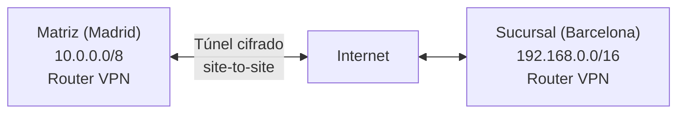
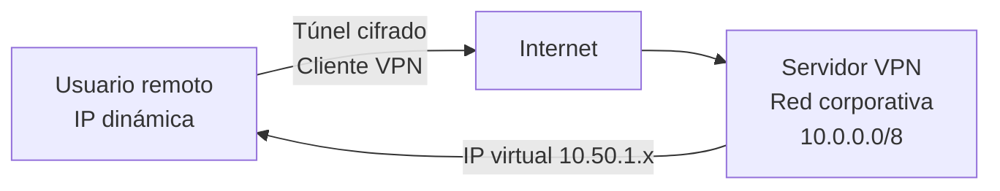

# VPN: conceptos, tipos y tecnologías

## Qué aprenderás

- Qué es una red privada virtual (VPN) y cómo encapsula y cifra el tráfico.
- En qué se diferencian una VPN site-to-site y una VPN de acceso remoto.
- Qué ofrecen WireGuard, OpenVPN e IPsec, y en qué se distinguen en arquitectura, cifrado, rendimiento y uso.
- Qué escenarios reales resuelve cada tipo de VPN.

## Qué es una VPN

El concepto de VPN es sencillo: una **red privada virtual (VPN)**, o VPN, crea un **canal seguro y aislado** entre dos o más puntos que se comunican por una red que no es de fiar, normalmente Internet. Es «privada» porque el tráfico viaja cifrado y separado del de los demás, y es «virtual» porque no usa una línea física dedicada, sino una conexión lógica montada sobre la red que ya existe.

Una VPN aporta cuatro cosas:

- **Encapsulación:** el paquete original se mete dentro de otro, con cabeceras de protocolo que ocultan su estructura.
- **Cifrado:** los datos que viajan dentro del túnel se cifran, de forma que quien los intercepte no pueda leerlos.
- **Autenticación:** se comprueba la identidad de los extremos del túnel.
- **Aislamiento:** aunque el medio de transporte sea compartido, la VPN crea una red lógica privada e independiente.

## Tipos de VPN

Según la topología, hay dos grandes categorías.

### VPN site-to-site

Une dos **redes completas**: sucursales, centros de datos u oficinas repartidas. Los extremos son puertas de enlace o routers, no equipos individuales, y es el router o el cortafuegos de cada sitio el que cifra y descifra el tráfico.

Para el usuario final no hace falta ninguna configuración especial: le basta con conocer la IP de destino. Eso sí, los extremos del túnel necesitan una IP fija o un DNS dinámico.

**Ejemplo:** la matriz de Madrid (red 10.0.0.0/8) se conecta a la sucursal de Barcelona (red 192.168.0.0/16) a través de Internet.



### VPN de acceso remoto (remote-access)

Une **equipos individuales**, como los portátiles de usuarios móviles o de trabajadores en remoto, con una red privada. Cada equipo instala un cliente VPN que cifra todo su tráfico o solo el que va a la red privada.

Para el usuario esto tiene algunas consecuencias:

- Necesita el cliente VPN y sus credenciales de autenticación.
- Su dirección IP es virtual: la asigna el servidor VPN.
- Es la opción natural para el teletrabajo o para conectarse desde redes públicas, como cafeterías o aeropuertos.
- Un mismo servidor puede atender a muchos clientes a la vez.
- Si cambia la IP real del cliente, la conexión no se ve afectada.

**Ejemplo:** un empleado se conecta desde casa, con una IP dinámica de su proveedor de Internet. Tras autenticarse recibe la IP 10.50.1.100 y accede a los servidores de la empresa como si estuviera en la oficina.



## Túneles y encapsulación

Un túnel VPN funciona por **encapsulación**: el paquete original se envuelve dentro de otro protocolo que viaja cifrado. El proceso, paso a paso, es este:

1. **Paquete original:** por ejemplo, un paquete TCP/IP de la red privada.
2. **Encapsulación:** se añade una cabecera que indica qué protocolo encapsula (GRE, ESP, etc.).
3. **Cifrado:** el paquete encapsulado se cifra.
4. **Envío:** se transmite por la red de transporte, normalmente Internet.
5. **Recepción:** el extremo remoto descifra, desencapsula y entrega el paquete original.

**Ejemplo de capas:**

| Capa | Contenido |
|---|---|
| Capa de aplicación | HTTP, SSH, DNS, ... |
| Transporte | TCP puerto 443 |
| IP interior (privada) | Origen 10.0.0.5, destino 10.0.0.200 |
| **Cifrado y encapsulación** | Cabecera del protocolo VPN (ESP, GRE, ...) |
| IP exterior (pública) | Origen 203.0.113.50, destino 198.51.100.1 |
| Enlace | Ethernet, fibra, ... |

Un caso clásico es **GRE** (*Generic Routing Encapsulation*, RFC 2784), que encapsula un protocolo arbitrario dentro de otro:

```text
[ Cabecera IP exterior ] [ Cabecera GRE ] [ Paquete IP interior ] [ Datos ]
   203.0.113.50 →          Protocolo      10.0.0.5 →               HTTP
   198.51.100.1            0x800           10.0.0.200
```

Ojo: GRE no cifra, solo encapsula. Por eso las VPN modernas combinan encapsulación y cifrado, como ocurre con WireGuard, IPsec/ESP u OpenVPN.

## Comparativa de protocolos VPN

### WireGuard

**Filosofía:** simplicidad y velocidad.

- **Implementación:** unas 4000 líneas de código C, pequeño y fácil de auditar.
- **Criptografía:** Noise, Curve25519 para el intercambio de claves y ChaCha20-Poly1305 para cifrar y autenticar.
- **Funcionamiento:** crea una interfaz virtual `wg0` como cualquier otra interfaz de red. Se configura intercambiando claves públicas, de forma parecida a SSH.
- **Encapsulación:** UDP, con muy poca sobrecarga.
- **Negociación:** no hay un handshake complejo; solo se intercambian claves públicas y la criptografía se apoya en el protocolo Noise.
- **Rendimiento:** alto. Por su sencillez, es rápido incluso en máquinas modestas.
- **Casos de uso:** VPN site-to-site seguras, conexiones punto a punto y contenedores.
- **Limitación:** no es un estándar IETF (aunque ganó atención en RFC 9216), y ambos extremos deben ejecutar WireGuard o una alternativa compatible.

**Configuración mínima:**

```ini
[Interface]
PrivateKey = <clave-privada>
ListenPort = 51820

[Peer]
PublicKey = <clave-pública-del-par>
AllowedIPs = 10.0.0.0/24
Endpoint = 203.0.113.50:51820
```

### OpenVPN

**Filosofía:** flexibilidad y amplia compatibilidad.

- **Implementación:** unos 600 KB, que usan OpenSSL para la criptografía.
- **Criptografía:** TLS 1.2 o 1.3 para negociar las claves de forma segura, además de AES y SHA, seleccionables.
- **Funcionamiento:** es una aplicación de usuario que establece un túnel cifrado con TLS. Según la configuración, crea una interfaz virtual `tun0` (tuneladora) o `tap0` (de nivel 2, para puentes).
- **Encapsulación:** TCP o UDP. La negociación usa TLS, normalmente en el puerto TCP 443, y los datos pueden ir por TCP o UDP.
- **Negociación:** un handshake TLS completo, parecido al de HTTPS. Puede usar certificados X.509 o claves precompartidas (PSK).
- **Rendimiento:** moderado. Tiene más sobrecarga que WireGuard porque TLS es más exigente. Es válido para uso general.
- **Casos de uso:** VPN corporativas de acceso remoto, compatibilidad con sistemas antiguos y varios protocolos de transporte.
- **Ventaja:** es un estándar de facto y hay clientes oficiales para todas las plataformas.

**Configuración mínima (servidor):**

```ini
proto udp
port 1194
ca ca.crt
cert server.crt
key server.key
dh dh2048.pem
server 10.8.0.0 255.255.255.0
```

### IPsec

**Filosofía:** un estándar IETF robusto para redes empresariales.

- **Implementación:** compleja. Es un módulo del kernel de Linux y existen varias implementaciones (strongSwan, Libreswan, NETKEY).
- **Criptografía:** AES, 3DES y SHA, configurables. La negociación se hace con IKEv2 (RFC 7296).
- **Funcionamiento:** opera en la capa IP (capa 3). Puede trabajar en modo transporte, que cifra solo los datos, o en modo túnel, que cifra el paquete IP completo. Al integrarse en el kernel, rinde muy bien.
- **Encapsulación:** ESP (*Encapsulating Security Payload*) cifra y autentica. AH (*Authentication Header*) solo autentica y hoy se usa poco.
- **Negociación:** IKE (*Internet Key Exchange*) realiza la autenticación mutua y genera las claves de sesión. Es muy flexible: admite certificados, PSK (claves precompartidas) y EAP.
- **Rendimiento:** muy alto gracias al kernel. Es ideal para mucho volumen de tráfico.
- **Casos de uso:** VPN site-to-site entre routers, interconexión de centros de datos y cumplimiento normativo.
- **Complejidad:** es más difícil de configurar que WireGuard. Hay que entender IKEv2, las SA (*Security Associations*) y la SPD (*Security Policy Database*).

**Configuración mínima (strongSwan, conexión site-to-site):**

```ini
conn madrid-barcelona
  left = 203.0.113.50
  right = 198.51.100.1
  leftsubnet = 10.0.0.0/8
  rightsubnet = 192.168.0.0/16
  ike = aes128-sha256-ecp256!
  esp = aes128-sha256-ecp256!
  auth = ecdsa
  leftauth = psk
  rightauth = psk
  auto = start
```

### Tabla comparativa

| Aspecto | WireGuard | OpenVPN | IPsec |
|---|---|---|---|
| **Tamaño de código** | ~4000 líneas | ~600 KB | Kernel + IKE |
| **Estándar** | RFC 9216 (reciente) | RFC 2818 (TLS) | RFC 7296 (IKE), RFC 4301 (IPsec) |
| **Criptografía** | Noise, ChaCha20-Poly1305 | TLS (OpenSSL) | AES, 3DES, SHA |
| **Encapsulación** | UDP | TCP/UDP | UDP (ESP) |
| **Velocidad** | Muy alta | Moderada | Muy alta (kernel) |
| **Facilidad de uso** | Muy simple | Compleja | Muy compleja |
| **Casos de uso** | Site-to-site, P2P | Corporativo, acceso remoto | Empresarial, gobierno |
| **Escalabilidad cliente** | Limitada | Buena | Excelente (servidor) |

## Casos de uso de VPN

### Acceso remoto a la red corporativa

**Escenario:** los empleados trabajan desde casa o de viaje y necesitan acceder a recursos de la empresa, como servidores de archivos, correo o la intranet.

**Solución:** una VPN de acceso remoto, con OpenVPN o con IPsec y un servidor de acceso remoto. El empleado se conecta con sus credenciales, obtiene una IP virtual y accede a la red corporativa.

**Ventajas:** la empresa mantiene el control, el empleado queda protegido aunque use una red pública y no hace falta una VPN en cada dispositivo, porque basta con un servidor centralizado.

### Interconexión de oficinas y sucursales

**Escenario:** dos o más oficinas distribuidas geográficamente necesitan compartir recursos de forma segura, como bases de datos, servidores de archivos o sistemas ERP.

**Solución:** una VPN site-to-site entre routers. Una vez establecido el túnel, el tráfico entre oficinas se cifra automáticamente. IPsec es habitual en routers de empresa, mientras que WireGuard se elige cada vez más por su sencillez.

**Ventajas:** los usuarios no notan nada, no cambia el direccionamiento IP y la solución escala a varios sitios.

### Protección en redes públicas

**Escenario:** un usuario conectado a una Wi-Fi pública, en una cafetería o un aeropuerto, quiere proteger su privacidad.

**Solución:** un cliente VPN de acceso remoto (OpenVPN o WireGuard) conectado a un servidor en Internet. Todo el tráfico del usuario se cifra antes de salir a la red pública.

**Ventajas:** nadie puede escuchar el tráfico, el proveedor de la cafetería no ve qué páginas visitas y el equipo queda protegido frente a ataques en la red local.

### Protección de datos en tránsito

**Escenario:** dispositivos IoT, como sensores o cámaras, situados en una red insegura necesitan enviar datos a un servidor central de forma segura.

**Solución:** un túnel VPN entre el dispositivo y el servidor. Por ejemplo, WireGuard se usa cada vez más en IoT por su bajo consumo de recursos.

### Cumplimiento normativo

**Escenario:** una empresa de un sector regulado, como finanzas o sanidad, debe garantizar que ciertos datos viajan cifrados.

**Solución:** IPsec, porque es un estándar internacional y está ampliamente auditado, lo que facilita justificarlo en una auditoría de cumplimiento.

## Conceptos clave

- **VPN site-to-site:** conecta dos redes enteras; es transparente para el usuario final.
- **VPN de acceso remoto:** conecta usuarios individuales a una red y requiere cliente VPN.
- **Túnel:** canal de comunicación encapsulado y cifrado.
- **Encapsulación:** envoltura de un protocolo dentro de otro; en VPN va acompañada de cifrado.
- **ESP (Encapsulating Security Payload):** protocolo de IPsec que cifra y autentica (RFC 4303).
- **WireGuard:** VPN moderna, simple y rápida, que usa Noise y UDP; es ideal para proyectos nuevos.
- **OpenVPN:** VPN flexible, basada en TLS; es el estándar de facto en el acceso remoto corporativo.
- **IPsec:** arquitectura de seguridad a nivel IP (RFC 7296); se usa en routers de empresa y en organismos públicos.
- **IKEv2:** protocolo de negociación para IPsec; gestiona la autenticación y la generación de claves.

## Documentación oficial

- [WireGuard](https://www.wireguard.com/): descripción general, arquitectura, roaming y configuración.
- [WireGuard Quick Start](https://www.wireguard.com/quickstart/): guía de instalación y configuración inicial.
- [OpenVPN](https://openvpn.net/): documentación oficial y guías de OpenVPN.
- [strongSwan Introduction](https://docs.strongswan.org/docs/latest/howtos/introduction.html): introducción a IPsec e IKEv2.
- [strongSwan Configuration Quickstart](https://docs.strongswan.org/docs/latest/config/quickstart.html): configuración práctica de IPsec.
- [RFC 2784: Generic Routing Encapsulation (GRE)](https://www.rfc-editor.org/rfc/rfc2784): especificación de encapsulación GRE.
- [RFC 4301: IP Security Architecture](https://www.rfc-editor.org/rfc/rfc4301): arquitectura de IPsec.
- [RFC 7296: Internet Key Exchange Protocol Version 2 (IKEv2)](https://www.rfc-editor.org/rfc/rfc7296): protocolo de negociación IPsec.
- [RFC 8446: TLS 1.3](https://www.rfc-editor.org/rfc/rfc8446): protocolo de cifrado en el que se apoya OpenVPN.
