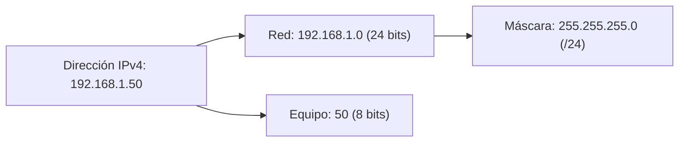
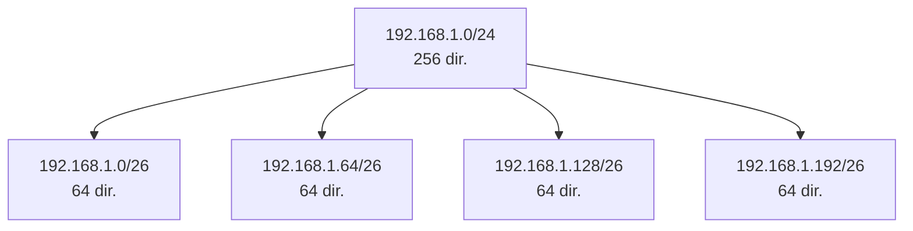
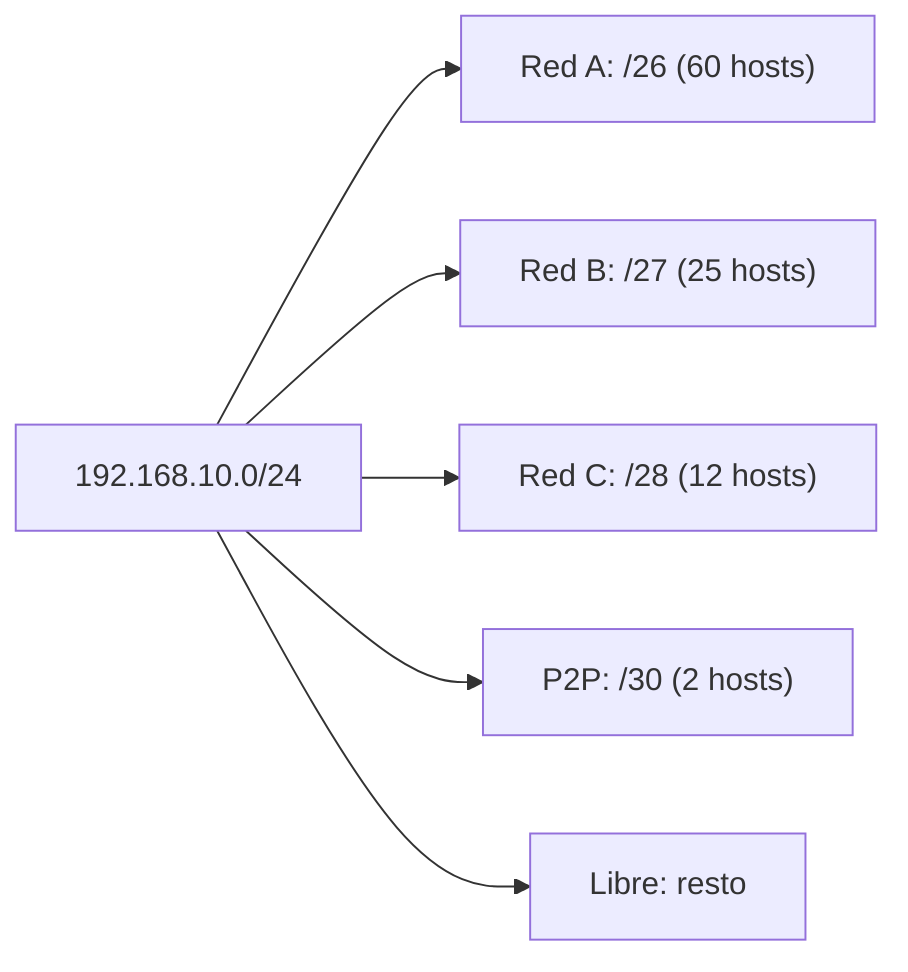

# Direccionamiento IPv4: subnetting, CIDR y VLSM

## Qué aprenderás

- Entender la **estructura de direcciones IPv4 (clases y formato)**.
- Realizar **cálculo de subredes (subnetting)** paso a paso.
- Leer y escribir prefijos en **notación CIDR**.
- Aplicar **VLSM (Variable Length Subnet Mask)** para repartir bloques en subredes de distinto tamaño.
- Reconocer las **direcciones especiales y rangos privados** y quién gestiona el espacio de direcciones.

---

## Estructura de direcciones IPv4 (clases y formato)

Una **dirección IPv4** tiene una longitud fija de **cuatro octetos (32 bits)** y se escribe en decimal separado por puntos, como `172.16.0.0`. La **estructura de direcciones IPv4** siempre se compone de dos partes:

- **Número de red** (prefijo): identifica la red.
- **Parte de equipo** (resto): identifica la interfaz dentro de esa red.

!!! note "Nota"
    Un mismo equipo físico puede tener varias direcciones IP, y también varias interfaces de red (*multi-homing*). La dirección identifica una **interfaz lógica**, no necesariamente una máquina.

### Formato original: clases A, B, C

El diseño original definía tres **clases**, que se distinguían por los primeros bits:

| Clase | Primeros bits | Bits de red | Bits de equipo | Redes posibles | Ejemplo |
|-------|--------------|------------|--------------|----------------|---------|
| **A** | `0` | 8 | 24 | 128 | `10.0.0.0/8` |
| **B** | `10` | 16 | 16 | 16 384 | `172.16.0.0/16` |
| **C** | `110` | 24 | 8 | 2 097 152 | `192.168.1.0/24` |

Las direcciones que empiezan por `1110` se reservaron para **multicast** (clase D), y el resto del espacio que empieza por `111` quedó reservado para usos futuros (clase E). En cada red, dos combinaciones de bits del equipo (todo ceros y todo unos) están reservadas: la de todo ceros identifica la **red** y la de todo unos sirve para **difusión** (*broadcast*). Por eso una clase C ofrece **254 direcciones útiles** (256 − 2).

## Por qué hicieron falta las máscaras y CIDR

Con solo tres tamaños de red (clases) había problemas evidentes:

1. Una **clase C** (254 equipos) se quedaba pequeña para una organización mediana.
2. Una **clase B** (65 534 equipos) era demasiado grande para la mayoría.
3. Agotamiento del espacio de direcciones de clase B y crecimiento inmanejable de las **tablas de enrutamiento**.

La respuesta fue **CIDR** (*Classless Inter-Domain Routing*, enrutamiento entre dominios sin clases). Su idea: **dejar de deducir la parte de red a partir de la clase** y **decirlo explícitamente** mediante un **prefijo** (cuántos bits de los 32 son de red).

### Notación CIDR (prefijo)

Un prefijo CIDR se escribe como una dirección de cuatro octetos, una barra `/` y un número entre 0 y 32:

- `172.16.0.0/16` → 16 bits de red (antigua clase B, máscara `255.255.0.0`).
- `192.168.99.0/24` → 24 bits de red (antigua clase C, máscara `255.255.255.0`).

Con prefijos explícitos se puede definir **cualquier bloque** cuyo tamaño sea una potencia de dos, desde 1 hasta 2³² direcciones.

## Tabla de tamaños de bloque (prefijos CIDR)

Cada bit que añades al prefijo divide el bloque a la mitad:

| Prefijo | Direcciones | Uso típico |
|----------|------------|-------------|
| `/32` | 1 | Ruta de equipo (*host route*) |
| `/31` | 2 | Enlace punto a punto (RFC 3021) |
| `/30` | 4 | Enlace punto a punto clásico |
| `/29` | 8 | Pequeñas subredes |
| `/28` | 16 | |
| `/27` | 32 | |
| `/26` | 64 | |
| `/25` | 128 | |
| `/24` | 256 | Antigua clase C |
| `/23` | 512 | Dos /24 |
| `/22` | 1 024 | Cuatro /24 |
| `/16` | 65 536 | Antigua clase B |
| `/8` | 16 777 216 | Antigua clase A |

## Cálculo de subredes (subnetting)

El **subnetting** consiste en **alargar el prefijo** (tomar bits de la parte de equipo) para dividir un bloque en **subredes más pequeñas**.

!!! example "Ejemplo: subneteo de una /24 en cuatro /26"

    Partimos de `192.168.1.0/24` (256 direcciones). Alargamos el prefijo 2 bits → `/26` (4 subredes × 64 direcciones cada una).

    | Subred | Prefijo | Rango de direcciones | Broadcast |
    |---|---|---|---|
    | 1 | `192.168.1.0/26` | `192.168.1.1 – 192.168.1.62` | `192.168.1.63` |
    | 2 | `192.168.1.64/26` | `192.168.1.65 – 192.168.1.126` | `192.168.1.127` |
    | 3 | `192.168.1.128/26` | `192.168.1.129 – 192.168.1.190` | `192.168.1.191` |
    | 4 | `192.168.1.192/26` | `192.168.1.193 – 192.168.1.254` | `192.168.1.255` |

    **Fórmula**: 2^(bits añadidos) = nº de subredes; 2^(32 − nuevo_prefijo) = direcciones por subred.

### Pasos para el cálculo de subredes

1. **Identifica el prefijo original** (ej. `/24`).
2. **Decide cuántas subredes necesitas** (ej. 4 → necesitas 2 bits extra).
3. **Calcula el nuevo prefijo** (original + bits extra = `/26`).
4. **Calcula el salto de bloque** (block size = 2^(32 − nuevo_prefijo) = 64).
5. **Enumera las subredes** sumando el salto al octeto variable.
6. **Para cada subred**: primera usable = red + 1; última usable = broadcast − 1; broadcast = siguiente red − 1.

## VLSM (Variable Length Subnet Mask)

El **VLSM** permite usar **prefijos de longitud distinta** dentro del mismo bloque, ajustando el tamaño de cada subred a su necesidad real. Así se **evita desperdiciar direcciones**.

!!! example "Ejemplo VLSM"

    Tienes `192.168.10.0/24` y necesitas:
    - Red A: 60 hosts → `/26` (62 usables)
    - Red B: 25 hosts → `/27` (30 usables)
    - Red C: 12 hosts → `/28` (14 usables)
    - Enlace punto a punto: 2 hosts → `/30` (2 usables)

    **Asignación óptima (de mayor a menor):**

    | Red | Prefijo | Inicio | Fin | Usables |
    |---|---|---|---|---|
    | A | `/26` | `192.168.10.0` | `192.168.10.63` | 62 |
    | B | `/27` | `192.168.10.64` | `192.168.10.95` | 30 |
    | C | `/28` | `192.168.10.96` | `192.168.10.111` | 14 |
    | P2P | `/30` | `192.168.10.112` | `192.168.10.115` | 2 |
    | **Libre** | — | `192.168.10.116` | `192.168.10.255` | — |

    **Regla de oro VLSM**: ordena las subredes **de mayor a menor** y asígnalas contiguamente desde el inicio del bloque.

## Agregación de rutas y enrutamiento

La **agregación** (*route summarization*) es el proceso inverso: **anunciar un único prefijo** que representa varias subredes más específicas. Esto mantiene **manejables las tablas de enrutamiento**.

- **Coincidencia más larga** (*longest prefix match*): el router elige siempre la ruta con el prefijo más específico (más bits de red).
- **Ruta por defecto** (`0.0.0.0/0`): cubre todo el espacio de direcciones; captura los paquetes que no coinciden con ninguna ruta más específica.

---

## Direcciones especiales y rangos privados

El espacio IPv4 lo administra la **IANA**, que reparte bloques `/8` a los **RIR** (registros regionales). Estos asignan bloques menores a proveedores (LIR) y estos a clientes.

Algunos bloques tienen **uso especial** y **no son enrutables globalmente**:

| Bloque | Nombre | ¿Enrutable? | ¿Global? | Uso |
|-------|-------|-------------|----------|------|
| `10.0.0.0/8` | **Privado** (RFC 1918) | Sí (interno) | No | Redes privadas grandes |
| `172.16.0.0/12` | **Privado** (RFC 1918) | Sí (interno) | No | Redes privadas medianas |
| `192.168.0.0/16` | **Privado** (RFC 1918) | Sí (interno) | No | Redes privadas pequeñas (hogar, PYME) |
| `127.0.0.0/8` | **Loopback** | No | No | Comunicación local (`127.0.0.1`) |
| `169.254.0.0/16` | **Link-local** (APIPA) | No | No | Autoconfiguración sin DHCP |
| `192.0.2.0/24`, `198.51.100.0/24`, `203.0.113.0/24` | **Documentación** (RFC 5737) | No | No | Ejemplos en docs |
| `255.255.255.255/32` | **Difusión limitada** | No | No | Broadcast local |

!!! warning "Importante"
    Las **direcciones privadas (RFC 1918)** solo tienen validez dentro de la organización. Para salir a Internet se requiere **NAT** (traducción de direcciones).

---

## Resumen

- La **estructura de direcciones IPv4** usa 32 bits divididos en **red** y **equipo**.
- Las **clases A, B, C** fijaban solo tres tamaños; CIDR lo sustituye con **prefijos de longitud variable**.
- **Cálculo de subredes (subnetting)**: alargar el prefijo para partir un bloque.
- **VLSM (Variable Length Subnet Mask)**: subredes con distintos prefijos en el mismo bloque.
- **Agregación** y **coincidencia más larga** mantienen las tablas de enrutamiento pequeñas.
- Existen **direcciones especiales y rangos privados** (RFC 1918, loopback, link-local, documentación) con reglas propias.

---

## Conceptos clave

- **Prefijo:** Conjunto de bits de red de una dirección, indicado con `/n`.
- **CIDR:** Esquema de direccionamiento y enrutamiento sin clases basado en prefijos de longitud explícita.
- **Máscara:** Valor de 32 bits con unos en la parte de red y ceros en la de equipo (`/24` = `255.255.255.0`).
- **Subnetting:** División de un bloque en bloques menores alargando el prefijo.
- **VLSM:** Subredes con prefijos de longitud distinta dentro del mismo bloque.
- **Agregación:** Anunciar un único prefijo que representa varios más específicos.
- **Coincidencia más larga:** Criterio por el que se elige la ruta de prefijo más específico.
- **Ruta por defecto:** `0.0.0.0/0`, cubre todo el espacio de direcciones.
- **RFC 1918:** Define los rangos privados `10.0.0.0/8`, `172.16.0.0/12`, `192.168.0.0/16`.

---

## Documentación oficial

- [RFC 791: Internet Protocol](https://www.rfc-editor.org/rfc/rfc791): Especificación original del protocolo IP, con el formato de direcciones y las clases.
- [RFC 4632: Classless Inter-domain Routing (CIDR)](https://www.rfc-editor.org/rfc/rfc4632): Notación de prefijos, tabla de tamaños, agregación y reglas de rutas.
- [IANA IPv4 Address Space Registry](https://www.iana.org/assignments/ipv4-address-space/ipv4-address-space.xhtml): Reparto de los bloques `/8` entre registros y usos reservados.
- [IANA IPv4 Special-Purpose Address Registry](https://www.iana.org/assignments/iana-ipv4-special-registry/iana-ipv4-special-registry.xhtml): Bloques de uso especial (privados, loopback, documentación) y sus propiedades.
