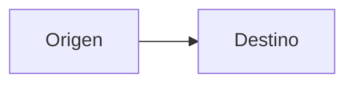

# [Título del apartado]

## Qué aprenderás

- [Resultado concreto 1, en lenguaje llano]
- [Resultado concreto 2]

## [Concepto o bloque 1]

[Explicación progresiva, directa y cercana, con terminología técnica correcta. Define cada término antes de usarlo.]

> **Ejemplo**
>
> [Ejemplo práctico derivado de las fuentes, sin hechos nuevos.]

> **Importante**
>
> [Advertencia o error frecuente respaldado por las fuentes.]

## [Concepto o bloque 2]

[...]

## Resumen

- [Idea clave 1]
- [Idea clave 2]

## Conceptos clave

- **[Término]:** [definición breve].

<!-- Sección opcional: incluir solo si el apartado tiene `autoevaluacion: N` en contenidos/unidades.yml (N = nº de preguntas). Si no, omitirla. -->

## Comprueba lo aprendido

1. [Pregunta]
   - a) …
   - b) …
   - c) …

Soluciones

1. [letra] — [justificación breve]

## Documentación oficial

- [Nombre de la documentación](https://url-oficial): [qué encontrarás].

<!--
Reglas de esta plantilla (borrar este comentario al generar):
- Texto solo para el alumnado: sin estado, fuentes internas, páginas, lagunas ni comentarios docentes.
- Único tipo de referencia admitido: URLs de documentación oficial del apartado «Documentación oficial».
- Extensión, nº de diagramas y autoevaluación: según contenidos/unidades.yml.
- «Comprueba lo aprendido» solo si el apartado declara `autoevaluacion`; borrar el comentario y la sección si no.
- Trazabilidad, lagunas y dudas: en trabajo/<unidad>/<apartado>/informe.md (plantillas/informe_trabajo.md).
-->
