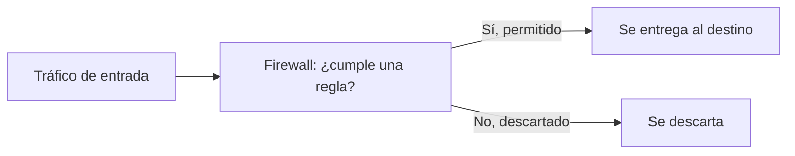
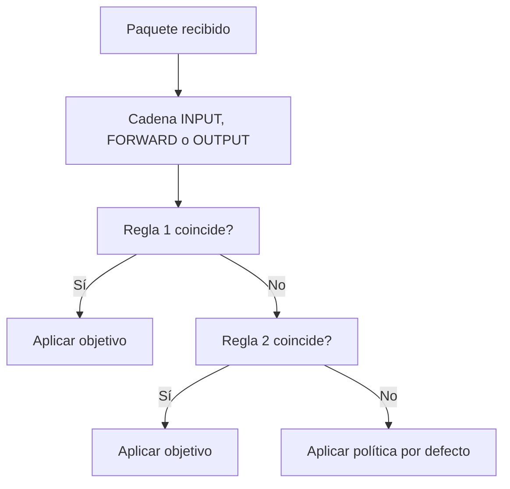
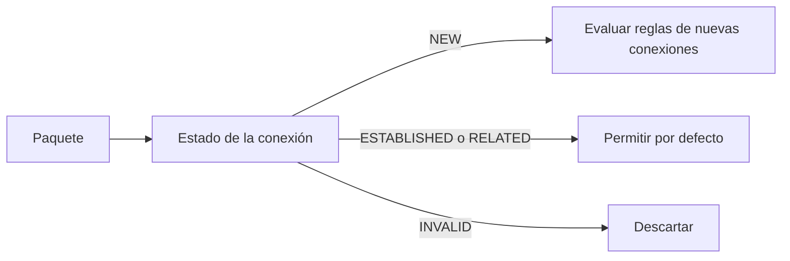

# Firewall: Netfilter, introducción y uso de iptables

## Qué aprenderás

- Explicar qué es un firewall y qué función cumple en una red.
- Describir la arquitectura de Netfilter en Linux y su relación con iptables.
- Entender las tablas, las cadenas y los objetivos de iptables.
- Distinguir las políticas de filtrado sin estado (*stateless*) y con estado (*stateful*).
- Leer y escribir reglas de iptables sencillas.

---

## Concepto y función del firewall

Un **firewall** (cortafuegos) es un dispositivo o un programa que controla el tráfico entre redes con distinto nivel de confianza, por ejemplo, entre Internet y la red interna de una organización. Decide qué paquetes se dejan pasar y cuáles se descartan según unas reglas.

Un **firewall filtra paquetes**: examina sus cabeceras (y, en algunos casos, su estado) y aplica una regla a cada uno. El **filtrado de paquetes** se apoya en los datos de las capas de Internet y de transporte. Según la pila TCP/IP, IP identifica el origen y el destino del datagrama, y TCP o UDP identifican los puertos de cada aplicación.

Este **control de tráfico** consiste en comparar esos campos con la regla y decidir qué hacer. Por ejemplo, el tráfico web usa los protocolos TCP en los puertos 80 (HTTP) o 443 (HTTPS). Un firewall puede permitir esos puertos y bloquear el resto de accesos. Al filtrar por protocolo y por puerto se reduce la superficie expuesta de un equipo: solo quedan accesibles los servicios que realmente se necesitan.

!!! abstract "Idea clave"
    Un firewall es como un portero de seguridad: revisa cada paquete que entra o sale y decide si deja pasar según las reglas que le hayas enseñado.



---

## Arquitectura Netfilter en Linux

**Netfilter** es el subsistema del kernel de Linux que proporciona los puntos de enganche (*hooks*) por los que pasan los paquetes durante su recorrido. Sobre esos puntos se aplican el filtrado, la traducción de direcciones (NAT) y el seguimiento de conexiones. Netfilter es la infraestructura; las herramientas de usuario son las que escriben las reglas en ella.

Netfilter abarca el filtrado de paquetes, NAT y el seguimiento de conexiones (*connection tracking*, conocido como `conntrack`). En el ámbito de este apartado interesan dos herramientas:

- **iptables:** herramienta clásica de línea de comandos para administrar las reglas.
- **nftables:** sucesor moderno de iptables, que configura las reglas sobre Netfilter con una sintaxis unificada.

!!! note
    El seguimiento de conexiones (`conntrack`) es un subsistema independiente dentro de Netfilter. Las reglas de estado que se ven más abajo dependen de él.

---

## Tablas, cadenas y objetivos de iptables

iptables organiza las reglas en tres niveles:

- **Tabla:** agrupa las reglas según su finalidad. Las principales son `filter` (filtrado, que es la tabla por defecto), `nat` (traducción de direcciones) y `mangle` (modificación de cabeceras).
- **Cadena (*chain*):** lista ordenada de reglas dentro de una tabla. `filter` tiene las cadenas predefinidas INPUT (paquetes destinados a sockets locales), FORWARD (paquetes que se enrutan a través del equipo) y OUTPUT (paquetes generados localmente).
- **Objetivo (*target*):** acción que se aplica cuando una regla coincide. Los valores especiales son `ACCEPT` (dejar pasar), `DROP` (descartar) y `RETURN` (volver a la cadena anterior).

Si ninguna regla de la cadena coincide, se aplica la **política** (*policy*) de esa cadena.



!!! warning "Orden de las reglas"
    Las reglas se evalúan en orden. Una regla general colocada antes que otra más específica impide que esta última se aplique.

---

## Ejemplos sencillos de reglas

Estas reglas muestran la sintaxis básica:

```bash
# Descartar todo el tráfico entrante de una red concreta
iptables -A INPUT -s 192.168.1.0/24 -j DROP

# Insertar una regla en primera posición de la cadena INPUT
iptables -I INPUT 1 -p icmp -j ACCEPT

# Listar la tabla nat sin resolver nombres
iptables -t nat -n -L
```

### Nota importante

- `-A` añade la regla al final de la cadena; `-I` la inserta en la posición indicada.
- `-s` indica el origen y `-p` el protocolo.
- `-j` indica el objetivo (`ACCEPT`, `DROP`, `REJECT`, etc.).
- `-t` selecciona la tabla; si se omite, se usa `filter`.

---

## Políticas de filtrado: sin estado y con estado

Las políticas de filtrado pueden tomar dos formas:

### Sin estado (*stateless*)

Cada paquete se evalúa de forma aislada, solo con sus cabeceras. El firewall **no recuerda** los paquetes anteriores, así que **no sabe** si un paquete de respuesta pertenece a una conexión que ya se estableció.

### Con estado (*stateful*)

El firewall mantiene el estado de cada conexión gracias al seguimiento de conexiones (`conntrack`). Así puede distinguir si un paquete:

- **NEW** (abre una conexión nueva)
- **ESTABLISHED** (forma parte de una conexión ya establecida)
- **RELATED** (está asociado a una conexión existente, como una conexión FTP data después de la conexión principal)
- **INVALID** (no encaja con ninguna conexión conocida)

!!! tip "Recomendación práctica"
    Un filtrado con estado suele permitir el tráfico de respuesta de las conexiones establecidas y aplicar las reglas restrictivas solo a las conexiones nuevas. Así se reduce el número de reglas que hay que escribir.



---

## Ejemplos prácticos de reglas de firewall

Un firewall típico tiene una política por defecto restrictiva y permite explícitamente el tráfico necesario. Esta forma de trabajar se llama **denegar por defecto** y es más segura que la contraria, porque cualquier servicio que no se haya autorizado queda bloqueado automáticamente, aunque se haya olvidado de configurarlo.

Al diseñar las reglas conviene seguir este orden de trabajo:

1. Identificar qué servicios necesita realmente el equipo y en qué puertos y protocolos funcionan.
2. Establecer la política por defecto restrictiva en las cadenas afectadas.
3. Añadir las reglas que permiten cada servicio, desde la más específica a la más general.
4. Comprobar el resultado y revisar el conjunto de reglas con regularidad.

La siguiente secuencia ilustra la idea:

```bash
# Política por defecto: descartar el tráfico entrante no permitido
iptables -P INPUT DROP

# Permitir el tráfico de conexiones ya establecidas o relacionadas
iptables -A INPUT -m conntrack --ctstate ESTABLISHED,RELATED -j ACCEPT

# Permitir el acceso web (puerto 443) a conexiones nuevas
iptables -A INPUT -p tcp --dport 443 -m conntrack --ctstate NEW -j ACCEPT
```

!!! danger "Precaución"
    Si cambias la política de la cadena INPUT a `DROP` por SSH, puedes perder el acceso al equipo. **Antes de aplicar reglas restrictivas, asegúrate de tener una consola local o una sesión abierta de respaldo**.

---

## Resumen

- Un firewall filtra paquetes según reglas aplicadas a sus cabeceras y, en su caso, a su estado.
- Netfilter es el subsistema del kernel de Linux que ofrece los puntos de control de los paquetes.
- iptables organiza las reglas en tablas, cadenas y objetivos.
- El filtrado puede ser sin estado (cada paquete por separado) o con estado (con seguimiento de conexiones).
- Las reglas se evalúan en orden, y si ninguna coincide se aplica la política de la cadena.

---

## Conceptos clave

- **Firewall:** dispositivo o programa que filtra el tráfico entre redes según reglas.
- **Netfilter:** subsistema del kernel de Linux para filtrado, NAT y seguimiento de conexiones.
- **Tabla:** conjunto de reglas agrupadas por finalidad (por ejemplo, `filter` o `nat`).
- **Cadena:** lista ordenada de reglas dentro de una tabla.
- **Objetivo:** acción que se aplica cuando una regla coincide.
- **Política:** acción por defecto de una cadena cuando ninguna regla coincide.
- **Connection tracking (`conntrack`):** seguimiento del estado de las conexiones.

---

## Documentación oficial

- [Netfilter Documentation](https://www.netfilter.org/documentation/): documentación oficial de iptables, nftables y el seguimiento de conexiones.
- [iptables(8)](https://man7.org/linux/man-pages/man8/iptables.8.html): manual del comando iptables, con tablas, cadenas, objetivos y opciones.
- [iptables-extensions(8)](https://man7.org/linux/man-pages/man8/iptables-extensions.8.html): extensiones de coincidencia y objetivos, como `conntrack`.
- [nftables Wiki](https://wiki.nftables.org/): documentación del sucesor de iptables.
