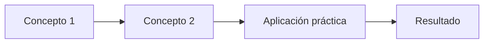

# 📚 [Unidad X.Y] [Título del Tema Principal]

> **Apartado:** [Número y descripción breve de la unidad]  
> **Duración:** [X horas de teoría + X horas de práctica]

---

## 🎯 Qué aprenderás

!!! note "Objetivos de este apartado"
    - ✅ Objetivo de aprendizaje específico 1
    - ✅ Objetivo de aprendizaje específico 2
    - ✅ Objetivo de aprendizaje específico 3
    - ✅ Objetivo de aprendizaje específico 4

---

## 📖 Conceptos Fundamentales

### Concepto 1: [Nombre del Concepto]

!!! example "Definición"
    Explicación clara y concisa del concepto. Debe incluir:
    - Qué es
    - Para qué sirve
    - Cuándo se usa

**Por qué es importante:**

- Razón 1: [Explicación breve]
- Razón 2: [Explicación breve]
- Razón 3: [Explicación breve]

**Contexto en Odoo:**

Aquí explicamos cómo se relaciona este concepto con Odoo específicamente, con ejemplos prácticos.

### Concepto 2: [Nombre del Concepto]

!!! warning "Atención"
    Aspecto importante que debes tener en cuenta. Describe:
    - Qué puede salir mal
    - Cómo evitarlo
    - Consecuencias de no hacerlo correctamente

**Características principales:**

| Característica | Descripción | Aplicación |
|---|---|---|
| [Aspecto 1] | Breve descripción | Cuándo/cómo usar |
| [Aspecto 2] | Breve descripción | Cuándo/cómo usar |
| [Aspecto 3] | Breve descripción | Cuándo/cómo usar |

---

## 🔧 Práctica Paso a Paso

!!! tip "Consejo"
    Una buena práctica es... Para mejorar, intenta...  
    💡 **Recuerda:** [Dato importante a retener]

### Paso 1: [Título de la acción]

Descripción de lo que vamos a hacer en este paso.

=== "Windows"

    Si usas Windows, haz lo siguiente:
    
    ```powershell
    # Comando específico para Windows
    python manage.py runserver
    ```

=== "Linux/macOS"

    En Linux o macOS, ejecuta:
    
    ```bash
    # Comando específico para Unix
    python3 manage.py runserver
    ```

=== "Docker"

    Si prefieres usar Docker:
    
    ```yaml
    version: '3.8'
    services:
      odoo:
        image: odoo:16
        ports:
          - "8069:8069"
    ```

**Resultado esperado:**

```
Conexión exitosa al servidor en http://localhost:8069
```

### Paso 2: [Título de la acción]

Descripción del siguiente paso.

```python
# Ejemplo de código Python
class MiModelo(models.Model):
    _name = 'mi.modelo'
    _description = 'Mi Modelo'
    
    nombre = fields.Char(string='Nombre')
    valor = fields.Float(string='Valor')
```

!!! note "Análisis del código"
    - `_name`: identificador único del modelo
    - `_description`: descripción para la interfaz
    - `fields`: campos de datos del modelo

### Paso 3: [Título de la acción]

Descripción del último paso.

---

## 📋 Comparativa: Enfoque A vs Enfoque B

| Aspecto | Enfoque A | Enfoque B | Recomendación |
|---------|-----------|-----------|---|
| **Rendimiento** | Rápido | Más lento | Usar A para datos grandes |
| **Mantenibilidad** | Media | Alta | Usar B para proyectos largos |
| **Complejidad** | Baja | Alta | Usar A para principiantes |
| **Flexibilidad** | Limitada | Muy flexible | Usar B para casos especiales |

---

## ✅ Checklist de Aprendizaje

!!! success "Verifica tu comprensión"
    - [ ] Entiendo qué es y para qué sirve [Concepto 1]
    - [ ] Puedo explicar [Concepto 2] con mis propias palabras
    - [ ] He completado todos los pasos de la práctica
    - [ ] Sé identificar cuándo aplicar esto en proyectos reales
    - [ ] Puedo troubleshootear problemas básicos

---

## 🎯 Ejercicio Propuesto

!!! example "Ejercicio"
    **Objetivo:** [Descripción clara del objetivo]
    
    **Requisitos:**
    - Requisito 1
    - Requisito 2
    - Requisito 3
    
    **Criterios de éxito:**
    - El resultado debe mostrar...
    - Debe funcionar sin errores...
    - La solución debe ser...

**Solución modelo:**

```python
# Aquí va la solución comentada
```

---

## 🚀 Ampliaciones Opcionales

Para estudiantes que quieren ir más allá:

- 🔹 **Nivel intermedio:** [Extensión del concepto con más complejidad]
- 🔹 **Nivel avanzado:** [Caso de uso real más complejo]
- 🔹 **Alternativas:** [Otras formas de resolver el mismo problema]

---

## 📚 Referencias y Recursos

### Documentación Oficial

- 📖 [Documentación oficial de Odoo](https://www.odoo.com/documentation/16.0/) — Referencia completa
- 🔍 [API de Odoo](https://www.odoo.com/documentation/16.0/developer/reference/) — Funciones y clases disponibles
- 💾 [Módulos community](https://github.com/OCA/community-data-files) — Ejemplos reales

### Recursos Complementarios

- 📺 [Tutoriales en video](https://www.youtube.com/results?search_query=odoo+tutorial)
- 💬 [Comunidad de Odoo](https://www.odoo.com/es/community) — Foros y ayuda
- 📝 [Blog oficial](https://www.odoo.com/es/blog) — Artículos técnicos

---

## 🔗 Conexiones con Otros Temas

Este concepto se relaciona con:

- **Tema anterior:** [Enlace a tema previo] — repasa esto si necesitas contexto
- **Tema siguiente:** [Enlace a tema siguiente] — continuaremos con esto
- **Temas relacionados:** [Enlace] — profundiza en aspectos específicos

---

## 💬 Preguntas Frecuentes

**P: ¿Cuál es la diferencia entre A y B?**

> A se usa cuando... B se usa cuando...

**P: ¿Qué pasa si obtengo error X?**

> Esto ocurre cuando... La solución es...

**P: ¿Puedo hacer esto de otra forma?**

> Sí, también puedes... La ventaja es... La desventaja es...

---

## 📊 Resumen Visual



---

## ⭐ Puntos Clave a Recordar

!!! success "Resumen"
    1. **[Punto clave 1]** — Explicación breve de por qué es importante
    2. **[Punto clave 2]** — Explicación breve de por qué es importante
    3. **[Punto clave 3]** — Explicación breve de por qué es importante
    4. **[Punto clave 4]** — Explicación breve de por qué es importante

---

*Última actualización: [Fecha]*  
*Revisado por: [Profesor/a]*

